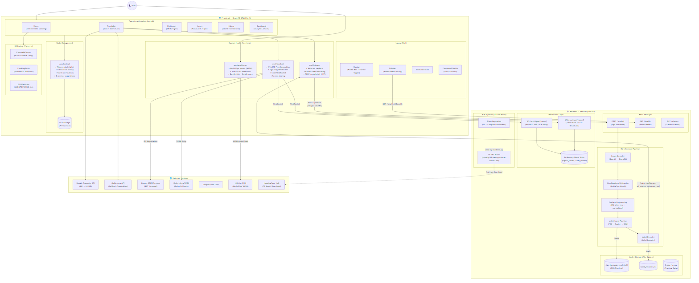
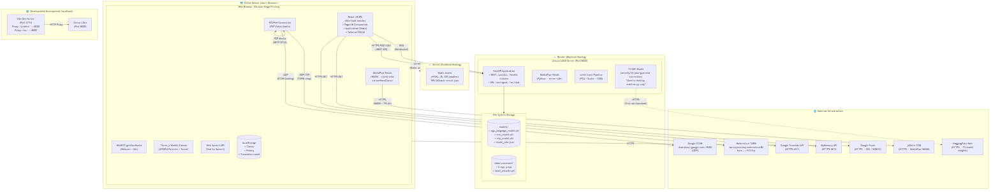
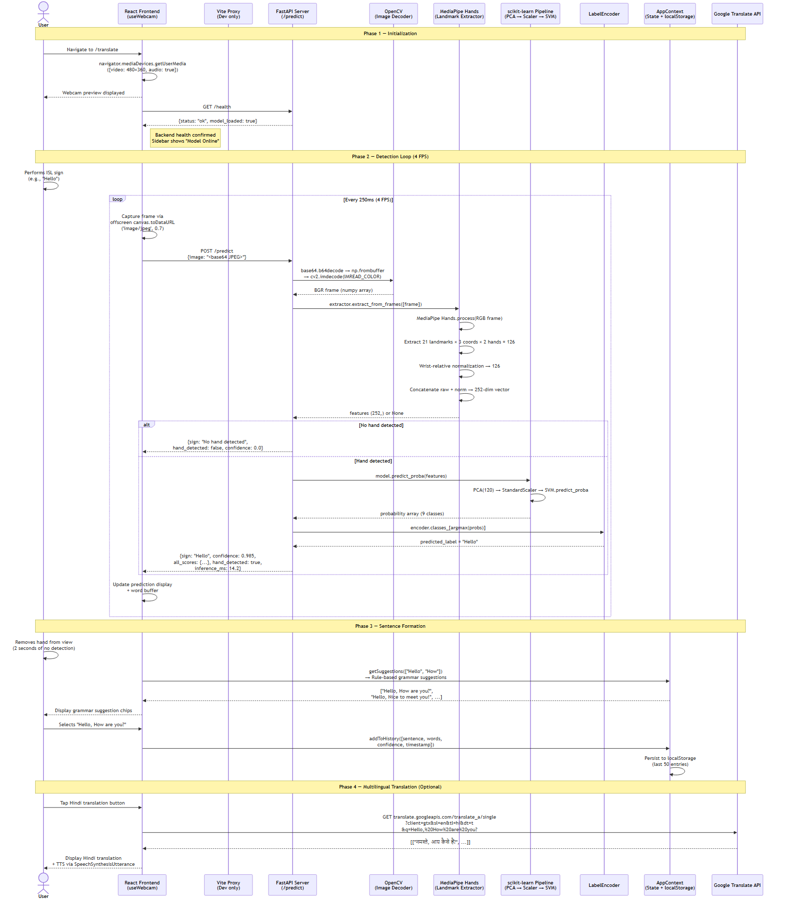

# Drishya Vaani: Indian Sign Language Translator

Drishya Vaani (the backend calls itself **SanketSetu**, the frontend package **MudraVani**) is a web app that reads Indian Sign Language (ISL) signs from a webcam and turns them into English sentences, with optional Hindi or Marathi translation and text-to-speech. It also supports video calls where each person's signs are translated live and shared with the others.

- **Frontend:** React 18 + Vite, deployed on Vercel (`https://drishya-vaani.vercel.app`)
- **Backend:** FastAPI + MediaPipe + scikit-learn, deployed on Render (`https://sign-language-backend-4uar.onrender.com`)

---

## How it works

```
Webcam (browser)
   │  JPEG frame, base64, 4 fps (2 fps during a call)
   ▼
POST /predict ──► OpenCV decode ──► MediaPipe Hand Landmarker
                                     │ 21 landmarks × 3 coords × 2 hands = 126
                                     │ + wrist-relative normalised copy  = 252 features
                                     ▼
                      PCA(120) → StandardScaler → SVM (RBF)
                                     ▼
                      { sign, confidence, all_scores, inference_ms }
   ▼
Frontend word buffer ──(2 s with no hand)──► grammar suggestions ──► sentence
   ▼
Optional: translate to Hindi / Marathi (Google Translate, MyMemory fallback) + speak it aloud
```

### Signs the model recognises

The deployed model is trained on **9 ISL signs**:

`Going` · `Hello` · `How` · `I` · `Meet` · `Nice` · `School` · `Thank you` · `You`

`models/model_info.json` reports **99.7 % test accuracy** for the SVM (99.7 % for the SVM + MLP ensemble). The data was augmented 6× with mirror, noise, scale and rotation. The Dictionary and Learn pages show a larger catalogue (alphabet, numbers, common words), but those are reference content only. The model does not predict them.

### Video calls

- WebRTC **mesh** call for up to **6 people** per room.
- `WS /ws/signal/{room}` relays SDP offers and answers and ICE candidates. The newcomer always sends the offers, so two peers never offer at the same time.
- `WS /ws/chat/{room}` broadcasts names, detected words, sentences, grammar suggestions and chat messages.
- `GET /turn-credentials` returns STUN and TURN servers. It tries Metered.ca, then Cloudflare, then a static `TURN_URLS` setting, and falls back to the public Open Relay.
- Rooms live in process memory, so the backend **must run with one worker**.

### Hand-gesture cursor

`useHandCursor` runs MediaPipe Hands in the browser (WASM) so the site can be used without a mouse:
- **Pinch:** click
- **Hold still 1.4 s:** click (dwell)
- **Top or bottom 15 % of the screen:** scroll
- **Two-finger swipe:** scroll
- **Ring-finger spread:** go back

---

## Repository layout

```
sign_language_project/        ← Python backend + ML pipeline (Render root dir)
├── api/
│   ├── server.py             FastAPI app: /predict, /health, /classes, CORS, model loading
│   └── signaling.py          WebRTC signaling + chat WebSockets, /turn-credentials, /rooms/{id}
├── src/
│   ├── config.py             Paths, class list, feature dimensions
│   ├── feature_extraction.py HandLandmarkExtractor (MediaPipe Tasks, 252-dim features)
│   ├── preprocessing.py      Video, image and folder frame loaders
│   ├── build_dataset.py      Builds X.npy / y.npy / label_encoder.pkl from data/raw
│   ├── train.py              Trains SVM + MLP pipelines, saves the best one
│   ├── inference.py          Predicts the sign in a video file from the CLI
│   ├── realtime.py           Desktop OpenCV app with T5 sentence generation (Q quit, R reset)
│   ├── nlp_model.py          ISL gloss → English candidates + T5 grammar correction
│   ├── record_data.py        Records training clips from the webcam
│   └── visualize.py          Draws MediaPipe landmarks over a video
├── models/                   sign_language_model.pkl (served), svm/mlp models, hand_landmarker.task
├── data/processed/           X.npy, y.npy, label_encoder.pkl
└── requirements.txt          Server-only dependencies (Python 3.10.12)

isl-frontend/                 ← React app (Vercel)
├── src/pages/                Home (3D landing), Translator, Dictionary, Learn, History, Dashboard
├── src/hooks/                useWebcam, useVideoCall, useHandCursor
├── src/context/AppContext.jsx Theme, history, toasts, rule-based grammar suggestions
├── src/components/scene/     Three.js scene: floating rocks, GPGPU particles
├── src/shaders/              GLSL for the particle simulation
├── vite.config.js            Dev server on :5174, proxies /predict /health /ws to :8000
└── vercel.json               SPA rewrite

diagrams/                     Mermaid sources + PNGs: component, deployment, sequence
render.yaml                   Render blueprint for the backend
other files/                  Older frontend copy, dataset recorder scripts, backups
backup files/                 Snapshot of an earlier backend + models
```

---

## Running locally

### 1. Backend (Python 3.10)

```bash
cd sign_language_project
python -m venv venv
venv\Scripts\activate          # Windows  (source venv/bin/activate on macOS/Linux)
pip install -r requirements.txt
python -m uvicorn api.server:app --host 0.0.0.0 --port 8000 --ws websockets --workers 1
```

Check it at <http://localhost:8000/health>. The response should include `"model_loaded": true` and `"websocket_support": true`. Interactive API docs are at `/docs`.

> Use Python **3.10** with `scikit-learn==1.4.2`. The pickled model was saved with that version and may not load with others.

### 2. Frontend

```bash
cd isl-frontend
npm install
npm run dev            # http://localhost:5174
```

In development, leave `VITE_API_URL` unset. Vite then proxies `/predict`, `/health`, `/turn-credentials` and `/ws/*` to `localhost:8000` (change the port with `VITE_API_PORT`). Use `npm run dev:public` to open the app from a phone on the same network. Webcam access outside localhost needs HTTPS, so use an ngrok or Cloudflare tunnel for that.

### 3. Optional: desktop real-time demo + NLP

```bash
cd sign_language_project
pip install -r src/requirements.txt   # adds torch, transformers, sentencepiece
python -m src.realtime
```

This downloads `vennify/t5-base-grammar-correction` from Hugging Face on first run.

---

## Training a new model

1. Record clips or images per sign into `data/raw/<ClassName>/...` (`src/record_data.py` or `other files/custom_dataset_recorder/custom_record_data.py`).
2. Add the class to `CLASSES` in `src/config.py`.
3. `python -m src.build_dataset`: extracts landmarks, augments, and writes `data/processed/`.
4. `python -m src.train`: trains SVM and MLP pipelines (PCA → scaler → classifier) and saves `models/sign_language_model.pkl`.
5. Restart the API. Update `GRAMMAR_RULES` in `isl-frontend/src/context/AppContext.jsx` so the new sign gets sentence suggestions.

---

## API reference

| Method | Path | Purpose |
|---|---|---|
| `POST` | `/predict` | Body `{ "image": "<base64 JPEG or data-URL>" }` → `{ sign, confidence, all_scores, hand_detected, inference_ms }` |
| `GET` | `/health` | Model status, classes, WebSocket support, active room count |
| `GET` | `/classes` | Trained sign labels |
| `GET` | `/turn-credentials` | ICE servers for `RTCPeerConnection` |
| `GET` | `/rooms/{room}` | Peers currently in a room (debugging) |
| `WS` | `/ws/signal/{room}` | WebRTC signaling (`joined`, `peer_joined`, `peer_left`, `offer`, `answer`, `ice`, `full`, `ping`) |
| `WS` | `/ws/chat/{room}` | Broadcast relay for translations, suggestions and chat |

Room IDs are 1–32 characters, `A–Z 0–9 _ -`, and are upper-cased automatically.

---

## Configuration

**Backend (environment variables)**

| Variable | Default | Notes |
|---|---|---|
| `ALLOWED_ORIGINS` | localhost 5173–5175 + `drishya-vaani.vercel.app` | Comma-separated CORS origins |
| `ALLOWED_ORIGIN_REGEX` | Vercel previews + ngrok | Extra allowed origins |
| `ENV` / `API_KEY_SECRET` | none / `dev-secret-key` | With `ENV=production`, `/predict` requires header `X-API-Key` |
| `METERED_API_KEY` + `METERED_APP_NAME` | none | Preferred TURN provider |
| `CLOUDFLARE_TURN_KEY_ID` + `CLOUDFLARE_TURN_API_TOKEN` | none | Alternative TURN |
| `TURN_URLS`, `TURN_USERNAME`, `TURN_CREDENTIAL` | none | Any static TURN server |

**Frontend**

| Variable | Notes |
|---|---|
| `VITE_API_URL` | Backend base URL for production (set in `.env.production` and in Vercel). The WebSocket URL (`wss://`) is derived from it. |
| `VITE_API_PORT` | Local backend port for the dev proxy (default `8000`) |

---

## Deployment

The backend settings live in [render.yaml](render.yaml). In short:

- **Render:** branch `main`, root `sign_language_project`, start command from `render.yaml`, health check `/health`, `PYTHON_VERSION=3.10.12`, **one worker**. The free tier sleeps after about 15 minutes, and the frontend waits up to 90 s for it to wake.
- **Vercel:** root `isl-frontend`, set `VITE_API_URL`, and redeploy after backend URL changes.
- Configure a real TURN provider, or calls between different networks (mobile data, college Wi-Fi) will often fail.

---

## Known issues

- `src/dataset.py` imports `DatasetBuilder` from itself, so `python -m src.build_dataset` fails until the `DatasetBuilder` class is restored.
- `src/record_data.py` imports `RAW_DATA_DIR`, but `config.py` defines `RAWDATADIR`.
- `data/raw/` (the original recordings) is not in the repo, so the model can't be retrained from scratch without re-recording.
- Rooms and peers are kept in memory: a backend restart drops active calls (clients rejoin automatically) and the service can't be scaled past one instance.
- Hindi and Marathi translation uses the unofficial Google Translate endpoint, which can be rate-limited.

---

## Diagrams

| Component | Deployment | Prediction sequence |
|---|---|---|
|  |  |  |
