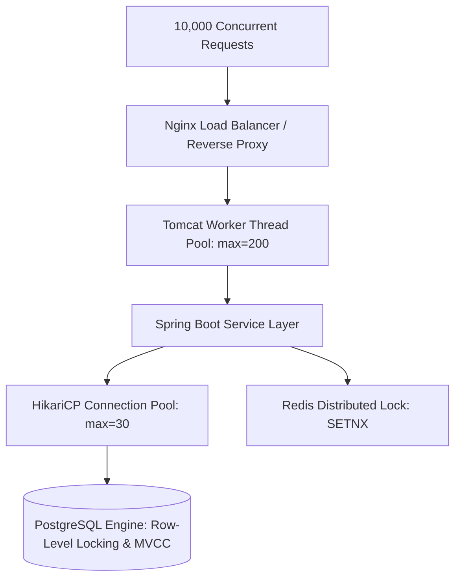
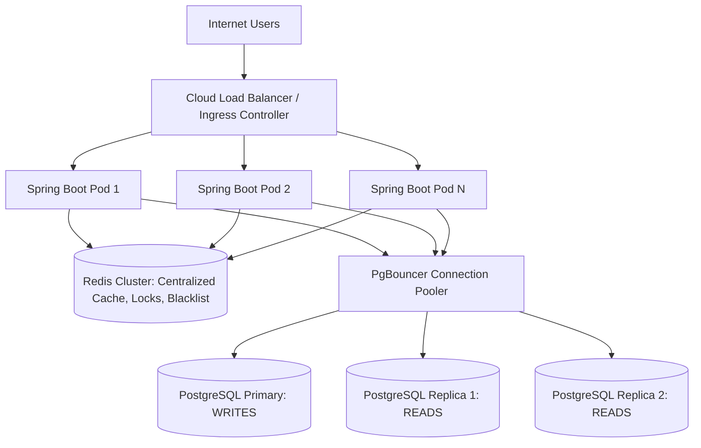
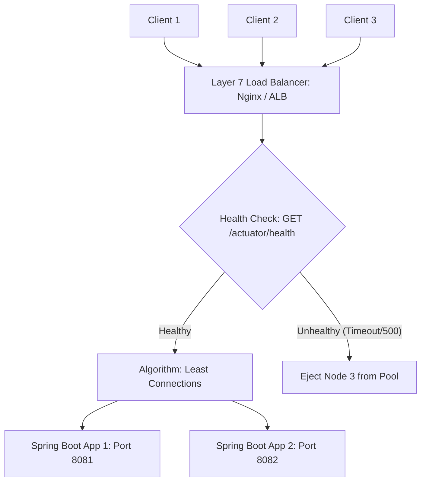
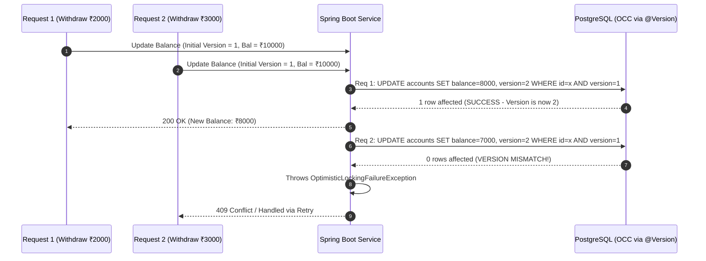
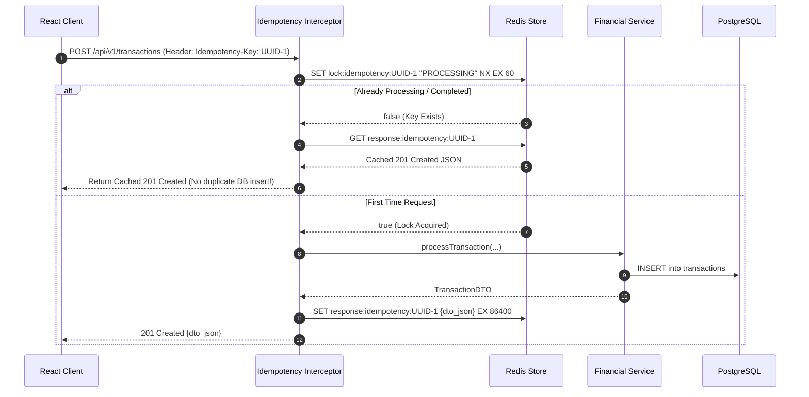
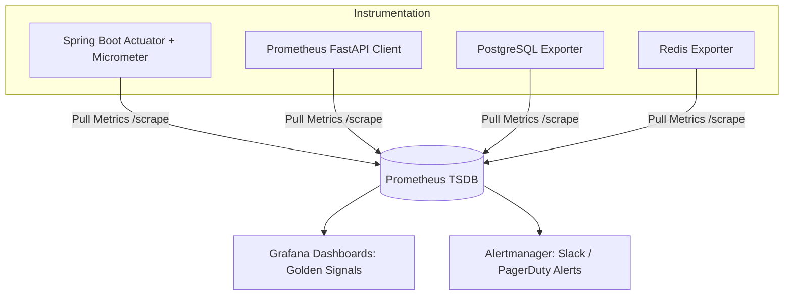

## Section 17: Advanced Questions

---

### Q246. How would you handle concurrent requests?

**Concept and Fundamentals:**
Concurrency occurs when multiple computational executions happen simultaneously and potentially interact with shared resources (CPU cores, memory, database connections, and records). In a full-stack enterprise web system, handling concurrency requires coordinating mechanisms across four distinct layers:
1. **Network & Web Server Tier (Tomcat Thread Pool):** Servlet containers like Embedded Tomcat use a worker thread pool (Worker Thread-per-Request model). Incoming TCP connections are queued and assigned to dedicated worker threads (`max-threads=200`, `min-spare-threads=20`, `accept-count=100`). In modern Java (Java 21+), Virtual Threads (Project Loom) can replace platform threads, enabling millions of lightweight, concurrent carrier-thread multiplexed executions without kernel context-switch overhead.
2. **Database Connection Pool (HikariCP):** Database connections are scarce, resource-heavy sockets. A high-performance connection pool prevents thread starvation and manages connection leasing with bounded limits (e.g., `maximum-pool-size=30`, `connection-timeout=20000ms`).
3. **Database Concurrency Control (ACID & Row Locks):** Relational engines prevent race conditions using transaction isolation levels (e.g., `READ COMMITTED`, `REPEATABLE READ`, `SERIALIZABLE`) and locking strategies (Optimistic Locking via version fields vs. Pessimistic Locking via `SELECT ... FOR UPDATE`).
4. **Distributed Concurrency (Distributed Locking):** When scaling horizontally across multiple server instances, in-memory Java synchronization (`synchronized`, `ReentrantLock`) fails. Distributed locks implemented via Redis (Redlock or `SET resource_name my_random_value NX PX 30000`) or database advisory locks are required to serialize access to critical cross-instance sections.



**My Project Implementation:**
In VittSaathi, concurrency is managed across the stack:
- **Web Layer:** Spring Boot 3 runs on Tomcat with configured thread pool bounds in `application.yml`:
  ```yaml
  server:
    tomcat:
      threads:
        max: 200
        min-spare: 20
      accept-count: 100
      connection-timeout: 20000
  ```
- **Connection Management:** HikariCP is configured with a 30-connection maximum pool, tuned according to PostgreSQL core capacity:
  ```yaml
  spring:
    datasource:
      hikari:
        maximum-pool-size: 30
        minimum-idle: 10
        idle-timeout: 300000
        connection-timeout: 20000
  ```
- **Optimistic Concurrency Control on Financial Entities:** To prevent lost updates on user accounts and asset portfolios without locking database rows, we annotate financial entities with JPA `@Version`:
  ```java
  @Entity
  @Table(name = "accounts")
  public class Account {
      @Id
      @GeneratedValue(strategy = GenerationType.UUID)
      private UUID id;
      
      @Column(precision = 12, scale = 2, nullable = false)
      private BigDecimal balance;
      
      @Version
      private Long version;
  }
  ```
  If two concurrent transactions attempt to update the balance simultaneously, the second transaction detects a version mismatch and throws an `OptimisticLockingFailureException`, which our service layer catches and handles cleanly (e.g., retry or notify user).
- **Distributed Lock for Multi-Agent Report Generation:** When generating long-running AI advisory plans, we prevent a user from firing duplicate concurrent generation requests by acquiring a Redis mutex:
  ```java
  Boolean acquired = redisTemplate.opsForValue()
      .setIfAbsent("lock:advisor:" + userId, "LOCKED", Duration.ofSeconds(45));
  if (Boolean.FALSE.equals(acquired)) {
      throw new DuplicateRequestException("An advisory plan is already generating. Please wait.");
  }
  ```

**Why I Used It:**
- **Zero Lock Contention for Reads:** Optimistic locking allows thousands of concurrent read queries without locking rows, maximizing read throughput.
- **Data Protection Without Deadlocks:** Pessimistic database locks risk deadlocks under high load; optimistic locking fails fast with immediate rollback.
- **Resource Safety:** Capping thread pools and connection limits prevents Out-Of-Memory (OOM) errors and protects PostgreSQL from thread exhaustion.

**Alternatives and Comparison:**

| Concurrency Approach | Throughput | Lock Overhead | Deadlock Risk | Best Used For | VittSaathi Choice |
| :--- | :--- | :--- | :--- | :--- | :--- |
| **Java Synchronized Blocks** | Low (Single JVM) | Minimal | High (Thread blocking) | Single instance, non-distributed | Rejected (Fails across horizontal containers) |
| **Pessimistic Locking (`SELECT FOR UPDATE`)** | Moderate | High (Database row locks held during transaction) | High if multiple tables locked in differing order | High-contention balance deductions | Used selectively on high-risk transfers |
| **Optimistic Locking (`@Version`)** | Extremely High | Zero (Validation happens at commit time) | Zero | Low-to-moderate contention financial reads/updates | **Selected as Primary Strategy** |
| **Distributed Locking (Redis `SETNX`)** | High | Low (In-memory Redis atomic ops) | Low (Handled by lease TTL) | Serializing multi-step long-running agent workflows | **Selected for AI generation jobs** |

**Interview-Ready Answer:**
"To handle concurrent requests in VittSaathi, we apply concurrency management at every tier. At the web tier, Spring Boot's embedded Tomcat handles concurrent requests using a tuned thread pool with a max of 200 worker threads, while HikariCP regulates database connections with a maximum pool of 30 to prevent PostgreSQL connection saturation. At the data layer, we implement Optimistic Concurrency Control using JPA's `@Version` annotation on sensitive financial entities like accounts and budgets. When concurrent updates collide, PostgreSQL detects the version discrepancy and throws an `OptimisticLockException`, which we handle gracefully with automatic retries or descriptive user feedback. Furthermore, for expensive, long-running AI operations—such as multi-agent financial plan generation—we use Redis distributed locking with `SETNX` and a time-to-live to prevent duplicate concurrent invocations from the same user."

**Follow-up Depth:**
- *Interviewer:* "What happens if an `OptimisticLockException` is thrown during a transaction update?"
  - *Answer:* "We handle optimistic lock failures using Spring Retry (`@Retryable(value = {OptimisticLockingFailureException.class}, maxAttempts = 3, backoff = @Backoff(delay = 100, multiplier = 2))`). The service re-reads the latest entity state, recalculates the business logic against the fresh balance, and re-attempts the update. If all three retries fail due to extreme contention, we return an HTTP 409 Conflict instructing the client to refresh."

---

### Q247. How would you make your application horizontally scalable?

**Concept and Fundamentals:**
**Horizontal Scaling (Scale-Out)** involves adding more machine instances (nodes, containers, or VMs) behind a load balancer to distribute incoming workload, contrasting with **Vertical Scaling (Scale-Up)**, which upgrades CPU/RAM on a single machine.

For an application to be horizontally scalable, it must adhere to the **Shared-Nothing Architecture** and **Twelve-Factor App principles**:
1. **Stateless Application Tier:** Application servers must not store client state (e.g., HTTP sessions, in-memory authentication tokens, or local file system uploads) in local JVM memory. Any instance must be capable of processing any request from any client at any time.
2. **Externalized State Management:** User sessions, authentication tokens, and transient locks must live in a centralized, high-throughput external store (e.g., Redis cluster).
3. **Database Scalability:** The relational database must scale out via Read Replicas (streaming replication) using connection routers, and write workloads must be partitioned or sharded if write capacity is exceeded.
4. **Containerization & Dynamic Orchestration:** Services must be packaged as immutable Docker containers and orchestrated using Kubernetes (K8s) or AWS ECS with Horizontal Pod Autoscalers (HPA) responding to CPU, memory, or HTTP request rates.



**My Project Implementation:**
In VittSaathi, horizontal scalability is architected through strict statelessness and containerized deployment:
1. **Stateless Spring Boot Backend:**
   - Spring Security is configured with `SessionCreationPolicy.STATELESS`.
   - Authentication is verified entirely via self-contained JWT tokens signed with HMAC-SHA256. Any Spring Boot instance can cryptographically verify an incoming token using the shared secret without communicating with other application instances.
   - Session revocation and token blacklisting are externalized to a shared Redis instance.
2. **Decoupled AI Microservice:**
   - The Python LangGraph service runs as an independent stateless HTTP microservice. When advisory traffic surges, the Python container count can scale from 2 to 10 instances without modifying or redeploying the Spring Boot backend.
3. **Containerized Docker Compose Infrastructure:**
   - All services (`frontend`, `backend`, `ai-service`, `postgres`, `redis`) run in isolated containers.
   - We can scale backend workers using Docker Compose command:
     `docker compose up --scale backend=3 --scale ai-service=3 -d`
4. **Database Connection Pooling Architecture:**
   - As backend containers scale out, raw database connections multiply ($3 \text{ instances} \times 30 \text{ connections} = 90$). In production, we place **PgBouncer** between Spring Boot and PostgreSQL to multiplex hundreds of container connections into a compact pool of physical database connections.

**Why I Used It:**
- **Elastic Cost Efficiency:** Compute resources scale dynamically with traffic surges (e.g., during tax season or salary credit days) and scale down during off-peak hours.
- **High Availability & Fault Tolerance:** If one Spring Boot pod crashes due to a JVM failure, the load balancer automatically redirects traffic to healthy instances without user disruption.

**Alternatives and Comparison:**

| Architecture Dimension | Vertical Scaling | Horizontal Scaling (VittSaathi Design) |
| :--- | :--- | :--- |
| **Implementation Effort** | Minimal (Upgrade cloud instance size) | Moderate (Requires stateless design, Redis, load balancers) |
| **Theoretical Ceiling** | Hard hardware limit (Max CPU/RAM of single VM) | Virtually limitless (Add more nodes) |
| **Downtime on Upgrade** | Requires downtime or failover to resize | Zero-downtime rolling deployments |
| **Cost Curve** | Exponential (Ultra-high spec cloud VMs are costly) | Linear (Commodity instances added elastically) |

**Interview-Ready Answer:**
"To make VittSaathi horizontally scalable, we designed both the Spring Boot backend and the Python AI service to be completely stateless. We eliminated server-side HTTP sessions in favor of stateless JWT authentication, where any backend instance can independently verify cryptographic signatures. All shared dynamic state—including the token revocation blacklist, distributed locks, and portfolio cache—is externalized to a centralized Redis cluster. This allows us to run multiple identical Spring Boot and Python containers behind an NGINX or cloud load balancer. Furthermore, to prevent our database from becoming the scaling bottleneck as instances multiply, we route read queries to PostgreSQL read replicas and employ PgBouncer for connection multiplexing."

**Follow-up Depth:**
- *Interviewer:* "If you scale Spring Boot to 10 instances, won't you exhaust PostgreSQL's maximum connection limit?"
  - *Answer:* "Yes, that is a classic connection explosion risk. If 10 instances each configure HikariCP with 30 connections, that's 300 concurrent open sockets to PostgreSQL. We mitigate this by using **PgBouncer** in transaction pooling mode. PgBouncer maintains a compact pool of ~50 physical connections to PostgreSQL, while serving hundreds of application-side connections, only assigning a real physical database connection during the exact lifespan of an active SQL transaction."

---

### Q248. What is load balancing?

**Concept and Fundamentals:**
**Load Balancing** is the process of efficiently distributing incoming network traffic across a pool of backend servers (the 'server farm' or 'upstream cluster'). A Load Balancer (LB) acts as the reverse-proxy traffic cop sitting between clients and backend servers, ensuring no single server becomes overwhelmed, minimizing response latency, and maximizing system throughput and uptime.

Load balancers operate at different layers of the OSI model:
1. **Layer 4 (L4 - Transport Layer):** Operates on TCP/UDP protocols without inspecting application payloads. Routing decisions are made based on IP address and TCP port (e.g., AWS Network Load Balancer, HAProxy TCP mode). Offers maximum throughput and minimal CPU overhead.
2. **Layer 7 (L7 - Application Layer):** Operates on application protocols (HTTP, HTTPS, gRPC, WebSocket). Inspects HTTP headers, cookies, URL paths, and query parameters (e.g., NGINX, AWS Application Load Balancer). Enables intelligent content-based routing (e.g., routing `/api/v1/agent/**` directly to the Python AI service and `/api/**` to Spring Boot).

**Load Balancing Algorithms:**
- **Round Robin:** Passes each new request sequentially to the next server in the list.
- **Weighted Round Robin:** Assigns proportionally more requests to higher-capacity servers.
- **Least Connections:** Directs traffic to the server currently processing the fewest active transactions.
- **IP Hash / Consistent Hashing:** Hashes the client IP to map requests from the same user to the same server (used for sticky sessions).



**My Project Implementation:**
In VittSaathi, load balancing is implemented using **NGINX as an L7 Reverse Proxy and Load Balancer**:
- **Upstream Configuration:**
  ```nginx
  upstream spring_backend {
      least_conn;
      server backend-1:8080 max_fails=3 fail_timeout=10s;
      server backend-2:8080 max_fails=3 fail_timeout=10s;
      server backend-3:8080 backup;
  }
  
  upstream python_ai {
      least_conn;
      server ai-service-1:8000;
      server ai-service-2:8000;
  }

  server {
      listen 80;
      server_name api.vittsaathi.in;

      location /api/v1/agent/ {
          proxy_pass http://python_ai;
          proxy_set_header Host $host;
          proxy_set_header X-Real-IP $remote_addr;
      }

      location /api/ {
          proxy_pass http://spring_backend;
          proxy_set_header Host $host;
          proxy_set_header X-Real-IP $remote_addr;
      }
  }
  ```
- **Health Checks:** NGINX monitors the backend servers using Spring Boot Actuator's health endpoint (`/actuator/health`). If a container fails to respond or returns 5xx errors, NGINX marks it as down and reroutes requests to the surviving healthy nodes.

**Why I Used It:**
- **Path-Based Routing:** Enables clean microservice routing, directing lightweight REST API calls to Spring Boot while dispatching heavy AI tasks to the Python service.
- **TLS Termination:** NGINX handles SSL/TLS decryption at the edge, relieving Spring Boot of cryptographic TLS handshake overhead.
- **Least Connections Algorithm:** Chosen over standard Round Robin because financial queries have variable latencies (a simple balance check takes 5ms, whereas a complex portfolio aggregation takes 80ms). Directing requests to the least busy server prevents head-of-line blocking.

**Alternatives and Comparison:**

| Load Balancer | Layer | Throughput | Path/Header Routing | Complexity | Use Case |
| :--- | :--- | :--- | :--- | :--- | :--- |
| **AWS NLB / HAProxy L4** | L4 (TCP) | Ultra-High (> millions req/s) | No | Low | High-packet raw streaming |
| **NGINX / HAProxy L7** | L7 (HTTP) | High | Yes (Full URL/Header routing) | Moderate | **Selected for VittSaathi Reverse Proxy** |
| **Spring Cloud Gateway** | L7 (Java) | Moderate | Yes (Programmatic Java filters) | Moderate/High | Great for pure Java microservices |

**Interview-Ready Answer:**
"Load balancing is the technique of distributing incoming user traffic across multiple backend servers to prevent bottlenecks, ensure high availability, and eliminate single points of failure. In VittSaathi, we use NGINX as an Application Layer 7 load balancer and reverse proxy. It performs SSL termination and routes requests using path-based rules—sending `/api/v1/agent/**` calls to our Python LangGraph microservice cluster and all other `/api/**` calls to our Spring Boot upstream cluster. We configure the `least_conn` algorithm so that incoming requests are dynamically dispatched to the instance with the fewest active connections, preventing requests from piling up on nodes processing complex financial aggregations. NGINX also performs automated health checks via Spring Boot Actuator, ejecting any unresponsive node from the active pool."

**Follow-up Depth:**
- *Interviewer:* "What is the difference between active and passive health checks in NGINX?"
  - *Answer:* "In passive health checks (standard NGINX), NGINX monitors real user requests; if an upstream server fails 3 consecutive requests (`max_fails=3`), NGINX temporarily stops routing traffic to it for `fail_timeout=10s`. In active health checks (available in NGINX Plus or cloud ALBs), the load balancer proactively sends synthetic periodic HTTP GET requests to `/actuator/health` in the background, detecting crashes before real users experience failures."

---

### Q249. What happens when two requests update the same financial record?

**Concept and Fundamentals:**
When two concurrent requests attempt to read, modify, and write the same financial record simultaneously, they risk triggering classic concurrency anomalies known as **race conditions**:
1. **Lost Update Anomaly:**
   - Transaction A reads Account Balance = ₹10,000.
   - Transaction B reads Account Balance = ₹10,000.
   - Transaction A deducts ₹2,000 and commits Balance = ₹8,000.
   - Transaction B deducts ₹3,000 and commits Balance = ₹7,000.
   - **Result:** Transaction A's deduction is completely lost; the bank loses ₹2,000.
2. **Inconsistent Read / Non-Repeatable Read:** Transaction reads a balance, another updates and commits it, and the first transaction reads a different value within the same operational unit.

To resolve this, database systems and application frameworks rely on **Concurrency Control Strategies**:
- **Pessimistic Concurrency Control:** Assumes conflicts *will* happen. Acquires an exclusive lock (`SELECT ... FOR UPDATE`) on the target row at the start of the transaction, blocking any other transaction from reading or writing until the lock is released upon commit or rollback.
- **Optimistic Concurrency Control (OCC):** Assumes conflicts are *rare*. Allows concurrent reads without locking. Records contain a version number (`version`). At commit time, the database checks if the version has changed:
  $$\text{UPDATE accounts SET balance = ?, version = version + 1 WHERE id = ? AND version = ?}$$
  If another transaction updated the version first, zero rows are updated, and the transaction is aborted.



**My Project Implementation:**
In VittSaathi, we handle simultaneous updates through a hybrid strategy:
1. **Optimistic Locking via JPA `@Version` (Default for Accounts & Budgets):**
   ```java
   @Entity
   public class Account {
       @Id
       private UUID id;
       private BigDecimal balance;
       
       @Version
       private Long version;
   }
   ```
   When two requests concurrently alter an account:
   - Request 1 checks out Version 1, computes new balance, updates the database, increments Version to 2, and commits.
   - Request 2 checks out Version 1, but its SQL update specifies `WHERE id = ? AND version = 1`. Because the version is now 2, the query matches 0 rows.
   - Hibernate detects 0 updated rows and throws `OptimisticLockingFailureException`.
2. **Automated Spring Retry Mechanism:**
   Instead of crashing, our service retries the transaction:
   ```java
   @Retryable(
       retryFor = { OptimisticLockingFailureException.class },
       maxAttempts = 3,
       backoff = @Backoff(delay = 50, multiplier = 2)
   )
   @Transactional(isolation = Isolation.READ_COMMITTED)
   public void debitAccount(UUID accountId, BigDecimal amount) {
       Account account = accountRepository.findById(accountId)
           .orElseThrow(() -> new ResourceNotFoundException("Account not found"));
       account.debit(amount);
       accountRepository.save(account);
   }
   ```
   On attempt 2, Request 2 reads the *updated* Version 2 balance (₹8,000), checks if sufficient funds remain, deducts ₹3,000, updates Version to 3, and commits cleanly.
3. **Pessimistic Locking for High-Risk Transfers:**
   For high-value balance transfers where retry loops are unacceptable, we use pessimistic write locks:
   ```java
   @Lock(LockModeType.PESSIMISTIC_WRITE)
   @Query("SELECT a FROM Account a WHERE a.id = :id")
   Optional<Account> findByIdForUpdate(@Param("id") UUID id);
   ```
   This generates `SELECT * FROM accounts WHERE id = ? FOR UPDATE`, forcing the second transaction to wait on PostgreSQL's row-lock queue until the first completes.

**Why I Used It:**
- **Guaranteed Consistency:** Eliminates the lost update anomaly entirely. Balance adjustments are mathematically exact.
- **High Read Concurrency:** OCC avoids row locks, enabling hundreds of concurrent dashboard read operations while safely isolating simultaneous writes.

**Alternatives and Comparison:**

| Concurrency Method | Read Overhead | Write Contention Behavior | Deadlock Risk | Best Match |
| :--- | :--- | :--- | :--- | :--- |
| **No Locking (Naive SQL)** | Zero | Lost updates, corrupted balances | Zero | Catastrophic for finance |
| **Optimistic Locking (`@Version`)** | Zero | Fails fast / Retries on commit collision | Zero | **VittSaathi Standard** |
| **Pessimistic Locking (`FOR UPDATE`)** | Moderate | Serializes transactions via database row lock | Moderate | **VittSaathi Balance Transfers** |

**Interview-Ready Answer:**
"If two concurrent requests attempt to update the same financial record in VittSaathi, our system uses Optimistic Concurrency Control backed by JPA's `@Version` annotation to prevent lost updates. When both requests read the account simultaneously, they retrieve the same version number. The first request to commit increments the version in PostgreSQL. When the second request attempts its update with the now-stale version number, PostgreSQL updates zero rows, causing Hibernate to throw an `OptimisticLockingFailureException`. Rather than surfacing an error to the user, our `@Retryable` service layer intercepts the exception, reloads the fresh account balance, validates that funds are still sufficient, and re-applies the debit against the new version. For critical inter-account transfers, we use Pessimistic Write Locking via `SELECT ... FOR UPDATE` to strictly serialize modifications at the database level."

**Follow-up Depth:**
- *Interviewer:* "What happens if two concurrent balance transfer requests attempt to transfer funds between Account A and Account B in reverse order (A -> B and B -> A) using pessimistic locking?"
  - *Answer:* "That is the textbook recipe for a **database deadlock**. Thread 1 locks Account A and waits for Account B; Thread 2 locks Account B and waits for Account A. To eliminate deadlocks, we enforce a **strict global lock acquisition order** based on primary keys: our transfer service always locks the account with the smaller UUID first, and the larger UUID second (`if (accA.getId().compareTo(accB.getId()) < 0) ...`). By imposing a consistent lock hierarchy, circular waits are mathematically impossible."

---

### Q250. How do transactions prevent inconsistent data?

**Concept and Fundamentals:**
A **Database Transaction** is a single logical unit of work comprising one or more operations (reads, writes, updates, deletes) executed against a database. Transactions prevent inconsistent data by strictly upholding the **ACID guarantees**:
1. **Atomicity (All-or-Nothing):** Guarantees that either all operations within the transaction succeed, or the entire transaction is rolled back as if it never occurred. If a server crashes midway through a ledger update, the Write-Ahead Log (WAL) undoes partial mutations.
2. **Consistency (Integrity Preservation):** Guarantees that a transaction transforms the database from one valid state to another, strictly satisfying all defined schema rules, foreign key constraints, `CHECK` constraints (e.g., `balance >= 0`), and unique indexes.
3. **Isolation (Concurrency Shield):** Dictates how intermediate modifications of concurrently executing transactions are hidden from each other. SQL defines four ANSI isolation levels:
   - *Read Uncommitted:* Dirty reads allowed (Never used in finance).
   - *Read Committed:* Default in PostgreSQL. Prevents dirty reads; a transaction only sees committed changes.
   - *Repeatable Read:* Prevents dirty and non-repeatable reads using Multi-Version Concurrency Control (MVCC) snapshots.
   - *Serializable:* Complete execution equivalence to serial processing; prevents phantom reads and write skew.
4. **Durability (Persistent Survival):** Guarantees that once a transaction commits, its state is permanently written to non-volatile storage via the Write-Ahead Log (WAL) and will survive power failure or application crashes.

```mermaid
graph TD
    subgraph Spring Transaction Boundary [@Transactional]
        Op1[Step 1: INSERT into transactions debit ₹5000]
        Op2[Step 2: UPDATE accounts SET balance = balance - 5000]
        Op3[Step 3: External Call or Network Failure / Exception]
    end
    Op1 --> Op2
    Op2 --> Op3
    Op3 -- RuntimeException --> Rollback[TRANSACTION ROLLBACK: PostgreSQL WAL Reverts Op1 and Op2]
    Rollback --> DBState[Database Restored to Pristine State: Balance Untouched]
```

**My Project Implementation:**
In VittSaathi, transactional integrity is managed declaratively using Spring's `@Transactional` annotation over the service layer:
1. **Atomic Multi-Table Mutation Example:**
   ```java
   @Service
   public class TransactionServiceImpl implements TransactionService {

       @Transactional(
           isolation = Isolation.READ_COMMITTED,
           propagation = Propagation.REQUIRED,
           rollbackFor = { Exception.class }
       )
       public TransactionDTO recordExpense(CreateExpenseRequest request, UUID userId) {
           // 1. Fetch and lock Account
           Account account = accountRepository.findById(request.getAccountId())
               .orElseThrow(() -> new ResourceNotFoundException("Account not found"));

           // 2. Business Check Constraint
           if (account.getBalance().compareTo(request.getAmount()) < 0) {
               throw new InsufficientBalanceException("Cannot record expense: Insufficient funds");
           }

           // 3. Mutate Account Balance
           account.debit(request.getAmount());
           accountRepository.save(account);

           // 4. Create and persist Ledger Transaction Record
           Transaction txn = Transaction.builder()
               .user(userRepository.getReferenceById(userId))
               .account(account)
               .amount(request.getAmount())
               .category(request.getCategory())
               .type(TransactionType.EXPENSE)
               .transactionDate(request.getDate())
               .build();
           transactionRepository.save(txn);

           // 5. Invalidate Cached Portfolio
           cacheService.evictPortfolioCache(userId);

           return transactionMapper.toDTO(txn);
       }
   }
   ```
2. **Database Constraints Backing Application Logic:**
   We enforce database-level `CHECK` constraints in PostgreSQL migrations so that even if application logic were bypassed, the database itself rejects illegal states:
   ```sql
   ALTER TABLE accounts ADD CONSTRAINT chk_balance_non_negative CHECK (balance >= 0);
   ```

**Why I Used It:**
- **Elimination of Orphaned Ledger Records:** Without transactions, if step 3 (persisting the transaction entity) fails due to a network glitch or disk constraint after step 2 (balance deduction) succeeds, money would vanish from the user's account without an audit trail. `@Transactional` guarantees atomicity.
- **Declarative Simplicity:** Spring's AOP transaction interceptor manages `begin`, `commit`, and `rollback` automatically, reducing boilerplate error-handling code.

**Alternatives and Comparison:**

| Approach | Atomicity | Error Handling | Overhead | VittSaathi Usage |
| :--- | :--- | :--- | :--- | :--- |
| **Manual JDBC Transactions (`conn.setAutoCommit(false)`)** | Full | Highly error-prone; manual `commit()` and `rollback()` required in `catch` blocks | Low | Rejected in favor of declarative Spring `@Transactional` |
| **Spring Declarative `@Transactional`** | Full | Automatic rollback on `RuntimeException` / specified checked exceptions | Minimal (AOP proxy) | **Standard for all financial mutations** |
| **Two-Phase Commit (2PC / XA)** | Full across distributed DBs | Complex, high latency, blocking coordinator | Very High | Unnecessary (Single primary PostgreSQL instance) |

**Interview-Ready Answer:**
"Transactions prevent inconsistent data by guaranteeing the ACID properties across all multi-step financial operations in VittSaathi. When recording an expense or transferring funds, multiple operations must occur together: deducting from an account balance, inserting an immutable transaction ledger record, and updating asset allocations. We wrap these operations in Spring's `@Transactional` annotation set to `READ_COMMITTED` isolation. If any step fails—such as an out-of-memory error, network disconnect, or a constraint violation like attempting to overdraft a non-negative account balance—Spring's transaction manager intercepts the exception and issues a database `ROLLBACK`. This relies on PostgreSQL's Write-Ahead Log to undo any intermediate writes, ensuring the database never remains in a partially updated or corrupted state."

**Follow-up Depth:**
- *Interviewer:* "Does Spring's `@Transactional` rollback for every exception by default?"
  - *Answer:* "No! By default, Spring only rolls back transactions for unchecked exceptions (`RuntimeException` and `Error`). It does *not* roll back for checked exceptions (`Exception`). To ensure financial safety against any checked exception, we always explicitly declare `@Transactional(rollbackFor = Exception.class)`."

---

### Q251. How would you design idempotent APIs?

**Concept and Fundamentals:**
An API operation is **idempotent** if making the same request multiple times produces the exact same server-side state as making it once:
$$f(f(x)) = f(x)$$
- **Naturally Idempotent HTTP Methods:**
  - `GET`, `HEAD`, `OPTIONS`: Safe and idempotent (Read-only).
  - `PUT`: Idempotent (Replacing resource state with identical payload yields identical result).
  - `DELETE`: Idempotent (Deleting resource with ID 10 once or five times leaves resource 10 gone).
- **Non-Idempotent HTTP Methods:**
  - `POST`: Non-idempotent (Submitting a payment `POST /api/v1/payments` three times due to mobile network timeouts can charge the user's card three times).

To make `POST` mutations idempotent, distributed systems implement the **Idempotency Key Pattern**:
1. Client generates a unique UUID (the `Idempotency-Key`) for every distinct user intent.
2. The key is transmitted in the HTTP header: `Idempotency-Key: 9b1deb4d-3b7d-4bad-9bdd-2b0d7b3dcb6d`.
3. The server checks a high-speed store (Redis) or database table for this key:
   - **Key Not Found:** Server records the key with status `IN_PROGRESS`, processes the request, saves the resulting response body and status code, and updates the key status to `COMPLETED`.
   - **Key Found & IN_PROGRESS:** Server rejects the duplicate with `409 Conflict` or awaits completion.
   - **Key Found & COMPLETED:** Server skips execution and immediately replays the cached original response (`201 Created` with original payload).



**My Project Implementation:**
In VittSaathi, idempotent APIs are critical for financial transaction creation and investment allocation orders:
1. **Frontend Key Generation:**
   When the user submits a financial mutation form, React generates an idempotency key using `crypto.randomUUID()` and attaches it to the Axios request:
   ```javascript
   const submitTransaction = async (formData) => {
       const idempotencyKey = crypto.randomUUID();
       return apiClient.post('/api/v1/financial/transactions', formData, {
           headers: { 'Idempotency-Key': idempotencyKey }
       });
   };
   ```
2. **Spring Boot Handler Interceptor:**
   We register an `IdempotencyInterceptor` implementing `HandlerInterceptor`:
   ```java
   @Component
   public class IdempotencyInterceptor implements HandlerInterceptor {
       @Autowired
       private StringRedisTemplate redisTemplate;

       @Override
       public boolean preHandle(HttpServletRequest request, HttpServletResponse response, Object handler) throws Exception {
           if (!"POST".equalsIgnoreCase(request.getMethod())) return true;

           String key = request.getHeader("Idempotency-Key");
           if (key == null) return true; // Or enforce key presence

           String redisKey = "idempotency:" + key;
           Boolean acquired = redisTemplate.opsForValue().setIfAbsent(redisKey, "IN_PROGRESS", Duration.ofMinutes(2));

           if (Boolean.FALSE.equals(acquired)) {
               String cachedResponse = redisTemplate.opsForValue().get(redisKey + ":response");
               if (cachedResponse != null) {
                   response.setStatus(HttpServletResponse.SC_OK);
                   response.setContentType("application/json");
                   response.getWriter().write(cachedResponse);
                   return false; // Halt execution chain, replay response
               }
               response.sendError(HttpServletResponse.SC_CONFLICT, "Request is currently being processed.");
               return false;
           }
           return true;
       }
   }
   ```
3. **Response Caching Filter:**
   Once the controller completes successfully, a response wrapper captures the serialized response JSON and saves it to Redis under `idempotency:{key}:response` with a 24-hour TTL.

**Why I Used It:**
- **Network Resilience:** Mobile users often tap "Submit" multiple times or experience packet drops after the server processes the record but before the 200 OK reaches the phone. Idempotency guarantees the user is never double-billed.
- **Consistent Replay:** Replaying the exact original response guarantees predictable frontend state machine transitions without creating duplicate database rows.

**Alternatives and Comparison:**

| Design Strategy | Deduplication Window | Storage Layer | Complexity | VittSaathi Choice |
| :--- | :--- | :--- | :--- | :--- |
| **Client-Side Button Disabling (`disabled={loading}`)** | Window of UI interaction only | Browser memory | Extremely Low | Good UX, but easily bypassed by network retry or refresh |
| **Database Unique Constraint on Business Keys** | Permanent | Relational DB | Low | Useful fallback, but fails if legitimate repeat values exist |
| **Idempotency Key Pattern via Redis** | 24 Hours | Redis In-Memory | Moderate | **Selected as Enterprise Standard** |

**Interview-Ready Answer:**
"To design idempotent APIs in VittSaathi, particularly for non-idempotent HTTP POST endpoints like creating transactions or balance allocations, we implemented the Idempotency Key pattern. When a user submits a financial form on React, our client generates a unique UUID and transmits it in the `Idempotency-Key` header. In Spring Boot, an `IdempotencyInterceptor` checks Redis using `SETNX` with a short expiration. If the key is new, the request proceeds, and upon completion, the generated response is cached in Redis with a 24-hour TTL. If a client retries the exact same request due to a network glitch or double-click, our interceptor detects the existing key, bypasses the database and controller entirely, and directly returns the cached original JSON response with an HTTP 200 OK."

**Follow-up Depth:**
- *Interviewer:* "What happens if a request with an idempotency key crashes midway through processing?"
  - *Answer:* "If an unhandled exception or crash occurs, our global exception handler catches it, evicts the `IN_PROGRESS` key from Redis, and returns an HTTP 500 error. This allows subsequent retries from the client to execute cleanly rather than remaining perpetually locked."

---

### Q252. How would you monitor the system?

**Concept and Fundamentals:**
System monitoring involves continuously collecting, aggregating, and analyzing operational telemetry to ensure availability, performance, and security across all architectural components. Comprehensive production observability rests on the **Four Golden Signals of Monitoring** (Google SRE Framework):
1. **Latency:** Time taken to service a request (differentiating successful requests from failed requests).
2. **Traffic:** Demand placed on the system (e.g., HTTP requests per second - RPS, active WebSocket connections).
3. **Errors:** Rate of requests that fail explicitly (HTTP 5xx), implicitly (HTTP 200 with error payload), or policy-wise.
4. **Saturation:** How full the most constrained service resources are (CPU utilization, JVM Heap usage, HikariCP connection pool saturation, PostgreSQL disk I/O, Redis memory consumption).

A mature monitoring stack encompasses **Metrics Collection, Log Aggregation, Distributed Tracing, and Alerting Rules**.



**My Project Implementation:**
In VittSaathi, monitoring is structured across three core layers:
1. **Application Metrics Exposure (Micrometer & Actuator):**
   - Spring Boot Actuator is configured with Micrometer Prometheus registry in `pom.xml`:
     ```xml
     <dependency>
         <groupId>org.springframework.boot</groupId>
         <artifactId>spring-boot-starter-actuator</artifactId>
     </dependency>
     <dependency>
         <groupId>io.micrometer</groupId>
         <artifactId>micrometer-registry-prometheus</artifactId>
     </dependency>
     ```
   - Exposed endpoints in `application.yml`:
     ```yaml
     management:
       endpoints:
         web:
           exposure:
             include: "health,metrics,prometheus,info"
       endpoint:
         health:
           show-details: when-authorized
     ```
   - Custom Business Metrics: We track financial metrics using Micrometer `Counter` and `Timer`:
     ```java
     Timer.Sample sample = Timer.start(meterRegistry);
     // ... execute AI advisory plan ...
     sample.stop(meterRegistry.timer("vittsaathi.advisor.plan.duration"));
     meterRegistry.counter("vittsaathi.transactions.created", "category", category).increment();
     ```
2. **Infrastructure & Database Monitoring:**
   - **HikariCP Pool Health:** Monitoring `hikaricp.connections.active`, `hikaricp.connections.pending`, and `hikaricp.connections.timeout` to detect connection pool starvation.
   - **Redis Saturation:** Monitoring `used_memory`, `evicted_keys`, and `connected_clients`.
   - **PostgreSQL Telemetry:** Tracking slow queries via `pg_stat_statements` and monitoring connection saturation against `max_connections`.
3. **Visualization & Alerting:**
   - Prometheus scrapes `/actuator/prometheus` every 15 seconds.
   - Grafana renders real-time dashboards displaying p95/p99 request latencies, JVM heap usage, error rates, and Gemini API call durations.
   - Alertmanager triggers alerts if HTTP 5xx error rate exceeds 1% over 5 minutes or database connection pool utilization exceeds 85%.

**Why I Used It:**
- **Proactive Incident Response:** Identifying a spike in HikariCP wait times or JVM memory leaks allows mitigation before users experience site outages.
- **AI Latency & Cost Tracking:** Tracking Gemini API execution time and token consumption prevents budget overruns and isolates whether latency spikes originate from our backend or upstream Google API endpoints.

**Alternatives and Comparison:**

| Monitoring Stack | Architecture | Resource Footprint | Cost | VittSaathi Choice |
| :--- | :--- | :--- | :--- | :--- |
| **Cloud Managed (AWS CloudWatch / Datadog)** | SaaS Agent | Minimal local CPU | High recurring SaaS cost | Great for enterprise, costly for lean projects |
| **Prometheus + Grafana + Micrometer** | Open-source Pull-based TSDB | Low / Contained in Docker | Free / Open Source | **Selected as Primary Stack** |
| **ELK Stack (Elasticsearch Metrics)** | Push-based indexing | Heavy JVM memory consumption | Free self-hosted, heavy memory | Reserved for log analysis |

**Interview-Ready Answer:**
"To monitor VittSaathi in production, we implement the Four Golden Signals—Latency, Traffic, Errors, and Saturation—using Spring Boot Actuator, Micrometer, Prometheus, and Grafana. Spring Boot exposes operational metrics at `/actuator/prometheus`, including JVM heap usage, garbage collection pauses, HTTP response latency distributions, and HikariCP connection pool saturation. We also register custom Micrometer metrics to track business-level events, such as transaction creation volume and AI advisory plan generation durations. Prometheus scrapes these endpoints alongside exporters for PostgreSQL and Redis every 15 seconds. In Grafana, we visualize real-time p95 and p99 latency heatmaps, and Alertmanager notifies the team if the 5xx error rate crosses 1% or if HikariCP active connections exceed 85%."

**Follow-up Depth:**
- *Interviewer:* "How would you monitor the health and performance of the Python LangGraph microservice?"
  - *Answer:* "In the Python service, we use `prometheus-fastapi-instrumentator` to automatically expose HTTP request metrics and instrument custom Prometheus gauges and histograms around LangGraph node execution times. This allows us to monitor exactly how much time is spent inside the Sentinel guardrail, Kalpa's mathematical calculations, and Drishti's Gemini API calls."

---

### Q253. How would you implement logging?

**Concept and Fundamentals:**
Logging is the practice of recording sequential application events, execution state, and runtime diagnostics to an output stream for debugging, auditing, compliance, and security monitoring.

Enterprise logging fundamentals require:
1. **Hierarchical Log Levels:**
   - `TRACE`: Ultra-detailed diagnostic flow (e.g., individual SQL parameter bindings).
   - `DEBUG`: Internal execution milestones for developer debugging.
   - `INFO`: High-level operational events (e.g., "User registered", "Advisory plan generated").
   - `WARN`: Unexpected situations that didn't fail the request but indicate potential trouble (e.g., slow query, high memory, cache miss fallback).
   - `ERROR`: Runtime exceptions and operation failures requiring investigation.
2. **Structured Logging (JSON Format):** Replacing unstructured flat text strings (`[INFO] User logged in`) with structured JSON objects containing standardized schema attributes (`timestamp`, `level`, `thread`, `traceId`, `userId`, `message`). Machines can ingest, parse, index, and query JSON logs in Elasticsearch without fragile regular expressions.
3. **Mapped Diagnostic Context (MDC):** A thread-local storage mechanism provided by SLF4J/Logback that stamps contextual metadata (e.g., `traceId`, `userId`, `clientIp`) onto every log statement emitted during the lifespan of an HTTP request thread.
4. **Data Sanitization (PII Masking):** In a fintech application, regulatory frameworks (GDPR, PCI-DSS, RBI guidelines) strictly forbid logging plaintext passwords, full Credit Card PANs, Aadhaar/SSN numbers, or unmasked bank account balances.

```mermaid
graph LR
    LogEvent[Application Log Event: log.info] --> MDC[Inject MDC: traceId, userId]
    MDC --> LogbackEncoder[Logstash Logback JSON Encoder]
    LogbackEncoder --> MaskingRegex[PII Masking Filter: Passwords, PAN, PIN]
    MaskingRegex --> OutputConsole[STDOUT / File / Docker Logs]
    OutputConsole --> LogCollector[Fluentbit / Filebeat]
    LogCollector --> OpenSearch[Elasticsearch / OpenSearch]
    OpenSearch --> Kibana[Kibana / Grafana Logs Dashboard]
```



**My Project Implementation:**
In VittSaathi, logging is implemented using **SLF4J with Logback** configured for structured JSON output and PII masking:
1. **Logback Configuration (`logback-spring.xml`):**
   ```xml
   <configuration>
       <appender name="JSON_CONSOLE" class="ch.qos.logback.core.ConsoleAppender">
           <encoder class="net.logstash.logback.encoder.LoggingEventCompositeJsonEncoder">
               <providers>
                   <timestamp><timeZone>UTC</timeZone></timestamp>
                   <logLevel/>
                   <loggerName/>
                   <threadName/>
                   <mdc/>
                   <message/>
                   <stackTrace/>
               </providers>
           </encoder>
       </appender>
       <root level="INFO">
           <appender-ref ref="JSON_CONSOLE"/>
       </root>
   </configuration>
   ```
2. **MDC Filter for Trace and User Correlation:**
   ```java
   @Component
   public class LoggingContextFilter extends OncePerRequestFilter {
       @Override
       protected void doFilterInternal(HttpServletRequest request, HttpServletResponse response, FilterChain filterChain)
               throws ServletException, IOException {
           try {
               String traceId = request.getHeader("X-Trace-Id");
               if (traceId == null) traceId = UUID.randomUUID().toString();
               MDC.put("traceId", traceId);
               
               Authentication auth = SecurityContextHolder.getContext().getAuthentication();
               if (auth != null && auth.isAuthenticated()) {
                   MDC.put("userId", auth.getName());
               }
               response.setHeader("X-Trace-Id", traceId);
               filterChain.doFilter(request, response);
           } finally {
               MDC.clear(); // CRITICAL: Prevent thread-local memory leak in Tomcat thread pool
           }
       }
   }
   ```
3. **PII Masking Pattern:**
   We configure custom Logback conversion rules or regex masking patterns that replace sensitive fields matching `password`, `panNumber`, or `token` with `[REDACTED]`.

**Why I Used It:**
- **Zero Ambiguity in Multi-User Concurrency:** Standard text logs get interleaved when 100 threads log simultaneously. Including `traceId` and `userId` via MDC allows searching for a single user's request lifecycle across millions of lines of logs in Kibana.
- **Fintech Compliance:** Masking credentials and PII guarantees that our logging infrastructure never stores plain financial secrets, avoiding compliance violations.

**Alternatives and Comparison:**

| Logging Approach | Parseability | Performance | Distributed Querying | VittSaathi Choice |
| :--- | :--- | :--- | :--- | :--- |
| **`System.out.println`** | Disastrous | Blocking, slow | Impossible | Strictly forbidden in production |
| **Unstructured Flat Text (Standard Logback)** | Poor (Requires complex regex) | High | Difficult | Rejected |
| **Structured JSON Logging with MDC (Logstash Encoder)** | Instant / Native JSON | High (Asynchronous appender) | Seamless indexing in ELK / Grafana Loki | **Selected as Architecture Standard** |

**Interview-Ready Answer:**
"In VittSaathi, logging is designed for production observability and financial security using SLF4J and Logback. We format all logs as structured JSON using the Logstash Logback encoder, allowing them to be ingested, indexed, and searched by centralized log management systems like Grafana Loki or Elasticsearch. We implement an MDC (Mapped Diagnostic Context) servlet filter that generates a unique `traceId` and captures the authenticated `userId`, automatically stamping these attributes onto every log statement emitted during the request thread. Crucially, because VittSaathi is a fintech platform, we configure automated PII masking filters in our logback configuration to redact passwords, authentication tokens, and bank account numbers, ensuring sensitive financial data is never exposed in our log aggregations."

**Follow-up Depth:**
- *Interviewer:* "Why is calling `MDC.clear()` inside a `finally` block mandatory in Spring Boot?"
  - *Answer:* "Tomcat reuses worker threads from a fixed thread pool. Because MDC relies on `ThreadLocal` storage, if you fail to invoke `MDC.clear()` at the end of the request filter lifecycle, the thread will return to the pool retaining the previous user's `traceId` and `userId`. When that thread is later allocated to service a completely different user's request, subsequent log statements will emit corrupted context, leaking identity and ruining distributed log correlation."
