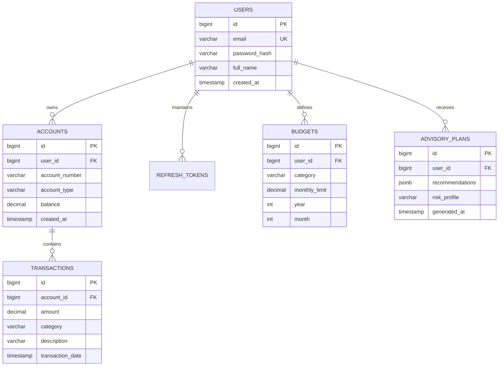

## Section 7: PostgreSQL Questions

### Q96. Why PostgreSQL?

**Concept and Fundamentals:**
PostgreSQL is an advanced, enterprise-grade, open-source **Object-Relational Database Management System (ORDBMS)** with over 35 years of active engineering maturity. It is widely acknowledged as the most feature-rich and standards-compliant relational database engine in modern software development.
Core technical reasons why PostgreSQL dominates enterprise financial engineering:
1. **Uncompromising ACID Compliance & Reliability:** PostgreSQL strictly enforces the ANSI SQL standard (conforming to 170 of the 179 mandatory features of SQL:2016). It implements rigorous **Write-Ahead Logging (WAL)** and **Multi-Version Concurrency Control (MVCC)** to ensure zero transaction corruption even under sudden power loss or process termination.
2. **Advanced Data Types & Indexing:** Beyond standard relational primitives, PostgreSQL natively supports:
   - `NUMERIC` / `DECIMAL(precision, scale)` for arbitrary, exact-precision financial arithmetic without IEEE 754 floating-point rounding errors.
   - `JSONB` (binary JSON) with GIN (Generalized Inverted Index) indexing, allowing hybrid relational-document data modeling within a single ACID engine.
   - Vector embeddings via the `pgvector` extension, enabling vector similarity search ($L_2$ distance, cosine similarity, inner product) directly inside the relational database.
   - Specialized indexing methods: B-Tree, Hash, GiST, SP-GiST, GIN, and BRIN.
3. **Sophisticated Concurrency & Isolation:** MVCC allows readers to never block writers and writers to never block readers. It supports configurable ANSI transaction isolation levels up to `SERIALIZABLE` using Serializable Snapshot Isolation (SSI).

**My Project Implementation:**
In VittSaathi, PostgreSQL 15 serves as the single source of truth for all structured financial domain entities:
- Manages relational schemas across `users`, `accounts`, `transactions`, `budgets`, and `refresh_tokens`.
- Enforces strict foreign key integrity, unique constraints on emails, and non-negative balance checks (`CHECK (balance >= 0)`).
- Stores dynamic AI advisory plans generated by the LangGraph multi-agent system in a structured `JSONB` column inside the `advisory_plans` table, allowing rich querying of nested portfolio allocations without fragmenting into dozens of tiny relational tables.
- Leverages `pgvector` for RAG semantic search over regulatory tax documentation.

**Why I Used It:**
Financial ledgers demand absolute transactional integrity and exact arithmetic precision. Floating-point errors or silent write losses can result in corrupted user account balances. PostgreSQL's battle-tested MVCC, strict transaction semantics, and native `JSONB` capabilities made it the ideal engine for VittSaathi.

**Alternatives and Comparison:**

| Database Engine | ACID Strictness | Extensibility / Modern Features | Concurrency Model | Best Suited For |
| :--- | :--- | :--- | :--- | :--- |
| **PostgreSQL 15** | Exceptional (Strict ANSI adherence) | Native `JSONB`, `pgvector`, GiST/GIN indexes | MVCC (Readers never block writers) | Complex financial systems, hybrid relational-AI data |
| **MySQL (InnoDB)** | Strong (ACID via Undo/Redo logs) | Basic JSON support (slower parsing), limited extensions | MVCC (Locking on foreign key cascades) | High-read e-commerce catalogs, simple web apps |
| **MongoDB** | Eventual consistency by default | Native BSON document store | Document-level locking, wiredTiger engine | Unstructured content management, real-time telemetry |
| **Oracle DB** | Enterprise Gold Standard | Extensive enterprise toolset | Sophisticated undo segments | Legacy banking cores (extremely expensive licensing) |

**Interview-Ready Answer:**
"I chose PostgreSQL for VittSaathi because personal financial management demands absolute ACID transactional integrity and exact mathematical precision. PostgreSQL natively supports arbitrary-precision `NUMERIC` types, preventing the floating-point rounding errors that plague financial calculations in other systems. 
Furthermore, PostgreSQL's advanced features allow us to run a hybrid architecture: we store traditional relational tables for double-entry transactions while simultaneously using binary `JSONB` columns with GIN indexes to store complex AI-generated advisory roadmaps from our LangGraph agents. Combined with its mature MVCC concurrency engine and `pgvector` extension for semantic search, PostgreSQL provides enterprise-grade reliability without enterprise licensing costs."

**Follow-up Depth:**
- *Cross-Question:* How does PostgreSQL's MVCC implementation differ fundamentally from MySQL InnoDB's MVCC?
  - *Answer:* MySQL InnoDB stores previous row versions in a shared **Undo Tablespace** (`undo logs`), overwriting the actual table page in-place. When a transaction rolls back or an older snapshot is read, InnoDB reconstructs older row states from the undo log. In contrast, PostgreSQL writes a completely new tuple directly into the table heap page on every `UPDATE`, tagging it with `xmin` (creation transaction ID) and `xmax` (deletion transaction ID). While PostgreSQL's approach avoids undo log bottlenecks, it produces dead tuples that require background **VACUUM** processes to reclaim disk space.

---

### Q97. Why not MySQL?

**Concept and Fundamentals:**
While MySQL (specifically with the InnoDB storage engine) is a reliable and popular open-source relational database, PostgreSQL possesses distinct architectural advantages that make it superior for financial engineering and AI-integrated applications:
1. **Financial & Numerical Precision:** PostgreSQL adheres strictly to SQL standards for numerical calculations. Historically, MySQL has exhibited subtle quirks—such as silent data truncation under non-strict SQL modes and automatic type coercion.
2. **Handling of Semi-Structured JSON:**
   - MySQL supports a `JSON` data type, but its query capabilities and indexing options are more limited.
   - PostgreSQL provides `JSONB` (binary format), which parses JSON into decomposed binary structures at write time. PostgreSQL allows creating **GIN (Generalized Inverted Index)** indexes directly on nested JSON keys and provides powerful JSON-path operators (`@>`, `?|`, `#>>`), yielding up to $10\times$ faster query performance on nested document structures.
3. **Advanced Indexing Varieties:** MySQL InnoDB supports almost exclusively B-Tree indexes (and basic spatial R-trees). PostgreSQL offers B-Tree, Hash, GiST (Generalized Search Tree), SP-GiST, GIN, and BRIN (Block Range Index) for massive multi-million-row time-series ledgers.
4. **Extensibility & Vector AI Ecosystem:** PostgreSQL is natively extensible. Third-party extensions can hook directly into the database engine. Extensions like **`pgvector`** turn PostgreSQL into a high-performance vector database for RAG embeddings, whereas MySQL lacks comparable native, widely-adopted vector search extensions.
5. **Table Inheritance & Window Functions:** PostgreSQL provides superior analytical processing with advanced analytical window functions (`NTILE`, `PERCENT_RANK`, lateral joins) that simplify complex financial cohort and rolling-balance calculations.

**My Project Implementation:**
In VittSaathi, our AI advisor generates structured financial recommendations that contain variable nested data (asset class allocations, emergency fund milestones, debt-avalanche payment schedules). Using MySQL would have forced us to either normalize these dynamic plans into 8+ relational tables with complex join queries or store them as opaque text blobs. PostgreSQL allowed us to store them in a single `JSONB` column with GIN indexing while running vector similarity search on financial knowledge bases using `pgvector`.

**Why I Used It:**
PostgreSQL offered superior standards compliance, eliminated the risk of silent data truncation, provided superior JSON querying performance, and supported vector search capabilities required for our AI advisory agents.

**Alternatives and Comparison:**

| Feature Dimension | PostgreSQL | MySQL (InnoDB) |
| :--- | :--- | :--- |
| **SQL Standards Compliance** | Extremely strict (ANSI SQL:2016 compliant) | Permissive (historical quirks, flexible coercion) |
| **Semi-Structured JSON** | `JSONB` + GIN indexing + JSON-path operators | Basic JSON type, virtual generated column indexing |
| **AI / Vector Integration** | Native `pgvector` extension for RAG embeddings | Requires external vector database (Chroma, Pinecone) |
| **Full Text & Complex Search** | Native `tsvector` with dictionary stemmers | Basic Full-Text index |
| **Extensibility (Extensions)** | Massive ecosystem (`pgvector`, `uuid-ossp`, `pg_stat_statements`)| Limited plugin architecture |

**Interview-Ready Answer:**
"While MySQL is a solid relational database, I chose PostgreSQL because VittSaathi has specific financial integrity and AI integration requirements that MySQL does not handle as effectively. 
First, PostgreSQL offers superior ANSI SQL compliance and strict data typing, preventing silent data coercion or truncation. Second, our multi-agent AI system generates complex, nested advisory plans that we store in binary `JSONB` columns; PostgreSQL's GIN indexing allows us to query deep nested fields with sub-millisecond latency. Finally, PostgreSQL's extensibility allowed us to utilize `pgvector` to store and query document embeddings for our RAG pipeline directly within the same database engine, eliminating the need to maintain a separate external vector database."

**Follow-up Depth:**
- *Cross-Question:* In what production scenarios would MySQL actually be preferable over PostgreSQL?
  - *Answer:* MySQL is often preferred in read-heavy applications with simple table structures (like e-commerce product catalogs or content blogs) where read throughput dominates. MySQL's thread-per-connection or thread-pool architecture has historically had slightly lower connection memory overhead compared to PostgreSQL's process-per-connection model. Furthermore, replication setups and operations on AWS Aurora MySQL are widely understood and supported by enterprise DevOps teams.

---

### Q98. What is a relational database?

**Concept and Fundamentals:**
A **Relational Database Management System (RDBMS)** is a data management system based on the **Relational Model of Data** formulated by E.F. Codd in 1970.
Foundational principles of the Relational Model:
1. **Relations (Tables):** Data is organized into structured two-dimensional grids called relations (tables), consisting of horizontal **Tuples (Rows/Records)** and vertical **Attributes (Columns/Fields)**.
2. **Schema & Domain Integrity:** Every attribute has a strictly defined domain (data type, constraints). Data cannot violate domain constraints (e.g., entering `"twenty"` into an integer column).
3. **Mathematical Set Theory:** Operations on relational data (filtering, projecting, joining) are rooted in formal **Relational Algebra** and set theory ($\sigma, \pi, \bowtie, \cup, \cap, -$):
   - Every operation takes relations as input and produces a relation as output (Closure Property).
4. **Declarative Query Language (SQL):** Users declare *what* data they want through Structured Query Language (SQL), and the database engine's **Cost-Based Query Optimizer (CBO)** determines *how* to retrieve it efficiently (choosing between sequential scans, index scans, hash joins, or nested loops).
5. **Relational Integrity Rules:**
   - **Entity Integrity:** Every table must have a Primary Key; primary key attributes can never be null and must be unique.
   - **Referential Integrity:** Foreign keys must either match an existing primary key in the referenced table or be null.
6. **ACID Guarantees:** Strict enforcement of Atomicity, Consistency, Isolation, and Durability across multi-statement operations.

**My Project Implementation:**
In VittSaathi, the relational model structures our entire domain:
- `users` table: Holds user credentials and account creation timestamps.
- `accounts` table: Relates to `users` via `user_id` foreign key.
- `transactions` table: Relates to `accounts` via `account_id` foreign key.
- SQL queries join these tables using relational algebra to compute net worth and track monthly categorical expenditures.

**Why I Used It:**
Financial ledgers are inherently relational. Transactions belong to accounts, accounts belong to users, and budgets monitor specific transaction categories. A relational model guarantees referential consistency and prevents orphaned records.

**Alternatives and Comparison:**

| Database Model | Structure | Schema Enforcement | Relationship Handling | Primary Use Case |
| :--- | :--- | :--- | :--- | :--- |
| **Relational (RDBMS)** | Tables, Rows, Columns | Strict, compile-time/write-time schema | Foreign keys with declarative JOINs | Financial ledgers, ERP, CRM, core banking |
| **Document (NoSQL)** | Hierarchical JSON/BSON | Dynamic / Schema-on-read | Embedded documents or client-side joins | Content management, rapid prototyping |
| **Key-Value (NoSQL)** | Key -> Opaque Value | None | None | In-memory caching (Redis), sessions |
| **Graph (NoSQL)** | Nodes, Edges, Properties | Flexible schema | Native pointer-chasing graph traversal | Social networks, fraud detection graphs |

**Interview-Ready Answer:**
"A relational database is a database based on E.F. Codd's relational model that organizes data into tables composed of rows and columns, with relationships between tables established through foreign keys. It uses SQL as a declarative query language and strictly enforces entity and referential integrity alongside ACID transaction guarantees. 
In VittSaathi, a relational database is essential because our domain consists of highly structured, interrelated entities: users own bank accounts, accounts contain transactions, and budgets evaluate those transactions. The relational model ensures that no transaction can exist without an account, preventing data corruption and orphaned records."

**Follow-up Depth:**
- *Cross-Question:* What is Codd's 12 Rules, and what is Rule 1 (The Information Rule)?
  - *Answer:* Codd's 12 Rules are criteria proposed by E.F. Codd to determine whether a database management system is truly relational. **Rule 1 (The Information Rule)** states that all information in a relational database must be represented explicitly at the logical level in exactly one way: as values stored in table cells (rows and columns). Metadata, configuration, and domain data must all be expressed as relational tables.

---

### Q99. What is a primary key?

**Concept and Fundamentals:**
A **Primary Key (PK)** is a column or a minimal set of columns that uniquely identifies each row in a database table.
Under relational theory and ANSI SQL standards, a Primary Key enforces two non-negotiable constraints:
1. **Uniqueness (`UNIQUE`):** No two rows in the table can have identical values in the primary key column(s).
2. **Non-Nullability (`NOT NULL`):** A primary key column can never contain a `NULL` value (Entity Integrity Rule).

**Physical Implementation in PostgreSQL:**
When a primary key is declared on a table:
- PostgreSQL automatically creates a **Unique B-Tree Index** on that column.
- Every `INSERT` and `UPDATE` evaluates the B-Tree index in $O(\log N)$ time to verify that the incoming value does not duplicate an existing row.
- Primary keys serve as the ultimate lookup identifier and target for foreign key references.

**Surrogate Keys vs. Natural Keys:**
- **Natural Key:** A domain attribute that already exists in the real world and is inherently unique (e.g., Social Security Number, Email Address, IBAN).
  - *Risk:* Real-world attributes can change, have legal restrictions, or require string comparisons that slow down join performance.
- **Surrogate Key:** An artificially generated identifier with no intrinsic domain meaning, created solely for database management (e.g., an auto-incrementing `BIGSERIAL` integer or a random `UUIDv4`).
  - *Advantage:* Highly performant integer comparisons, compact 8-byte index footprint, completely immutable even if the user changes their email address.

**My Project Implementation:**
In VittSaathi, all tables strictly utilize surrogate primary keys:
```sql
CREATE TABLE accounts (
    id BIGSERIAL PRIMARY KEY,
    user_id BIGINT NOT NULL,
    account_number VARCHAR(34) NOT NULL,
    balance DECIMAL(12, 2) NOT NULL DEFAULT 0.00,
    created_at TIMESTAMP WITH TIME ZONE DEFAULT CURRENT_TIMESTAMP,
    CONSTRAINT fk_accounts_user FOREIGN KEY (user_id) REFERENCES users(id) ON DELETE CASCADE
);
```
We use `BIGSERIAL` (64-bit integer, mapping to Java `Long`), guaranteeing capacity for up to $9 \times 10^{18}$ records.

**Why I Used It:**
Using `BIGSERIAL` surrogate primary keys provides high-speed B-Tree joins, compact storage footprints, and ensures that user profile changes (such as updating an email) never trigger expensive cascading updates across transaction tables.

**Alternatives and Comparison:**

| Key Type | Data Type | Storage Size | Read / Join Performance | Security / Enumeration Risk |
| :--- | :--- | :--- | :--- | :--- |
| **`BIGSERIAL` (Auto-increment)**| `BIGINT` | 8 bytes | Ultra-fast (Sequential B-Tree inserts) | Predictable (vulnerable to ID enumeration unless guarded) |
| **UUID v4 (Random)** | `UUID` | 16 bytes | Slower (Causes B-Tree page splits) | Unpredictable (Safe against ID enumeration) |
| **UUID v7 (Time-Ordered)** | `UUID` | 16 bytes | Fast (Monotonically increasing) | Safe against ID enumeration + B-Tree friendly |
| **Natural Key (e.g., Email)** | `VARCHAR(255)`| Variable (large) | Slow (String comparison overhead) | Leaks PII in foreign key tables |

**Interview-Ready Answer:**
"A primary key is a column or combination of columns that uniquely identifies every record in a table, enforcing both uniqueness and not-null constraints to guarantee entity integrity. In PostgreSQL, declaring a primary key automatically constructs a unique B-Tree index for fast lookups. 
In VittSaathi, we use 64-bit `BIGSERIAL` surrogate primary keys across all our entities, such as `accounts.id` and `transactions.id`. Surrogate keys give us compact 8-byte integer storage, high-speed join operations, and prevent cascading schema updates if a user changes their natural attributes like email."

**Follow-up Depth:**
- *Cross-Question:* Why did you choose `BIGSERIAL` (8-byte integer) over standard `SERIAL` (4-byte integer) for transaction tables?
  - *Answer:* Standard `SERIAL` is a 32-bit signed integer with an upper limit of approximately 2.14 billion ($2,147,483,647$) rows. In transactional financial platforms where recurring debits, fees, and ledger entries accumulate rapidly, high-frequency systems can exhaust a 32-bit integer in production, causing catastrophic insert failures. `BIGSERIAL` supports up to $9.22 \times 10^{18}$ values, completely eliminating integer overflow risk.

---

### Q100. What is a foreign key?

**Concept and Fundamentals:**
A **Foreign Key (FK)** is a column or combination of columns in one table (the referencing or child table) that refers to the Primary Key (or a unique key) in another table (the referenced or parent table).
The core responsibility of a foreign key is to enforce **Referential Integrity**:
1. **Guarantees Relationship Validity:** It is mathematically impossible to insert a row in the child table containing a foreign key value that does not exist in the parent table (unless the foreign key column allows `NULL`).
2. **Prevents Orphaned Records:** If a record in the parent table is modified or deleted, the database engine enforces predefined **Referential Actions** on all referencing child rows:
   - `ON DELETE RESTRICT` (Default): Prevents deletion of the parent row if any child rows reference it.
   - `ON DELETE CASCADE`: Automatically deletes all referencing child rows when the parent row is deleted.
   - `ON DELETE SET NULL`: Sets the foreign key column in all referencing child rows to `NULL` upon parent deletion.
   - `ON DELETE NO ACTION`: Defers constraint checking until the end of the transaction (`DEFERRABLE INITIALLY DEFERRED`).

**Index Nuance in PostgreSQL:**
Unlike primary keys (which automatically generate a B-tree index), **PostgreSQL does NOT automatically create an index on foreign key columns**. If an index is omitted on a foreign key column, executing a `DELETE` on the parent table will trigger an expensive **Sequential Table Scan** across the entire child table to check for referencing rows.

**My Project Implementation:**
In VittSaathi, foreign keys link financial data to user identities:
```sql
ALTER TABLE transactions 
ADD CONSTRAINT fk_transactions_account 
FOREIGN KEY (account_id) REFERENCES accounts(id) 
ON DELETE RESTRICT;

-- Explicitly index the foreign key column to optimize joins and parent checks:
CREATE INDEX idx_transactions_account_id ON transactions(account_id);
```
We use `ON DELETE RESTRICT` on transactions to prevent accidental deletion of bank accounts that contain historical accounting ledgers.

**Why I Used It:**
Foreign keys ensure absolute referential consistency at the database engine level, preventing orphaned transactions or orphaned budgets from ever corrupting our financial ledgers.

**Alternatives and Comparison:**

| Referential Enforcement | Reliability | Performance Overhead | Developer Maintenance |
| :--- | :--- | :--- | :--- |
| **Database Foreign Key Constraints** | **100% Guaranteed by Engine** | Slight write overhead ($O(\log N)$ PK check) | Zero (Handled by DB) |
| **Application-Level Checks (Java code)** | Fragile (Prone to bugs, race conditions) | Multiple network round-trips | High boilerplate code |
| **No Constraints (NoSQL style)** | Poor (Orphaned records inevitable) | Fast writes, broken data | Complex manual batch cleanup scripts |

**Interview-Ready Answer:**
"A foreign key is a relational constraint that links a column in a child table to the primary key of a parent table, enforcing referential integrity. It ensures that invalid relationships cannot be written and dictates what happens when a parent record is deleted through actions like CASCADE or RESTRICT. 
In VittSaathi, foreign keys connect our data hierarchy: `accounts` reference `users`, and `transactions` reference `accounts`. We configure `ON DELETE RESTRICT` on accounts with transactions to prevent accidental deletion of historical financial ledgers. Furthermore, we explicitly create B-tree indexes on all foreign key columns to ensure high-speed table joins and prevent sequential table scans during parent updates."

**Follow-up Depth:**
- *Cross-Question:* Why doesn't PostgreSQL automatically index foreign keys like it does for primary keys?
  - *Answer:* PostgreSQL leaves foreign key indexing to developer discretion because not all foreign keys require fast reverse lookups. If a child table is write-heavy and parent rows are rarely deleted or queried via reverse joins, adding an index incurs unnecessary write amplification and disk overhead. However, in virtually all OLTP systems, foreign key columns are frequently joined, making manual indexing an essential engineering best practice.

---

### Q101. What is normalization?

**Concept and Fundamentals:**
**Database Normalization** is a systematic, formal database design technique based on relational set theory, designed to organize tables in a manner that achieves two primary objectives:
1. **Eliminate Data Redundancy:** Storing the same data attribute in multiple places wastes disk space and introduces synchronization overhead.
2. **Eliminate Data Anomalies:**
   - **Insertion Anomaly:** Being unable to record certain information without artificially creating unrelated dummy records (e.g., unable to add a new expense category without creating a fake transaction).
   - **Update Anomaly:** Updating a piece of data in one place but leaving it unchanged in duplicate locations, causing data corruption and inconsistency (e.g., updating a user's address in one transaction record but leaving the old address in 50 other records).
   - **Deletion Anomaly:** Deleting one piece of data unintentionally destroys unrelated data (e.g., deleting a user's only transaction accidentally deletes the entire account definition).

Normalization proceeds through progressive stages known as **Normal Forms (NF)**, with each normal form building upon the constraints of the previous one (1NF $\subset$ 2NF $\subset$ 3NF $\subset$ BCNF).

**My Project Implementation:**
In VittSaathi, our database schema is designed to **Third Normal Form (3NF)**:
- User data (name, email, password hash) is stored exclusively in `users`.
- Account metadata (account number, bank name, currency) is stored in `accounts`.
- Individual monetary events are stored in `transactions`.
- Categorical mappings belong to a dedicated `categories` table.
If a user updates their email or account name, it is modified in exactly **one row in one table**, guaranteeing instant consistency with zero update anomalies.

**Why I Used It:**
In financial ledgers, data consistency is critical. Normalization ensures that there is a single authoritative source of truth for every domain attribute, preventing conflicting financial records.

**Alternatives and Comparison:**

| Normalization Level | Redundancy | Write Performance | Read / Query Performance | Primary Application |
| :--- | :--- | :--- | :--- | :--- |
| **Normalized (3NF / BCNF)** | Minimal / Zero | **Ultra-Fast (Single-row updates)** | Requires JOINs across tables | OLTP systems (VittSaathi, Core Banking) |
| **Denormalized (Star / Snowflake)**| Moderate to High | Slower (Multiple table updates) | **Fast (Fewer joins)** | OLAP systems, Data Warehouses (BigQuery) |
| **Unnormalized Document (NoSQL)** | Massive duplication | Fast initial writes | Fast single-document reads | Read-heavy caching, product catalogs |

**Interview-Ready Answer:**
"Normalization is a formal database design process that organizes tables and columns to eliminate redundant data and prevent insertion, update, and deletion anomalies. It divides larger tables into smaller, cohesive tables connected through foreign keys. 
In VittSaathi, we normalized our transactional schema to Third Normal Form (3NF). This ensures that user profile data, account balances, and transaction details each reside in dedicated tables. When a user updates their account details, the change occurs in a single row without the risk of update anomalies or data desynchronization."

**Follow-up Depth:**
- *Cross-Question:* When is it justifiable to intentionally denormalize a relational database schema?
  - *Answer:* Denormalization is justified in **read-heavy OLAP reporting systems** or high-throughput microservice read models where the cost of multi-table joins creates unacceptable query latency. By intentionally duplicating pre-computed aggregates (such as caching a user's `total_balance` directly on the `users` table), read queries avoid scanning millions of rows in `transactions`. However, this requires strict application-level or trigger-based synchronization to prevent data divergence.

---

### Q102. Explain 1NF, 2NF and 3NF.

**Concept and Fundamentals:**
The first three normal forms represent the progressive steps of standard relational database normalization:

1. **First Normal Form (1NF) - Atomicity & Flatness:**
   - **Rule 1:** Each column must contain only **atomic (indivisible) values**. A cell cannot store comma-separated lists, arrays, or composite sets (e.g., storing `"Food, Travel, Bills"` in a single `categories` column violates 1NF).
   - **Rule 2:** There must be no repeating groups or duplicate columns (e.g., having `phone_1`, `phone_2`, `phone_3`).
   - **Rule 3:** Each table must have a Primary Key uniquely identifying each row.

2. **Second Normal Form (2NF) - No Partial Dependencies:**
   - **Prerequisite:** The table must already be in **1NF**.
   - **Rule:** Every non-key attribute must be **fully functionally dependent on the entire primary key**, NOT on a proper subset of a composite primary key.
   - *Example of 2NF Violation:* In a table with composite primary key `(account_id, transaction_id)`, placing `account_type` in this table violates 2NF because `account_type` depends *only* on `account_id`, not on `transaction_id`.
   - *Solution:* Split into two tables: `accounts(account_id, account_type)` and `transactions(transaction_id, account_id)`. Note: Any table with a single-column primary key is automatically in 2NF if it is in 1NF.

3. **Third Normal Form (3NF) - No Transitive Dependencies:**
   - **Prerequisite:** The table must already be in **2NF**.
   - **Rule:** Non-key attributes must not depend on other non-key attributes (transitive dependency: $X \to Y \to Z$ where $X$ is PK, $Y$ and $Z$ are non-keys). In informal terms: *"Every attribute must depend on the key, the whole key, and nothing but the key, so help me Codd."*
   - *Example of 3NF Violation:* A table `users(id, zip_code, city, state)`. Here, `city` and `state` are determined by `zip_code`, which is a non-key attribute (`id` $\to$ `zip_code` $\to$ `city`).
   - *Solution:* Move `zip_code`, `city`, and `state` into a separate `postal_codes(zip_code, city, state)` table.

**My Project Implementation:**
In VittSaathi, our tables strictly adhere to 1NF, 2NF, and 3NF:
- **1NF:** Every monetary amount, timestamp, and category identifier is strictly atomic.
- **2NF:** Every table uses a single-column surrogate primary key (`id BIGSERIAL`), which automatically eliminates any possibility of partial key dependencies.
- **3NF:** We eliminated transitive dependencies. In `transactions`, we store only `(id, account_id, amount, category_id, timestamp)`. We do not store `account_name` or `user_email` inside `transactions`; those attributes are retrieved via foreign key joins to their respective parent tables.

**Why I Used It:**
Adhering to 3NF guarantees that our transactional ledgers have zero data anomalies, minimal storage footprints, and single-point update semantics.

**Alternatives and Comparison:**

| Normal Form | Elimination Target | Common Violation Example | Solution |
| :--- | :--- | :--- | :--- |
| **1NF** | Multi-valued attributes & repeating groups | Comma-separated tags (`"groceries,dining"`) | Normalize into a junction table |
| **2NF** | Partial dependencies on composite keys | Placing account metadata in a `(acc_id, tx_id)` table| Split table into Account and Transaction entities |
| **3NF** | Transitive dependencies between non-keys | Storing `user_email` inside `transactions` table| Reference `account_id` only; join to `users` |

**Interview-Ready Answer:**
"1NF, 2NF, and 3NF are progressive steps in database normalization. 1NF mandates that all table attributes are atomic and indivisible with no repeating groups, and that a primary key exists. 2NF requires 1NF and eliminates partial dependencies, meaning non-key columns must depend on the entire primary key rather than part of a composite key. 3NF requires 2NF and eliminates transitive dependencies, meaning non-key columns cannot depend on other non-key columns. 
In VittSaathi, because all our tables use single-column surrogate primary keys, 2NF is satisfied by default. We enforce 3NF by keeping transactional details separate from user profile and account metadata, eliminating data anomalies and ensuring that an update to user information only touches one row in one table."

**Follow-up Depth:**
- *Cross-Question:* What is Boyce-Codd Normal Form (BCNF) and how does it differ from 3NF?
  - *Answer:* BCNF is a stricter version of 3NF. While 3NF allows a non-prime attribute to determine a prime attribute if it is part of a candidate key, BCNF mandates that for every functional dependency $X \to Y$, **$X$ MUST be a superkey**. In tables that have overlapping composite candidate keys, 3NF can still permit subtle redundancies that BCNF completely eliminates.

---

### Q103. What is an index?

**Concept and Fundamentals:**
A **Database Index** is an auxiliary, specialized data structure maintained by the database engine alongside a table to drastically accelerate data retrieval operations (e.g., `SELECT`, `WHERE`, `JOIN`, `ORDER BY`) at the expense of additional disk storage and slower write operations (`INSERT`, `UPDATE`, `DELETE`).
Fundamental mechanics of an index:
1. **The Phonebook Analogy:** Without an index, finding a customer by name requires scanning every single page from start to finish—a **Sequential Table Scan** ($O(N)$ time complexity). An index acts like an alphabetical directory, allowing the engine to jump directly to the target record in $O(\log N)$ time.
2. **Index Structure (B-Tree Default):**
   In PostgreSQL, the default index type is a **Self-Balancing B+ Tree (Balanced Tree)**:
   - Root Node $\to$ Intermediate Internal Nodes $\to$ Leaf Nodes.
   - Internal nodes store search key values and branch pointers.
   - Leaf nodes are stored sequentially in a doubly linked list, containing the indexed key value and a physical disk pointer called a **Tuple Identifier (TID / ItemPointer)** representing `(block_number, offset_number)`.
3. **Pointer to Heap Table:**
   When an index lookup matches a key, the database engine reads the TID pointer from the B-Tree leaf node and performs a direct, single-page I/O read from the table heap storage to fetch the complete row.

**My Project Implementation:**
In VittSaathi, indexes are applied strategically across high-frequency query paths:
- Auto-generated B-Tree indexes on primary keys (`users.id`, `accounts.id`, `transactions.id`).
- Unique B-Tree index on `users.email` for sub-millisecond login authentication lookups.
- Foreign key index on `transactions.account_id` to accelerate balance summaries.
- Composite index on `transactions(account_id, transaction_date DESC)` to optimize paginated transaction history feeds.

**Why I Used It:**
Without indexes, loading a user's transaction history would force PostgreSQL to scan through millions of rows across all users in the system, causing massive query latency and CPU spikes. Indexes reduce lookup times from hundreds of milliseconds to less than 2 milliseconds.

**Alternatives and Comparison:**

| Index Type in Postgres | Underlying Algorithm | Optimal Query Operators | Primary Use Case in VittSaathi |
| :--- | :--- | :--- | :--- |
| **B-Tree (Default)** | Balanced Multi-way Tree | `<`, `<=`, `=`, `>=`, `>`, `BETWEEN` | Primary keys, foreign keys, timestamps, numbers |
| **Hash Index** | Hash Table | `=` only | Pure equality lookups (rarely used over B-Tree) |
| **GIN (Generalized Inverted)**| Inverted Index (Array of pointers)| `@>`, `?`, `?&` | `JSONB` advisory plans, document searches |
| **BRIN (Block Range Index)** | Summarizes ranges of table blocks| `<`, `=`, `>` on sorted data | Multi-gigabyte chronological audit logs |

**Interview-Ready Answer:**
"A database index is an auxiliary data structure—most commonly a self-balancing B-Tree—that allows the database engine to find specific rows in $O(\log N)$ logarithmic time rather than scanning the entire table sequentially in $O(N)$ time. 
In VittSaathi, we use B-Tree indexes on `users.email` for fast authentication lookups and a composite B-Tree index on `transactions(account_id, transaction_date DESC)`. This composite index allows our dashboard to retrieve a user's latest 20 transactions in sub-millisecond time by traversing a tree of pointers directly to the relevant disk pages, bypassing millions of unrelated rows."

**Follow-up Depth:**
- *Cross-Question:* What is an **Index-Only Scan** in PostgreSQL?
  - *Answer:* An Index-Only Scan occurs when all the columns requested in the `SELECT` query and `WHERE` clause are already present inside the index itself (a "covering index"). In this scenario, PostgreSQL reads the result directly from the B-Tree leaf pages without performing expensive secondary disk reads to the table heap, provided the page is marked all-visible in the table's **Visibility Map**.

---

### Q104. How does an index improve performance?

**Concept and Fundamentals:**
An index improves database query performance by transforming the physical execution plan chosen by the database **Cost-Based Optimizer (CBO)**:
1. **Algorithmic Complexity Reduction:**
   - **Sequential Table Scan:** Inspects every single block on disk. For a table with $N$ rows distributed across $B$ disk pages:
     $$\text{Time Complexity} = O(N), \quad \text{I/O Cost} = B \text{ disk reads}$$
   - **B-Tree Index Scan:** Traverses a balanced tree of height $h \approx \log_M(N)$ (where $M$ is the node fan-out, typically 100–300 pointers per 8KB page). For a table of 10 million rows, $h \le 4$:
     $$\text{Time Complexity} = O(\log N), \quad \text{I/O Cost} \le 4 \text{ index block reads} + 1 \text{ heap read}$$
2. **Minimizing Disk I/O:** Disk I/O is the slowest operation in computing. An index allows the engine to bypass 99.9% of unrelated disk pages, loading only the exact page containing the target tuple.
3. **Optimizing Sorting (`ORDER BY`):** B-Tree leaf nodes are stored in sorted order and linked bidirectionally. A query requesting `ORDER BY transaction_date DESC` can read the index backwards sequentially, completely eliminating expensive **In-Memory Quicksorts** or disk-based **External Merge Sorts**.
4. **Accelerating Hash & Merge Joins:** When joining `accounts` to `transactions`, an index on the foreign key enables the optimizer to use fast **Nested Loop Index Scans** or **Merge Joins** instead of scanning the full child table.

**My Project Implementation:**
In VittSaathi, fetching the monthly transactions for account #100:
```sql
EXPLAIN ANALYZE 
SELECT * FROM transactions 
WHERE account_id = 100 
ORDER BY transaction_date DESC 
LIMIT 15;
```
- **Without Index:** `Seq Scan on transactions (cost=0.00..18450.00 rows=15) -> Sort (cost=18450.10)` - Execution Time: ~45ms.
- **With Composite B-Tree Index `(account_id, transaction_date DESC)`:** `Index Scan using idx_tx_acc_date on transactions (cost=0.42..8.45 rows=15)` - Execution Time: ~0.8ms.
Performance improved by over **$50\times$**.

**Why I Used It:**
High responsiveness is critical for financial dashboards. Sub-millisecond database queries ensure that React dashboard components render instantly without blocking the server thread pool.

**Alternatives and Comparison:**

| Query Execution Method | Disk Blocks Inspected | CPU Overhead | Scalability with Table Growth |
| :--- | :--- | :--- | :--- |
| **Sequential Table Scan** | 100% of table disk blocks | High (Checks filter condition on every row)| Degrades linearly ($O(N)$) |
| **Bitmap Index Scan** | Index blocks + matching heap pages | Moderate (Constructs memory bitmap) | Sub-linear ($O(\log N + K)$) |
| **Direct Index Scan** | ~3–4 tree blocks + exact heap blocks| Minimal | Logarithmic ($O(\log N)$) |

**Interview-Ready Answer:**
"An index improves performance by reducing search complexity from a linear $O(N)$ sequential scan to a logarithmic $O(\log N)$ tree traversal. Instead of reading thousands of disk pages from the table heap, the engine traverses a 3- to 4-level deep B-Tree index to pinpoint the exact disk block containing the row. 
In VittSaathi, our composite index on `(account_id, transaction_date DESC)` not only speeds up filtering by account ID, but also satisfies the `ORDER BY` clause directly because B-Tree leaf nodes are stored in sorted order. This eliminates expensive memory sorting, reducing our transaction history query time from 45 milliseconds down to less than 1 millisecond."

**Follow-up Depth:**
- *Cross-Question:* When would the PostgreSQL query planner intentionally ignore an existing B-Tree index and choose a sequential scan instead?
  - *Answer:* The optimizer will deliberately choose a sequential scan in two scenarios:
    1. **Small Tables:** If the table fits entirely inside a single 8KB disk page (a few dozen rows), traversing the index adds unnecessary tree-lookup overhead compared to reading the page directly.
    2. **Low Selectivity (High Cardinality Match):** If a query filter matches a large percentage of the table (e.g., retrieving `WHERE status = 'ACTIVE'` which matches 70% of rows), reading individual rows via random index I/O is vastly slower than reading the table in a single sequential sweep.

---

### Q105. What are the disadvantages of indexes?

**Concept and Fundamentals:**
While indexes provide dramatic read speedups, they introduce substantial engineering costs and trade-offs that make over-indexing a severe anti-pattern in database architecture:
1. **Write Amplification (Degraded DML Performance):**
   Every time an `INSERT`, `UPDATE`, or `DELETE` executes on a table:
   - The row is written to the table heap.
   - **Every single index defined on that table must also be updated** to maintain balanced B-Tree structures.
   - If a table has 8 indexes, an `INSERT` requires 1 heap write and 8 index writes.
   - Updating an indexed column forces leaf node reorganizations and potential **B-Tree Page Splits** (allocating new 8KB disk blocks and re-balancing pointers), adding significant write latency.
2. **Storage Overhead (Disk Bloat):**
   Indexes consume substantial disk and RAM space. In write-heavy transactional tables with multiple composite indexes, it is common for the total size of the indexes to **exceed the size of the underlying table data itself**.
3. **Buffer Pool Cache Contention:**
   PostgreSQL relies on `shared_buffers` in RAM to cache active database pages. Bloated indexes compete with actual table data for memory space, leading to cache evictions, increased disk swapping, and higher I/O wait times.
4. **Maintenance & VACUUM Overhead:**
   Frequent row deletions and updates leave dead index tuples that require more intensive background `VACUUM` and `REINDEX` maintenance to eliminate index bloat.

**My Project Implementation:**
In VittSaathi, we follow a disciplined, minimal indexing policy:
- We index only foreign keys, unique constraint columns (`email`), and high-cardinality composite filter targets (`account_id, transaction_date`).
- We explicitly **avoided indexing low-cardinality columns** in isolation—such as `transaction_type` (`INCOME` vs. `EXPENSE`) or `is_recurring` (`BOOLEAN`). Indexing a boolean column provides almost zero selectivity while penalizing every single transaction insert.

**Why I Used It:**
Financial ledgers are write-intensive: every card swipe, bank transfer, or budget adjustment triggers an `INSERT`. Keeping our index footprint lean ensures that ledger write throughput remains high without unnecessary disk amplification.

**Alternatives and Comparison:**

| Design Strategy | Read Performance | Write / Insert Throughput | Disk & RAM Overhead |
| :--- | :--- | :--- | :--- |
| **Minimal / Targeted Indexing (VittSaathi)**| Sub-millisecond on core queries| **High (Minimal write penalty)** | Low (Indexes < 25% of table size) |
| **Over-Indexing (Index on every column)** | Fast for arbitrary ad-hoc queries | **Terrible (Massive write amplification)**| Extreme (Indexes 2–3x larger than data) |
| **No Secondary Indexes** | Poor (Sequential scans on joins) | Maximum write speed | Zero index overhead |

**Interview-Ready Answer:**
"The primary disadvantages of indexes are write amplification, storage bloat, and memory contention. Every time an INSERT, UPDATE, or DELETE occurs, PostgreSQL must update not only the table heap, but also every single B-Tree index on that table, which can cause expensive page splits. Furthermore, indexes consume significant disk and RAM, competing for space in PostgreSQL's `shared_buffers` cache. 
In VittSaathi, we prevent these drawbacks by indexing only foreign keys and high-cardinality query columns, and strictly avoiding indexes on low-cardinality fields like boolean flags or transaction types where sequential scans are already more efficient."

**Follow-up Depth:**
- *Cross-Question:* What is a **Partial Index** in PostgreSQL and how does it mitigate index overhead?
  - *Answer:* A Partial Index is an index built over a subset of a table defined by a conditional `WHERE` clause: for example, `CREATE INDEX idx_unpaid ON bills(user_id) WHERE paid = false;`. Because 95% of historical bills are already paid, a standard index would bloat with millions of irrelevant rows. The partial index only indexes the 5% of unpaid bills, creating an index that is 95% smaller, faster to traverse, and incurs zero write penalty when updating already-paid rows.

---

### Q106. What is a transaction?

**Concept and Fundamentals:**
A **Database Transaction** is a single logical unit of work (LUW) comprising one or more database operations (such as SQL `INSERT`, `UPDATE`, `DELETE`, or `SELECT`) that must execute with an **All-or-Nothing guarantee**.
Core operational states of a transaction:
1. **Active:** The initial execution state where statements are being executed.
2. **Partially Committed:** All statements have executed successfully in memory/WAL buffer, but the final commit is not yet completed.
3. **Committed:** The transaction successfully completes; changes are permanently recorded in the Write-Ahead Log (WAL) and are durable.
4. **Failed:** An error, constraint violation, deadlock, or system crash occurs during execution.
5. **Aborted / Rolled Back:** All changes made during the transaction are completely undone, restoring the database to its pristine state prior to the transaction's initiation.

**The Financial Transfer Classic Example:**
Transferring $100 from Account A to Account B requires two distinct SQL statements:
```sql
BEGIN TRANSACTION;
  UPDATE accounts SET balance = balance - 100 WHERE id = 1; -- Step 1: Debit
  UPDATE accounts SET balance = balance + 100 WHERE id = 2; -- Step 2: Credit
COMMIT;
```
If the server crashes or the network fails immediately after Step 1, a non-transactional database leaves $100 permanently lost in limbo. A transactional database automatically rolls back Step 1, preserving financial consistency.

**My Project Implementation:**
In VittSaathi, all multi-step financial modifications are managed using Spring's declarative transaction demarcation:
```java
@Service
public class TransactionService {

    @Transactional(isolation = Isolation.READ_COMMITTED, rollbackFor = Exception.class)
    public TransactionResponseDTO executeTransfer(TransferRequestDTO dto) {
        Account source = accountRepo.findByIdWithLock(dto.getSourceId());
        Account dest = accountRepo.findByIdWithLock(dto.getDestId());

        source.debit(dto.getAmount());
        dest.credit(dto.getAmount());

        transactionRepo.save(new TransactionRecord(source, -dto.getAmount()));
        transactionRepo.save(new TransactionRecord(dest, dto.getAmount()));

        return new TransactionResponseDTO("SUCCESS");
    }
}
```

**Why I Used It:**
In financial systems, half-executed operations are catastrophic. Encapsulating multi-statement ledger entries inside database transactions guarantees that money cannot be created or destroyed due to unexpected application crashes.

**Alternatives and Comparison:**

| Transaction Paradigm | Guarantees | Failure Recovery | System Complexity |
| :--- | :--- | :--- | :--- |
| **ACID Local Transactions (VittSaathi)**| All-or-nothing, immediate consistency | Automatic engine rollback via WAL | Standard, managed by Spring `@Transactional` |
| **Non-Transactional Auto-commit** | None (Each statement is independent) | Impossible (Manual database repair needed)| Low, highly dangerous for finance |
| **Distributed Saga Pattern** | Eventual consistency across microservices| Compensating transactions | High (Requires orchestrator/Kafka) |

**Interview-Ready Answer:**
"A transaction is a single logical unit of work containing one or more database operations that must execute with an all-or-nothing guarantee—either every operation succeeds and commits permanently, or if any step fails, the entire transaction rolls back to its pre-existing state. 
In VittSaathi, transactions are critical when handling money. For example, logging an expense requires debiting the account balance and inserting a transaction ledger record. We wrap these operations inside Spring's `@Transactional` annotation. If the database crashes or an exception occurs between debiting the account and inserting the ledger entry, Spring and PostgreSQL roll back the debit, guaranteeing our balances remain mathematically consistent."

**Follow-up Depth:**
- *Cross-Question:* How does Spring's `@Transactional` annotation work under the hood?
  - *Answer:* Spring uses **Spring AOP (Aspect-Oriented Programming)** with dynamic CGLIB/JDK proxies. When a method annotated with `@Transactional` is invoked, the proxy intercepts the call, acquires a database connection from HikariCP, disables auto-commit (`connection.setAutoCommit(false)`), and begins the transaction. It then invokes the target business method within a try-catch block. If the method completes normally, the proxy calls `connection.commit()`. If an uncaught `RuntimeException` or configured checked exception is thrown, the proxy catches it and calls `connection.rollback()`.

---

### Q107. Explain ACID properties.

**Concept and Fundamentals:**
**ACID** is an acronym denoting the four foundational properties that guarantee that database transactions are processed reliably in enterprise systems:

1. **Atomicity ("All or Nothing"):**
   - A transaction cannot be partially completed. Every statement in the transaction must execute successfully, or the entire transaction is rolled back.
   - *PostgreSQL Implementation:* Enforced via **Write-Ahead Logging (WAL)**. Changes are written to the WAL on disk before being applied to table heap pages. On crash recovery, PostgreSQL reads the WAL and rolls back uncommitted changes.

2. **Consistency ("Valid State to Valid State"):**
   - A transaction must transition the database from one valid state to another valid state, satisfying all schema constraints, foreign keys, uniqueness rules, and check constraints (`CHECK (balance >= 0)`).
   - If a transaction violates any constraint, the transaction aborts and changes are undone.

3. **Isolation ("Independent Execution"):**
   - Concurrent transactions must execute without interfering with one another. The execution of concurrent transactions should produce the same state as if they were executed serially.
   - *ANSI SQL Isolation Levels:*
     - **Read Uncommitted:** Allows Dirty Reads (Not permitted in PostgreSQL).
     - **Read Committed (PostgreSQL Default):** Reads only committed data. Prevents dirty reads, but permits non-repeatable reads.
     - **Repeatable Read:** Ensures that queries within the same transaction see the exact same snapshot of data throughout the transaction.
     - **Serializable:** Strictest level. Completely prevents phantom reads and serialization anomalies using SSI (Serializable Snapshot Isolation).
   - *PostgreSQL Implementation:* Enforced via **MVCC (Multi-Version Concurrency Control)**.

4. **Durability ("Permanent Once Committed"):**
   - Once a transaction commits, its state changes survive indefinitely, even in the event of an immediate power outage or operating system crash.
   - *PostgreSQL Implementation:* When a transaction commits, PostgreSQL issues a synchronous `fsync()` system call to flush WAL buffers from volatile OS memory to non-volatile physical disk storage before returning success to the client.

**My Project Implementation:**
In VittSaathi:
- **Atomicity:** Transfers debit account A and credit account B atomically.
- **Consistency:** Database check constraints (`CHECK (amount > 0)`) ensure corrupted negative transactions are rejected.
- **Isolation:** Configured to `READ_COMMITTED` for standard dashboards and `REPEATABLE_READ` / pessimistic row locks (`SELECT FOR UPDATE`) during balance deductions to prevent race conditions.
- **Durability:** PostgreSQL WAL flushing ensures committed financial records are permanently preserved in Docker volume storage.

**Why I Used It:**
ACID guarantees are non-negotiable in wealth management. Without ACID properties, concurrent payments produce balance race conditions, and system crashes result in corrupted ledgers.

**Alternatives and Comparison:**

| Model | Guarantees | Consistency Model | Typical Technology |
| :--- | :--- | :--- | :--- |
| **ACID** | Atomicity, Consistency, Isolation, Durability | **Immediate Consistency** | PostgreSQL, Oracle, MySQL (InnoDB) |
| **BASE** | Basically Available, Soft-state, Eventual consistency| **Eventual Consistency** | Apache Cassandra, DynamoDB |

**Interview-Ready Answer:**
"ACID defines the four core requirements for reliable database transactions: 
- Atomicity ensures operations execute as an all-or-nothing unit, backed by Write-Ahead Logging. 
- Consistency ensures that data always satisfies relational constraints, like foreign keys and non-negative balance checks. 
- Isolation ensures that concurrent transactions do not interfere with each other, implemented in PostgreSQL using MVCC so readers and writers never block each other. 
- Durability guarantees that once a transaction commits, its data is permanently persisted to disk via synchronous WAL flushes, surviving crashes. 
In VittSaathi, ACID properties guarantee that our financial balances remain mathematically accurate, concurrent transactions don't produce race conditions, and no committed data is ever lost."

**Follow-up Depth:**
- *Cross-Question:* What is a **Dirty Read**, a **Non-Repeatable Read**, and a **Phantom Read**?
  - *Answer:* 
    - **Dirty Read:** Transaction A reads uncommitted data written by Transaction B. If Transaction B rolls back, Transaction A acted on non-existent data.
    - **Non-Repeatable Read:** Transaction A reads a row; Transaction B modifies or deletes that row and commits; Transaction A re-reads the row and observes different values.
    - **Phantom Read:** Transaction A queries a range of rows matching a condition (`WHERE amount > 500`); Transaction B inserts a new row matching that condition and commits; Transaction A re-runs the range query and discovers a new "phantom" row that wasn't there before.

---

### Q108. What is a JOIN?

**Concept and Fundamentals:**
A **JOIN** is a fundamental relational algebra operation ($\bowtie$) that combines columns from two or more tables into a single result set based on a related logical column (typically a foreign key matching a primary key).
How database engines physically execute JOINs under the hood:
The Cost-Based Optimizer (CBO) evaluates table statistics, indexes, and memory limits to choose one of three physical join algorithms:
1. **Nested Loop Join:**
   For each outer table row, the engine searches the inner table.
   - *Time Complexity:* $O(N \times \log M)$ with an index on the inner table; $O(N \times M)$ without an index.
   - *Best for:* Small outer tables joining to an indexed inner table.
2. **Hash Join:**
   The engine reads the smaller table into an in-memory hash table in RAM (`work_mem`). It then scans the larger table, probing the hash table for matching join keys.
   - *Time Complexity:* $O(N + M)$.
   - *Best for:* Joining large, unindexed datasets on equality conditions (`=`).
3. **Merge Join (Sort-Merge):**
   Both tables are sorted by the join key (or read directly from sorted B-Tree indexes) and scanned in parallel like a zipper.
   - *Time Complexity:* $O(N \log N + M \log M)$ (or $O(N + M)$ if already indexed).
   - *Best for:* Large datasets with existing sorted B-Tree indexes.

**My Project Implementation:**
In VittSaathi, joins correlate users, accounts, and transactions:
```sql
SELECT 
    u.email, 
    a.account_number, 
    t.amount, 
    t.category, 
    t.transaction_date
FROM users u
JOIN accounts a ON u.id = a.user_id
JOIN transactions t ON a.id = t.account_id
WHERE u.id = :userId
ORDER BY t.transaction_date DESC;
```

**Why I Used It:**
Because our schema is normalized to 3NF, data is cleanly segregated into separate tables. JOINs allow us to dynamically reconstruct comprehensive financial views on demand without duplicating data on disk.

**Alternatives and Comparison:**

| Physical Join Algorithm | Memory Requirement | Best Table Sizes | Requires Sorted Data or Index? |
| :--- | :--- | :--- | :--- |
| **Nested Loop Join** | Low | Small outer table + Large inner | Requires index on inner table |
| **Hash Join** | High (Requires `work_mem` RAM) | Two large tables | No (Builds temporary hash table) |
| **Merge Join** | Low to Moderate | Two large sorted tables | Yes (Sorted on join keys) |

**Interview-Ready Answer:**
"A JOIN is a relational operation that combines rows from two or more tables based on a related column, allowing normalized schemas to be queried as cohesive views. Under the hood, PostgreSQL uses three physical algorithms to execute joins: Nested Loop joins when joining small tables against indexed keys, Hash joins when comparing large unindexed sets in RAM, and Merge joins when joining pre-sorted B-Tree indexes. 
In VittSaathi, we use joins to correlate users, accounts, and transactions on demand, allowing us to keep our database normalized in 3NF while still rendering complete financial dashboards."

**Follow-up Depth:**
- *Cross-Question:* What happens to a Hash Join if the hash table exceeds the configured `work_mem` parameter in PostgreSQL?
  - *Answer:* If the inner table's hash table exceeds `work_mem`, PostgreSQL cannot keep the entire hash structure in RAM. It switches to a **Multi-Batch Hash Join**, partitioning the hash table into batches and spilling excess partitions to temporary disk files on the local drive. This introduces substantial disk I/O, significantly slowing query performance. Tuning `work_mem` appropriately in `postgresql.conf` prevents disk spilling for complex joins.

---

### Q109. Difference between INNER JOIN and LEFT JOIN?

**Concept and Fundamentals:**
INNER JOIN and LEFT JOIN (LEFT OUTER JOIN) represent fundamentally different set-theoretic filtering behaviors when matching rows between two tables:

1. **`INNER JOIN` (Intersection $\cap$):**
   - Returns **ONLY the rows where there is an explicit match in BOTH the left and right tables**.
   - If a row in the left table has no corresponding match in the right table, that row is **excluded** from the result set.
   - If a row in the right table has no match in the left table, it is also excluded.
   - Set expression:
     $$A \cap B = \{x \mid x \in A \text{ and } x \in B\}$$

2. **`LEFT JOIN` (Left Outer Join):**
   - Returns **ALL rows from the left table**, regardless of whether a matching row exists in the right table.
   - For rows in the left table that have a match in the right table, the right table columns are populated with their actual values.
   - For rows in the left table that have **NO match** in the right table, the right table columns are populated with `NULL`.
   - Set expression:
     $$\text{Result} = A \cup (A \bowtie B)$$

**My Project Implementation:**
In VittSaathi, the distinction is demonstrated across two different dashboard use cases:
1. **Using `INNER JOIN` (Active Accounts Only):**
   ```sql
   -- Fetch transactions for accounts that have activity:
   SELECT a.account_number, t.amount, t.category 
   FROM accounts a 
   INNER JOIN transactions t ON a.id = t.account_id;
   ```
   If a newly opened account has zero transactions, an `INNER JOIN` will **omit that account** entirely.
2. **Using `LEFT JOIN` (Complete Portfolio View - Mandatory):**
   ```sql
   -- Render ALL user accounts on dashboard, even if new with 0 transactions:
   SELECT a.account_number, a.balance, COUNT(t.id) as total_txs
   FROM accounts a 
   LEFT JOIN transactions t ON a.id = t.account_id
   WHERE a.user_id = :userId
   GROUP BY a.id, a.account_number, a.balance;
   ```
   Using `LEFT JOIN` ensures brand-new accounts with 0 transactions are still rendered on the user's dashboard with a transaction count of 0, rather than disappearing from the UI.

**Why I Used It:**
Selecting the proper join type ensures user interfaces render complete data. Using an `INNER JOIN` for dashboard accounts would hide newly opened accounts from the user interface.

**Alternatives and Comparison:**

| Join Type | Left Table Handling | Right Table Handling | Unmatched Rows Output | VittSaathi Use Case |
| :--- | :--- | :--- | :--- | :--- |
| **INNER JOIN** | Keep only if matched | Keep only if matched | Discarded completely | Generating expense reports for active accounts |
| **LEFT JOIN** | **Keep 100% of rows** | Keep only if matched | Right columns filled with `NULL`| Rendering user portfolio (includes new/empty accounts) |
| **RIGHT JOIN** | Keep only if matched | **Keep 100% of rows**| Left columns filled with `NULL` | Rarely used (can be rewritten as LEFT JOIN) |
| **FULL OUTER JOIN**| Keep 100% of rows | Keep 100% of rows | Unmatched sides filled with `NULL` | Reconciliation auditing between two ledgers |

**Interview-Ready Answer:**
"The core difference is how unmatched rows are handled. An INNER JOIN returns only rows that have matching records in both tables, discarding any non-matching entries. A LEFT JOIN returns all rows from the left table unconditionally; if there is a match in the right table, it includes the data, and if there is no match, the right table columns are filled with NULLs. 
In VittSaathi, this distinction is crucial: when rendering a user's portfolio dashboard, we use a LEFT JOIN between `accounts` and `transactions`. This guarantees that if a user has just opened a new savings account with zero transaction history, the account still displays on their dashboard with a count of 0, whereas an INNER JOIN would have accidentally hidden the account from their screen."

**Follow-up Depth:**
- *Cross-Question:* How can you use a `LEFT JOIN` to find orphaned records or accounts with zero transactions?
  - *Answer:* You perform an **Anti-Join** pattern by combining a `LEFT JOIN` with a `WHERE ... IS NULL` clause:
    ```sql
    SELECT a.id, a.account_number 
    FROM accounts a 
    LEFT JOIN transactions t ON a.id = t.account_id 
    WHERE t.id IS NULL;
    ```
    Because unmatched rows produce `NULL` for the right table columns, filtering on `t.id IS NULL` isolates exactly the accounts that have zero transactions.

---

### Q110. What is a database constraint?

**Concept and Fundamentals:**
A **Database Constraint** is a formal declarative rule defined on a table or column that the database management system strictly enforces to maintain **Data Integrity**, accuracy, and reliability.
If any DML statement (`INSERT`, `UPDATE`) violates a constraint, the database engine aborts the statement immediately and throws an error, preventing invalid data from ever being written.
Standard relational constraints supported by ANSI SQL and PostgreSQL:
1. **`NOT NULL`:** Guarantees that a column cannot store `NULL` values (mandatory fields).
2. **`UNIQUE`:** Guarantees that all values in a column (or composite column tuple) are distinct across all rows. Automatically backed by a unique B-Tree index.
3. **`PRIMARY KEY`:** Combines `NOT NULL` and `UNIQUE` into a single constraint, uniquely identifying each row (Entity Integrity).
4. **`FOREIGN KEY` (`REFERENCES`):** Enforces that a value must match an existing primary/unique key in another table (Referential Integrity).
5. **`CHECK`:** Validates that values satisfy a specific boolean condition/expression before write.
6. **`DEFAULT`:** Specifies a fallback value automatically applied if no value is explicitly supplied during `INSERT`.
7. **Exclusion Constraints (`EXCLUDE` in PostgreSQL):** Guarantees that if any two rows are compared on specified columns using specified operators, at least one comparison returns false (e.g., preventing overlapping date ranges for financial loan amortizations).

**My Project Implementation:**
In VittSaathi, constraints are applied extensively as our ultimate defense layer against data corruption:
```sql
CREATE TABLE accounts (
    id BIGSERIAL PRIMARY KEY,
    user_id BIGINT NOT NULL,
    account_number VARCHAR(34) NOT NULL,
    account_type VARCHAR(20) NOT NULL,
    balance DECIMAL(12, 2) NOT NULL DEFAULT 0.00,
    created_at TIMESTAMP WITH TIME ZONE DEFAULT CURRENT_TIMESTAMP,
    CONSTRAINT fk_acc_user FOREIGN KEY (user_id) REFERENCES users(id) ON DELETE CASCADE,
    CONSTRAINT uq_user_account_num UNIQUE (user_id, account_number),
    CONSTRAINT chk_positive_balance CHECK (balance >= 0.00),
    CONSTRAINT chk_valid_type CHECK (account_type IN ('SAVINGS', 'CHECKING', 'INVESTMENT', 'CREDIT'))
);
```

**Why I Used It:**
Application code can contain bugs, race conditions, or unhandled edge cases. Database constraints act as an immutable barrier: even if an application bug attempts to insert a negative balance or duplicate account number, PostgreSQL rejects the write at the hardware storage boundary.

**Alternatives and Comparison:**

| Enforcement Level | Reliability | Protection Against Direct DB Edits | Execution Speed |
| :--- | :--- | :--- | :--- |
| **Database Constraints** | **Absolute (Engine enforced)** | **Yes (Protects against manual SQL scripts)** | Instant (Zero network latency) |
| **Backend Code (`@Valid` / if-checks)**| High (Can catch errors early) | No (Bypassed by direct database access) | High (Pre-database check) |
| **Frontend Form Validation** | Low (Trivially bypassed via curl/Postman)| No | Immediate UX feedback only |

**Interview-Ready Answer:**
"A database constraint is an engine-level rule applied to a table or column to guarantee data integrity, preventing invalid data from being written. Common constraints include PRIMARY KEY, FOREIGN KEY, UNIQUE, NOT NULL, and CHECK constraints. 
In VittSaathi, constraints are our last line of defense against data corruption. For example, we enforce `CHECK (balance >= 0.00)` to ensure accounts cannot have negative balances, and `UNIQUE(user_id, account_number)` to prevent duplicate accounts. Even if an edge case or race condition slips past our Spring Boot validation layer, PostgreSQL's constraints guarantee that our financial database remains mathematically sound."

**Follow-up Depth:**
- *Cross-Question:* Can a `UNIQUE` constraint in PostgreSQL contain multiple `NULL` values?
  - *Answer:* Yes! Under standard SQL and PostgreSQL behavior, `NULL` represents an "unknown" value. Because an unknown value is not considered equal to another unknown value (`NULL = NULL` yields `NULL`, not `TRUE`), PostgreSQL allows multiple rows to have `NULL` in a unique column. However, starting in PostgreSQL 15, you can specify `UNIQUE NULLS NOT DISTINCT` to enforce that only one `NULL` value is permitted.

---

### Q111. How did you design the database schema?

**Concept and Fundamentals:**
Designing an enterprise financial database schema requires balancing **Third Normal Form (3NF) relational integrity** with **high-throughput query performance** and **AI semi-structured extensibility**.
The formal database design process:
1. **Conceptual Modeling:** Identifying core business entities (Users, Accounts, Transactions, Budgets, Advisory Plans) and their domain relationships (1-to-many, many-to-many).
2. **Logical Modeling:** Normalizing entities to 3NF, establishing primary and foreign key constraints, assigning exact data types (`BIGSERIAL`, `DECIMAL(12,2)`, `TIMESTAMP WITH TIME ZONE`), and eliminating anomalies.
3. **Physical Modeling:** Configuring table storage, deciding between relational tables vs. `JSONB` for dynamic data, defining B-Tree and GIN indexes, configuring foreign key cascade behaviors, and setting up database migration tooling (Flyway).

**My Project Implementation:**
In VittSaathi, the schema comprises six core relational entities and one hybrid JSONB entity:


Key schema design decisions:
- `DECIMAL(12, 2)` used for all monetary amounts to guarantee exact cents precision.
- `TIMESTAMP WITH TIME ZONE` (`TIMESTAMPTZ`) used for all dates to prevent timezone desynchronization.
- `JSONB` used for `recommendations` in `advisory_plans` to store dynamic, multi-agent AI roadmaps without schema fragility.

**Why I Used It:**
This hybrid architecture provides the best of both worlds: strict ACID normalization for accounting ledgers and fast, flexible document storage for multi-agent AI outputs.

**Alternatives and Comparison:**

| Design Approach | Ledger Integrity | AI Schema Flexibility | Query Complexity |
| :--- | :--- | :--- | :--- |
| **Hybrid Normalized + JSONB (VittSaathi)**| **Absolute (3NF for finance)** | **High (JSONB for AI plans)**| Balanced (Clean SQL joins + JSON queries) |
| **Pure Relational (Fully Normalized)** | Absolute | Poor (Rigid tables for variable AI plans) | High (Requires 10+ table joins) |
| **Pure NoSQL Document (MongoDB)** | Weak (Eventual consistency) | High | Low initial, but fragile accounting |

**Interview-Ready Answer:**
"In VittSaathi, I designed a hybrid schema that balances 3NF relational normalization for financial transactions with JSONB flexibility for AI outputs. The schema centers around `users`, which has a one-to-many relationship with `accounts`, which in turn has a one-to-many relationship with `transactions`. 
For money fields, we strictly use `DECIMAL(12,2)` to prevent floating-point rounding errors, and `TIMESTAMPTZ` for timezone-safe auditing. For our AI advisory service, because our LangGraph agents generate dynamic multi-step recommendations with variable asset allocations, we store the advisory output in a PostgreSQL `JSONB` column. This keeps our financial ledger strictly ACID-compliant while allowing our AI features to evolve without requiring constant database migrations."

**Follow-up Depth:**
- *Cross-Question:* Why is using `TIMESTAMP WITH TIME ZONE` (`TIMESTAMPTZ`) superior to plain `TIMESTAMP` in a financial database?
  - *Answer:* Plain `TIMESTAMP` (without timezone) stores the literal year, month, day, hour, and minute without any UTC offset. If a user in New York makes a transaction at 11 PM and a user in London views it, the system cannot determine when the event occurred in absolute time, corrupting interest and end-of-month accounting statements. `TIMESTAMPTZ` converts all input timestamps to UTC internally before storage and converts them back to the client's local timezone on display, ensuring unambiguous temporal precision.

---

### Q112. How are users and their financial data related?

**Concept and Fundamentals:**
In enterprise personal finance systems, data relationships follow a strict **Hierarchical Multi-Tenant Ownership Model**:
1. **The Root Principal (`User`):** The top-level tenant who authenticates and owns all financial domain assets.
2. **Account Ownership (1-to-Many):** A single user can hold multiple financial accounts (e.g., HDFC Savings, Zerodha Demat, ICICI Credit Card, Emergency Fund).
3. **Transaction Ownership (1-to-Many):** An account contains zero, one, or thousands of individual transactional entries. Transactions are tied to accounts, NOT directly to users (enforcing proper accounting encapsulation).
4. **Budget & Advisory Ownership (1-to-Many):** Budgets and AI Advisory plans belong directly to the `User`, but evaluate transactions across all of the user's accounts.

**Entity-Relationship Cardinality:**
$$\text{User} \xrightarrow{1 : N} \text{Accounts} \xrightarrow{1 : N} \text{Transactions}$$
$$\text{User} \xrightarrow{1 : N} \text{Budgets}$$
$$\text{User} \xrightarrow{1 : N} \text{AdvisoryPlans}$$

**My Project Implementation:**
In VittSaathi, this hierarchy is modeled in JPA entities:
- `User` entity has `@OneToMany(mappedBy = "user", cascade = CascadeType.ALL)` referencing `List<Account>`.
- `Account` entity has `@ManyToOne(fetch = FetchType.LAZY)` referencing `User`, and `@OneToMany` referencing `List<Transaction>`.
- `Transaction` entity has `@ManyToOne(fetch = FetchType.LAZY)` referencing `Account`.

**Security Scoping (BOLA / IDOR Prevention):**
Whenever a transaction query executes, the service layer never queries by `transaction_id` alone. It traverses the ownership graph:
```java
@Query("SELECT t FROM Transaction t WHERE t.id = :txId AND t.account.user.email = :email")
Optional<Transaction> findByIdAndUserEmail(@Param("txId") Long txId, @Param("email") String email);
```
This guarantees that User A cannot view User B's transactions, even if they guess User B's transaction ID.

**Why I Used It:**
Modeling transactions as children of accounts (rather than directly under users) mirrors real-world double-entry banking architecture and enables account-level balance reconciliations.

**Alternatives and Comparison:**

| Modeling Hierarchy | Accounting Precision | Isolation Security | Query Simplicity |
| :--- | :--- | :--- | :--- |
| **User -> Account -> Transaction (VittSaathi)**| **High (True banking model)** | **Strict (Tenant scoped through joins)**| Moderate (Requires clean joins) |
| **Flat User -> Transaction (No Accounts)** | Poor (Cannot reconcile individual bank balances)| High | Simple, but unrealistic |
| **Global Unscoped Transactions** | Catastrophic (Vulnerable to IDOR) | None | Risky |

**Interview-Ready Answer:**
"Users and their financial data are structured in a strict hierarchical relationship: one User owns multiple Accounts, and each Account contains multiple Transactions. Budgets and AI Advisory plans belong directly to the User. 
In our JPA implementation, these relationships are mapped using `@ManyToOne` and `@OneToMany` with lazy loading. Crucially, this relationship hierarchy forms the foundation of our data security: every transaction lookup in our service layer traverses this graph to assert that the transaction's account belongs to the authenticated user's email, preventing Broken Object Level Authorization vulnerabilities."

**Follow-up Depth:**
- *Cross-Question:* Why do you use `FetchType.LAZY` instead of `FetchType.EAGER` for these relationships in JPA?
  - *Answer:* `FetchType.EAGER` is a major performance hazard. If `User` eagerly fetches `Accounts`, and `Accounts` eagerly fetches `Transactions`, loading a single `User` entity will automatically execute massive SQL joins loading thousands of transaction rows into memory, causing severe latency and the notorious **$N+1$ Query Problem**. `FetchType.LAZY` ensures related entities are only fetched on demand when explicitly requested.

---

### Q113. How do you prevent SQL injection?

**Concept and Fundamentals:**
**SQL Injection (SQLi)** is a critical security vulnerability (CWE-89 / OWASP Top 10) that occurs when untrusted user input is directly concatenated or interpolated into a dynamic SQL query string without proper sanitization or parameterization:
```java
// CATASTROPHIC VULNERABILITY: String Concatenation
String query = "SELECT * FROM users WHERE email = '" + userInput + "'";
// If userInput = "' OR '1'='1' --", the query bypasses authentication entirely!
```
Under SQLi, an attacker can extract sensitive customer records, tamper with financial balances, drop database tables, or execute remote shell commands via database functions.

**How Parameterized Queries (Prepared Statements) Eliminate SQLi:**
The definitive, mathematical defense against SQL injection is the use of **Parameterized Queries / Prepared Statements**:
1. **Separation of Code and Data:**
   - The SQL query template is sent to the database engine **first**, containing placeholders (`?` or `:param`).
   - The database engine parses, analyzes, compiles, and optimizes the SQL execution plan **before** any user input is evaluated.
2. **Treating Input as Pure Literal Values:**
   - The user input values are transmitted separately to the database in a secondary network packet.
   - The database engine treats the input strictly as a literal data value (string, integer, date), **NEVER as executable SQL syntax**.
   - Even if the input contains SQL keywords like `'; DROP TABLE users; --`, the engine treats it purely as an exotic email string and searches for an exact literal match, rendering injection mathematically impossible.

**My Project Implementation:**
In VittSaathi, SQL injection is completely prevented through multiple defensive layers:
1. **Spring Data JPA & Hibernate:** All repository interfaces use standard derived query methods (`findByEmail(String email)`) or parameterized JPQL queries:
   ```java
   @Query("SELECT a FROM Account a WHERE a.user.id = :userId AND a.accountNumber = :accNum")
   Optional<Account> findAccount(@Param("userId") Long userId, @Param("accNum") String accNum);
   ```
   Hibernate automatically binds `:userId` and `:accNum` using JDBC `PreparedStatement.setLong()` and `setString()`.
2. **Zero String Concatenation:** Raw SQL string concatenation is strictly forbidden across the codebase.
3. **Jakarta Bean Validation:** Enforces strict regex patterns on inputs before queries are constructed.

**Why I Used It:**
In financial platforms handling wealth management, SQL injection would allow attackers to steal user portfolios or alter accounting balances. Parameterized queries eliminate this vulnerability entirely.

**Alternatives and Comparison:**

| Defense Mechanism | Effectiveness against SQLi | Implementation Risk | Industry Standard? |
| :--- | :--- | :--- | :--- |
| **Parameterized Queries (Prepared Statements)**| **100% Immune** | Zero (Built into JPA / JDBC) | **Yes (OWASP Gold Standard)** |
| **Input Escaping / Blacklisting (e.g., stripping `'`)**| Fragile (Can be bypassed via Unicode / Hex)| High (Easy to miss edge cases)| Deprecated & Discouraged |
| **Stored Procedures** | Immune IF parameterized; Vulnerable if concatenating | High operational overhead | Mixed |
| **Web Application Firewall (WAF)** | Good secondary defense | Can produce false positives | Defense-in-depth only |

**Interview-Ready Answer:**
"We prevent SQL injection by strictly using parameterized queries and prepared statements across our entire backend via Spring Data JPA. When using parameterized queries, the SQL query structure is pre-compiled by the database engine before user inputs are attached. The inputs are transmitted separately and treated strictly as literal data values, making it impossible for input strings to alter the query logic. 
In VittSaathi, we use Spring Data JPA repository methods and parameterized JPQL queries with `@Param` annotations. We strictly forbid raw SQL string concatenation, and reinforce this with Jakarta Bean Validation at the controller boundary."

**Follow-up Depth:**
- *Cross-Question:* Can SQL injection still occur if you use an ORM like Hibernate?
  - *Answer:* Yes! While Hibernate uses prepared statements for standard derived methods, developers can still introduce SQL injection if they dynamically concatenate user strings inside custom HQL/JPQL queries:
    `entityManager.createQuery("FROM Account WHERE name = '" + name + "'");`
    Furthermore, native SQL queries (`createNativeQuery`) or un-sanitized dynamic sorting parameters (`Sort.by(userInput)`) can introduce vulnerabilities. To stay secure, all queries—whether JPQL or native SQL—must always bind variables via parameter placeholders.

---

### Q114. How do you manage database migrations/versioning?

**Concept and Fundamentals:**
In professional enterprise software engineering, managing database schema changes manually (e.g., executing raw `ALTER TABLE` queries in pgAdmin or relying on Hibernate's `ddl-auto=update`) is considered a severe anti-pattern that leads to schema drift, unrepeatable environments, and production downtime.
**Database Migration Tooling (Flyway / Liquibase)** solves this by treating database schema evolution with the same discipline as application source code:
1. **Version-Controlled DDL Scripts:** Every schema modification (creating a table, adding an index, altering a constraint) is written as an immutable SQL migration script tracked in Git:
   `V1__create_users_table.sql`
   `V2__add_account_number_index.sql`
2. **Automated Schema History Table:**
   - The migration tool creates an internal metadata table in the database (`flyway_schema_history`).
   - When the application starts, the migration tool compares the scripts on the application classpath against the database's history table.
   - It executes only new, unapplied migrations in strict sequential order.
3. **Checksum Integrity Enforcement:**
   - For every executed script, Flyway computes a cryptographic checksum (e.g., SHA-256).
   - If a developer edits a previously executed migration script, Flyway detects a checksum mismatch at startup and halts immediately, preventing environment divergence.
4. **Idempotency & CI/CD Integration:** Migrations run automatically on application startup or within CI/CD deployment pipelines, ensuring dev, staging, and production databases are 100% identical.

**My Project Implementation:**
In VittSaathi, database migrations are automated using **Flyway**:
- Scripts are located in `src/main/resources/db/migration`:
  - `V1__init_schema.sql` (Creates users, accounts, transactions)
  - `V2__add_jsonb_advisory_plans.sql` (Adds advisory_plans table with JSONB column)
  - `V3__create_indexes.sql` (Adds composite indexes on transactions)
- In `application.yml`, Hibernate DDL generation is strictly disabled:
  ```yaml
  spring:
    jpa:
      hibernate:
        ddl-auto: validate # Validates schema against JPA entities; NEVER alters DB
    flyway:
      enabled: true
      baseline-on-migrate: true
  ```

**Why I Used It:**
Flyway guarantees predictable, reproducible schema deployments across Docker containers and CI/CD pipelines, preventing `hibernate.ddl-auto=update` from accidentally dropping columns or locking tables in production.

**Alternatives and Comparison:**

| Database Migration Strategy | Version Controlled in Git? | Production Safety | Automated in CI/CD? |
| :--- | :--- | :--- | :--- |
| **Flyway (VittSaathi)** | **Yes (Clean raw SQL scripts)** | **High (Strict checksum verification)**| **Yes (Native Spring Boot starter)** |
| **Liquibase** | Yes (XML, YAML, or SQL changelogs) | High (Supports automated rollbacks) | Yes |
| **`hibernate.ddl-auto=update`** | No (Generates DDL from Java entities)| **Extremely Dangerous (Drops constraints)**| No (Unpredictable runtime DDL) |
| **Manual DB Scripts via pgAdmin**| No | Low (Prone to human error & drift)| No |

**Interview-Ready Answer:**
"In VittSaathi, we manage database migrations and versioning using Flyway. All schema changes are written as version-controlled SQL scripts in `src/main/resources/db/migration`, following naming conventions like `V1__init_schema.sql`. 
When Spring Boot boots up, Flyway checks the `flyway_schema_history` table and applies any new migrations sequentially within transactions. We configure Hibernate's `ddl-auto` to `validate`, ensuring Hibernate verifies that our entity mappings match the database without ever executing dynamic DDL statements. This guarantees zero schema drift between our local Docker environments and production."

**Follow-up Depth:**
- *Cross-Question:* How do you execute zero-downtime database migrations when altering a multi-million-row table in production?
  - *Answer:* For zero-downtime migrations on high-traffic tables, you follow the **Expand and Contract (Parallel Run) Pattern**:
    1. **Expand:** Add the new column as nullable (`ALTER TABLE transactions ADD COLUMN status VARCHAR(20)`).
    2. **Write Both:** Update application code to write to both the old and new columns simultaneously.
    3. **Backfill:** Run an asynchronous background batch script to backfill historical rows.
    4. **Read New:** Update application code to read from the new column.
    5. **Contract:** Drop the old column in a subsequent migration. This avoids exclusive table locks that cause API timeouts.
