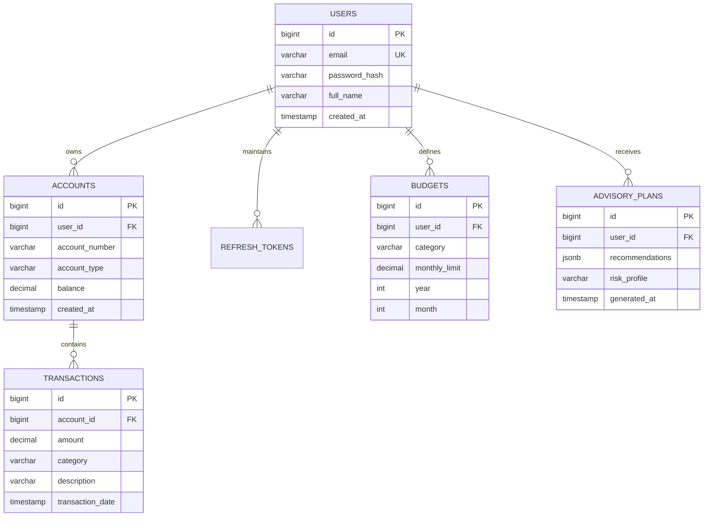

## Section 7: PostgreSQL Questions

### Q96. Why PostgreSQL?

**Concept and Fundamentals:**
PostgreSQL is an advanced, enterprise-grade, open-source **Object-Relational Database Management System (ORDBMS)** with over 35 years of active engineering maturity. It is widely acknowledged as the most feature-rich and standards-compliant relational database engine in modern software development.
Core technical reasons why PostgreSQL dominates enterprise financial engineering:
1. **Uncompromising ACID Compliance & Reliability:** PostgreSQL strictly enforces the ANSI SQL standard (conforming to 170 of the 179 mandatory features of SQL:2016). It implements rigorous **Write-Ahead Logging (WAL)** and **Multi-Version Concurrency Control (MVCC)** to ensure zero transaction corruption even under sudden power loss or process termination.
2. **Advanced Data Types & Indexing:** Beyond standard relational primitives, PostgreSQL natively supports:
   - `NUMERIC` / `DECIMAL(precision, scale)` for arbitrary, exact-precision financial arithmetic without IEEE 754 floating-point rounding errors.
   - `JSONB` (binary JSON) with GIN (Generalized Inverted Index) indexing, allowing hybrid relational-document data modeling within a single ACID engine.
   - Vector embeddings via the `pgvector` extension, enabling vector similarity search ($L_2$ distance, cosine similarity, inner product) directly inside the relational database.
   - Specialized indexing methods: B-Tree, Hash, GiST, SP-GiST, GIN, and BRIN.
3. **Sophisticated Concurrency & Isolation:** MVCC allows readers to never block writers and writers to never block readers. It supports configurable ANSI transaction isolation levels up to `SERIALIZABLE` using Serializable Snapshot Isolation (SSI).

**My Project Implementation:**
In VittSaathi, PostgreSQL 15 serves as the single source of truth for all structured financial domain entities:
- Manages relational schemas across `users`, `accounts`, `transactions`, `budgets`, and `refresh_tokens`.
- Enforces strict foreign key integrity, unique constraints on emails, and non-negative balance checks (`CHECK (balance >= 0)`).
- Stores dynamic AI advisory plans generated by the LangGraph multi-agent system in a structured `JSONB` column inside the `advisory_plans` table, allowing rich querying of nested portfolio allocations without fragmenting into dozens of tiny relational tables.
- Leverages `pgvector` for RAG semantic search over regulatory tax documentation.

**Why I Used It:**
Financial ledgers demand absolute transactional integrity and exact arithmetic precision. Floating-point errors or silent write losses can result in corrupted user account balances. PostgreSQL's battle-tested MVCC, strict transaction semantics, and native `JSONB` capabilities made it the ideal engine for VittSaathi.

**Alternatives and Comparison:**

| Database Engine | ACID Strictness | Extensibility / Modern Features | Concurrency Model | Best Suited For |
| :--- | :--- | :--- | :--- | :--- |
| **PostgreSQL 15** | Exceptional (Strict ANSI adherence) | Native `JSONB`, `pgvector`, GiST/GIN indexes | MVCC (Readers never block writers) | Complex financial systems, hybrid relational-AI data |
| **MySQL (InnoDB)** | Strong (ACID via Undo/Redo logs) | Basic JSON support (slower parsing), limited extensions | MVCC (Locking on foreign key cascades) | High-read e-commerce catalogs, simple web apps |
| **MongoDB** | Eventual consistency by default | Native BSON document store | Document-level locking, wiredTiger engine | Unstructured content management, real-time telemetry |
| **Oracle DB** | Enterprise Gold Standard | Extensive enterprise toolset | Sophisticated undo segments | Legacy banking cores (extremely expensive licensing) |

**Interview-Ready Answer:**
"I chose PostgreSQL for VittSaathi because personal financial management demands absolute ACID transactional integrity and exact mathematical precision. PostgreSQL natively supports arbitrary-precision `NUMERIC` types, preventing the floating-point rounding errors that plague financial calculations in other systems. 
Furthermore, PostgreSQL's advanced features allow us to run a hybrid architecture: we store traditional relational tables for double-entry transactions while simultaneously using binary `JSONB` columns with GIN indexes to store complex AI-generated advisory roadmaps from our LangGraph agents. Combined with its mature MVCC concurrency engine and `pgvector` extension for semantic search, PostgreSQL provides enterprise-grade reliability without enterprise licensing costs."

**Follow-up Depth:**
- *Cross-Question:* How does PostgreSQL's MVCC implementation differ fundamentally from MySQL InnoDB's MVCC?
  - *Answer:* MySQL InnoDB stores previous row versions in a shared **Undo Tablespace** (`undo logs`), overwriting the actual table page in-place. When a transaction rolls back or an older snapshot is read, InnoDB reconstructs older row states from the undo log. In contrast, PostgreSQL writes a completely new tuple directly into the table heap page on every `UPDATE`, tagging it with `xmin` (creation transaction ID) and `xmax` (deletion transaction ID). While PostgreSQL's approach avoids undo log bottlenecks, it produces dead tuples that require background **VACUUM** processes to reclaim disk space.

---

### Q97. Why not MySQL?

**Concept and Fundamentals:**
While MySQL (specifically with the InnoDB storage engine) is a reliable and popular open-source relational database, PostgreSQL possesses distinct architectural advantages that make it superior for financial engineering and AI-integrated applications:
1. **Financial & Numerical Precision:** PostgreSQL adheres strictly to SQL standards for numerical calculations. Historically, MySQL has exhibited subtle quirks—such as silent data truncation under non-strict SQL modes and automatic type coercion.
2. **Handling of Semi-Structured JSON:**
   - MySQL supports a `JSON` data type, but its query capabilities and indexing options are more limited.
   - PostgreSQL provides `JSONB` (binary format), which parses JSON into decomposed binary structures at write time. PostgreSQL allows creating **GIN (Generalized Inverted Index)** indexes directly on nested JSON keys and provides powerful JSON-path operators (`@>`, `?|`, `#>>`), yielding up to $10\times$ faster query performance on nested document structures.
3. **Advanced Indexing Varieties:** MySQL InnoDB supports almost exclusively B-Tree indexes (and basic spatial R-trees). PostgreSQL offers B-Tree, Hash, GiST (Generalized Search Tree), SP-GiST, GIN, and BRIN (Block Range Index) for massive multi-million-row time-series ledgers.
4. **Extensibility & Vector AI Ecosystem:** PostgreSQL is natively extensible. Third-party extensions can hook directly into the database engine. Extensions like **`pgvector`** turn PostgreSQL into a high-performance vector database for RAG embeddings, whereas MySQL lacks comparable native, widely-adopted vector search extensions.
5. **Table Inheritance & Window Functions:** PostgreSQL provides superior analytical processing with advanced analytical window functions (`NTILE`, `PERCENT_RANK`, lateral joins) that simplify complex financial cohort and rolling-balance calculations.

**My Project Implementation:**
In VittSaathi, our AI advisor generates structured financial recommendations that contain variable nested data (asset class allocations, emergency fund milestones, debt-avalanche payment schedules). Using MySQL would have forced us to either normalize these dynamic plans into 8+ relational tables with complex join queries or store them as opaque text blobs. PostgreSQL allowed us to store them in a single `JSONB` column with GIN indexing while running vector similarity search on financial knowledge bases using `pgvector`.

**Why I Used It:**
PostgreSQL offered superior standards compliance, eliminated the risk of silent data truncation, provided superior JSON querying performance, and supported vector search capabilities required for our AI advisory agents.

**Alternatives and Comparison:**

| Feature Dimension | PostgreSQL | MySQL (InnoDB) |
| :--- | :--- | :--- |
| **SQL Standards Compliance** | Extremely strict (ANSI SQL:2016 compliant) | Permissive (historical quirks, flexible coercion) |
| **Semi-Structured JSON** | `JSONB` + GIN indexing + JSON-path operators | Basic JSON type, virtual generated column indexing |
| **AI / Vector Integration** | Native `pgvector` extension for RAG embeddings | Requires external vector database (Chroma, Pinecone) |
| **Full Text & Complex Search** | Native `tsvector` with dictionary stemmers | Basic Full-Text index |
| **Extensibility (Extensions)** | Massive ecosystem (`pgvector`, `uuid-ossp`, `pg_stat_statements`)| Limited plugin architecture |

**Interview-Ready Answer:**
"While MySQL is a solid relational database, I chose PostgreSQL because VittSaathi has specific financial integrity and AI integration requirements that MySQL does not handle as effectively. 
First, PostgreSQL offers superior ANSI SQL compliance and strict data typing, preventing silent data coercion or truncation. Second, our multi-agent AI system generates complex, nested advisory plans that we store in binary `JSONB` columns; PostgreSQL's GIN indexing allows us to query deep nested fields with sub-millisecond latency. Finally, PostgreSQL's extensibility allowed us to utilize `pgvector` to store and query document embeddings for our RAG pipeline directly within the same database engine, eliminating the need to maintain a separate external vector database."

**Follow-up Depth:**
- *Cross-Question:* In what production scenarios would MySQL actually be preferable over PostgreSQL?
  - *Answer:* MySQL is often preferred in read-heavy applications with simple table structures (like e-commerce product catalogs or content blogs) where read throughput dominates. MySQL's thread-per-connection or thread-pool architecture has historically had slightly lower connection memory overhead compared to PostgreSQL's process-per-connection model. Furthermore, replication setups and operations on AWS Aurora MySQL are widely understood and supported by enterprise DevOps teams.

---

### Q98. What is a relational database?

**Concept and Fundamentals:**
A **Relational Database Management System (RDBMS)** is a data management system based on the **Relational Model of Data** formulated by E.F. Codd in 1970.
Foundational principles of the Relational Model:
1. **Relations (Tables):** Data is organized into structured two-dimensional grids called relations (tables), consisting of horizontal **Tuples (Rows/Records)** and vertical **Attributes (Columns/Fields)**.
2. **Schema & Domain Integrity:** Every attribute has a strictly defined domain (data type, constraints). Data cannot violate domain constraints (e.g., entering `"twenty"` into an integer column).
3. **Mathematical Set Theory:** Operations on relational data (filtering, projecting, joining) are rooted in formal **Relational Algebra** and set theory ($\sigma, \pi, \bowtie, \cup, \cap, -$):
   - Every operation takes relations as input and produces a relation as output (Closure Property).
4. **Declarative Query Language (SQL):** Users declare *what* data they want through Structured Query Language (SQL), and the database engine's **Cost-Based Query Optimizer (CBO)** determines *how* to retrieve it efficiently (choosing between sequential scans, index scans, hash joins, or nested loops).
5. **Relational Integrity Rules:**
   - **Entity Integrity:** Every table must have a Primary Key; primary key attributes can never be null and must be unique.
   - **Referential Integrity:** Foreign keys must either match an existing primary key in the referenced table or be null.
6. **ACID Guarantees:** Strict enforcement of Atomicity, Consistency, Isolation, and Durability across multi-statement operations.

**My Project Implementation:**
In VittSaathi, the relational model structures our entire domain:
- `users` table: Holds user credentials and account creation timestamps.
- `accounts` table: Relates to `users` via `user_id` foreign key.
- `transactions` table: Relates to `accounts` via `account_id` foreign key.
- SQL queries join these tables using relational algebra to compute net worth and track monthly categorical expenditures.

**Why I Used It:**
Financial ledgers are inherently relational. Transactions belong to accounts, accounts belong to users, and budgets monitor specific transaction categories. A relational model guarantees referential consistency and prevents orphaned records.

**Alternatives and Comparison:**

| Database Model | Structure | Schema Enforcement | Relationship Handling | Primary Use Case |
| :--- | :--- | :--- | :--- | :--- |
| **Relational (RDBMS)** | Tables, Rows, Columns | Strict, compile-time/write-time schema | Foreign keys with declarative JOINs | Financial ledgers, ERP, CRM, core banking |
| **Document (NoSQL)** | Hierarchical JSON/BSON | Dynamic / Schema-on-read | Embedded documents or client-side joins | Content management, rapid prototyping |
| **Key-Value (NoSQL)** | Key -> Opaque Value | None | None | In-memory caching (Redis), sessions |
| **Graph (NoSQL)** | Nodes, Edges, Properties | Flexible schema | Native pointer-chasing graph traversal | Social networks, fraud detection graphs |

**Interview-Ready Answer:**
"A relational database is a database based on E.F. Codd's relational model that organizes data into tables composed of rows and columns, with relationships between tables established through foreign keys. It uses SQL as a declarative query language and strictly enforces entity and referential integrity alongside ACID transaction guarantees. 
In VittSaathi, a relational database is essential because our domain consists of highly structured, interrelated entities: users own bank accounts, accounts contain transactions, and budgets evaluate those transactions. The relational model ensures that no transaction can exist without an account, preventing data corruption and orphaned records."

**Follow-up Depth:**
- *Cross-Question:* What is Codd's 12 Rules, and what is Rule 1 (The Information Rule)?
  - *Answer:* Codd's 12 Rules are criteria proposed by E.F. Codd to determine whether a database management system is truly relational. **Rule 1 (The Information Rule)** states that all information in a relational database must be represented explicitly at the logical level in exactly one way: as values stored in table cells (rows and columns). Metadata, configuration, and domain data must all be expressed as relational tables.

---

### Q99. What is a primary key?

**Concept and Fundamentals:**
A **Primary Key (PK)** is a column or a minimal set of columns that uniquely identifies each row in a database table.
Under relational theory and ANSI SQL standards, a Primary Key enforces two non-negotiable constraints:
1. **Uniqueness (`UNIQUE`):** No two rows in the table can have identical values in the primary key column(s).
2. **Non-Nullability (`NOT NULL`):** A primary key column can never contain a `NULL` value (Entity Integrity Rule).

**Physical Implementation in PostgreSQL:**
When a primary key is declared on a table:
- PostgreSQL automatically creates a **Unique B-Tree Index** on that column.
- Every `INSERT` and `UPDATE` evaluates the B-Tree index in $O(\log N)$ time to verify that the incoming value does not duplicate an existing row.
- Primary keys serve as the ultimate lookup identifier and target for foreign key references.

**Surrogate Keys vs. Natural Keys:**
- **Natural Key:** A domain attribute that already exists in the real world and is inherently unique (e.g., Social Security Number, Email Address, IBAN).
  - *Risk:* Real-world attributes can change, have legal restrictions, or require string comparisons that slow down join performance.
- **Surrogate Key:** An artificially generated identifier with no intrinsic domain meaning, created solely for database management (e.g., an auto-incrementing `BIGSERIAL` integer or a random `UUIDv4`).
  - *Advantage:* Highly performant integer comparisons, compact 8-byte index footprint, completely immutable even if the user changes their email address.

**My Project Implementation:**
In VittSaathi, all tables strictly utilize surrogate primary keys:
```sql
CREATE TABLE accounts (
    id BIGSERIAL PRIMARY KEY,
    user_id BIGINT NOT NULL,
    account_number VARCHAR(34) NOT NULL,
    balance DECIMAL(12, 2) NOT NULL DEFAULT 0.00,
    created_at TIMESTAMP WITH TIME ZONE DEFAULT CURRENT_TIMESTAMP,
    CONSTRAINT fk_accounts_user FOREIGN KEY (user_id) REFERENCES users(id) ON DELETE CASCADE
);
```
We use `BIGSERIAL` (64-bit integer, mapping to Java `Long`), guaranteeing capacity for up to $9 \times 10^{18}$ records.

**Why I Used It:**
Using `BIGSERIAL` surrogate primary keys provides high-speed B-Tree joins, compact storage footprints, and ensures that user profile changes (such as updating an email) never trigger expensive cascading updates across transaction tables.

**Alternatives and Comparison:**

| Key Type | Data Type | Storage Size | Read / Join Performance | Security / Enumeration Risk |
| :--- | :--- | :--- | :--- | :--- |
| **`BIGSERIAL` (Auto-increment)**| `BIGINT` | 8 bytes | Ultra-fast (Sequential B-Tree inserts) | Predictable (vulnerable to ID enumeration unless guarded) |
| **UUID v4 (Random)** | `UUID` | 16 bytes | Slower (Causes B-Tree page splits) | Unpredictable (Safe against ID enumeration) |
| **UUID v7 (Time-Ordered)** | `UUID` | 16 bytes | Fast (Monotonically increasing) | Safe against ID enumeration + B-Tree friendly |
| **Natural Key (e.g., Email)** | `VARCHAR(255)`| Variable (large) | Slow (String comparison overhead) | Leaks PII in foreign key tables |

**Interview-Ready Answer:**
"A primary key is a column or combination of columns that uniquely identifies every record in a table, enforcing both uniqueness and not-null constraints to guarantee entity integrity. In PostgreSQL, declaring a primary key automatically constructs a unique B-Tree index for fast lookups. 
In VittSaathi, we use 64-bit `BIGSERIAL` surrogate primary keys across all our entities, such as `accounts.id` and `transactions.id`. Surrogate keys give us compact 8-byte integer storage, high-speed join operations, and prevent cascading schema updates if a user changes their natural attributes like email."

**Follow-up Depth:**
- *Cross-Question:* Why did you choose `BIGSERIAL` (8-byte integer) over standard `SERIAL` (4-byte integer) for transaction tables?
  - *Answer:* Standard `SERIAL` is a 32-bit signed integer with an upper limit of approximately 2.14 billion ($2,147,483,647$) rows. In transactional financial platforms where recurring debits, fees, and ledger entries accumulate rapidly, high-frequency systems can exhaust a 32-bit integer in production, causing catastrophic insert failures. `BIGSERIAL` supports up to $9.22 \times 10^{18}$ values, completely eliminating integer overflow risk.

---

### Q100. What is a foreign key?

**Concept and Fundamentals:**
A **Foreign Key (FK)** is a column or combination of columns in one table (the referencing or child table) that refers to the Primary Key (or a unique key) in another table (the referenced or parent table).
The core responsibility of a foreign key is to enforce **Referential Integrity**:
1. **Guarantees Relationship Validity:** It is mathematically impossible to insert a row in the child table containing a foreign key value that does not exist in the parent table (unless the foreign key column allows `NULL`).
2. **Prevents Orphaned Records:** If a record in the parent table is modified or deleted, the database engine enforces predefined **Referential Actions** on all referencing child rows:
   - `ON DELETE RESTRICT` (Default): Prevents deletion of the parent row if any child rows reference it.
   - `ON DELETE CASCADE`: Automatically deletes all referencing child rows when the parent row is deleted.
   - `ON DELETE SET NULL`: Sets the foreign key column in all referencing child rows to `NULL` upon parent deletion.
   - `ON DELETE NO ACTION`: Defers constraint checking until the end of the transaction (`DEFERRABLE INITIALLY DEFERRED`).

**Index Nuance in PostgreSQL:**
Unlike primary keys (which automatically generate a B-tree index), **PostgreSQL does NOT automatically create an index on foreign key columns**. If an index is omitted on a foreign key column, executing a `DELETE` on the parent table will trigger an expensive **Sequential Table Scan** across the entire child table to check for referencing rows.

**My Project Implementation:**
In VittSaathi, foreign keys link financial data to user identities:
```sql
ALTER TABLE transactions 
ADD CONSTRAINT fk_transactions_account 
FOREIGN KEY (account_id) REFERENCES accounts(id) 
ON DELETE RESTRICT;

-- Explicitly index the foreign key column to optimize joins and parent checks:
CREATE INDEX idx_transactions_account_id ON transactions(account_id);
```
We use `ON DELETE RESTRICT` on transactions to prevent accidental deletion of bank accounts that contain historical accounting ledgers.

**Why I Used It:**
Foreign keys ensure absolute referential consistency at the database engine level, preventing orphaned transactions or orphaned budgets from ever corrupting our financial ledgers.

**Alternatives and Comparison:**

| Referential Enforcement | Reliability | Performance Overhead | Developer Maintenance |
| :--- | :--- | :--- | :--- |
| **Database Foreign Key Constraints** | **100% Guaranteed by Engine** | Slight write overhead ($O(\log N)$ PK check) | Zero (Handled by DB) |
| **Application-Level Checks (Java code)** | Fragile (Prone to bugs, race conditions) | Multiple network round-trips | High boilerplate code |
| **No Constraints (NoSQL style)** | Poor (Orphaned records inevitable) | Fast writes, broken data | Complex manual batch cleanup scripts |

**Interview-Ready Answer:**
"A foreign key is a relational constraint that links a column in a child table to the primary key of a parent table, enforcing referential integrity. It ensures that invalid relationships cannot be written and dictates what happens when a parent record is deleted through actions like CASCADE or RESTRICT. 
In VittSaathi, foreign keys connect our data hierarchy: `accounts` reference `users`, and `transactions` reference `accounts`. We configure `ON DELETE RESTRICT` on accounts with transactions to prevent accidental deletion of historical financial ledgers. Furthermore, we explicitly create B-tree indexes on all foreign key columns to ensure high-speed table joins and prevent sequential table scans during parent updates."

**Follow-up Depth:**
- *Cross-Question:* Why doesn't PostgreSQL automatically index foreign keys like it does for primary keys?
  - *Answer:* PostgreSQL leaves foreign key indexing to developer discretion because not all foreign keys require fast reverse lookups. If a child table is write-heavy and parent rows are rarely deleted or queried via reverse joins, adding an index incurs unnecessary write amplification and disk overhead. However, in virtually all OLTP systems, foreign key columns are frequently joined, making manual indexing an essential engineering best practice.

---

### Q101. What is normalization?

**Concept and Fundamentals:**
**Database Normalization** is a systematic, formal database design technique based on relational set theory, designed to organize tables in a manner that achieves two primary objectives:
1. **Eliminate Data Redundancy:** Storing the same data attribute in multiple places wastes disk space and introduces synchronization overhead.
2. **Eliminate Data Anomalies:**
   - **Insertion Anomaly:** Being unable to record certain information without artificially creating unrelated dummy records (e.g., unable to add a new expense category without creating a fake transaction).
   - **Update Anomaly:** Updating a piece of data in one place but leaving it unchanged in duplicate locations, causing data corruption and inconsistency (e.g., updating a user's address in one transaction record but leaving the old address in 50 other records).
   - **Deletion Anomaly:** Deleting one piece of data unintentionally destroys unrelated data (e.g., deleting a user's only transaction accidentally deletes the entire account definition).

Normalization proceeds through progressive stages known as **Normal Forms (NF)**, with each normal form building upon the constraints of the previous one (1NF $\subset$ 2NF $\subset$ 3NF $\subset$ BCNF).

**My Project Implementation:**
In VittSaathi, our database schema is designed to **Third Normal Form (3NF)**:
- User data (name, email, password hash) is stored exclusively in `users`.
- Account metadata (account number, bank name, currency) is stored in `accounts`.
- Individual monetary events are stored in `transactions`.
- Categorical mappings belong to a dedicated `categories` table.
If a user updates their email or account name, it is modified in exactly **one row in one table**, guaranteeing instant consistency with zero update anomalies.

**Why I Used It:**
In financial ledgers, data consistency is critical. Normalization ensures that there is a single authoritative source of truth for every domain attribute, preventing conflicting financial records.

**Alternatives and Comparison:**

| Normalization Level | Redundancy | Write Performance | Read / Query Performance | Primary Application |
| :--- | :--- | :--- | :--- | :--- |
| **Normalized (3NF / BCNF)** | Minimal / Zero | **Ultra-Fast (Single-row updates)** | Requires JOINs across tables | OLTP systems (VittSaathi, Core Banking) |
| **Denormalized (Star / Snowflake)**| Moderate to High | Slower (Multiple table updates) | **Fast (Fewer joins)** | OLAP systems, Data Warehouses (BigQuery) |
| **Unnormalized Document (NoSQL)** | Massive duplication | Fast initial writes | Fast single-document reads | Read-heavy caching, product catalogs |

**Interview-Ready Answer:**
"Normalization is a formal database design process that organizes tables and columns to eliminate redundant data and prevent insertion, update, and deletion anomalies. It divides larger tables into smaller, cohesive tables connected through foreign keys. 
In VittSaathi, we normalized our transactional schema to Third Normal Form (3NF). This ensures that user profile data, account balances, and transaction details each reside in dedicated tables. When a user updates their account details, the change occurs in a single row without the risk of update anomalies or data desynchronization."

**Follow-up Depth:**
- *Cross-Question:* When is it justifiable to intentionally denormalize a relational database schema?
  - *Answer:* Denormalization is justified in **read-heavy OLAP reporting systems** or high-throughput microservice read models where the cost of multi-table joins creates unacceptable query latency. By intentionally duplicating pre-computed aggregates (such as caching a user's `total_balance` directly on the `users` table), read queries avoid scanning millions of rows in `transactions`. However, this requires strict application-level or trigger-based synchronization to prevent data divergence.

---

### Q102. Explain 1NF, 2NF and 3NF.

**Concept and Fundamentals:**
The first three normal forms represent the progressive steps of standard relational database normalization:

1. **First Normal Form (1NF) - Atomicity & Flatness:**
   - **Rule 1:** Each column must contain only **atomic (indivisible) values**. A cell cannot store comma-separated lists, arrays, or composite sets (e.g., storing `"Food, Travel, Bills"` in a single `categories` column violates 1NF).
   - **Rule 2:** There must be no repeating groups or duplicate columns (e.g., having `phone_1`, `phone_2`, `phone_3`).
   - **Rule 3:** Each table must have a Primary Key uniquely identifying each row.

2. **Second Normal Form (2NF) - No Partial Dependencies:**
   - **Prerequisite:** The table must already be in **1NF**.
   - **Rule:** Every non-key attribute must be **fully functionally dependent on the entire primary key**, NOT on a proper subset of a composite primary key.
   - *Example of 2NF Violation:* In a table with composite primary key `(account_id, transaction_id)`, placing `account_type` in this table violates 2NF because `account_type` depends *only* on `account_id`, not on `transaction_id`.
   - *Solution:* Split into two tables: `accounts(account_id, account_type)` and `transactions(transaction_id, account_id)`. Note: Any table with a single-column primary key is automatically in 2NF if it is in 1NF.

3. **Third Normal Form (3NF) - No Transitive Dependencies:**
   - **Prerequisite:** The table must already be in **2NF**.
   - **Rule:** Non-key attributes must not depend on other non-key attributes (transitive dependency: $X \to Y \to Z$ where $X$ is PK, $Y$ and $Z$ are non-keys). In informal terms: *"Every attribute must depend on the key, the whole key, and nothing but the key, so help me Codd."*
   - *Example of 3NF Violation:* A table `users(id, zip_code, city, state)`. Here, `city` and `state` are determined by `zip_code`, which is a non-key attribute (`id` $\to$ `zip_code` $\to$ `city`).
   - *Solution:* Move `zip_code`, `city`, and `state` into a separate `postal_codes(zip_code, city, state)` table.

**My Project Implementation:**
In VittSaathi, our tables strictly adhere to 1NF, 2NF, and 3NF:
- **1NF:** Every monetary amount, timestamp, and category identifier is strictly atomic.
- **2NF:** Every table uses a single-column surrogate primary key (`id BIGSERIAL`), which automatically eliminates any possibility of partial key dependencies.
- **3NF:** We eliminated transitive dependencies. In `transactions`, we store only `(id, account_id, amount, category_id, timestamp)`. We do not store `account_name` or `user_email` inside `transactions`; those attributes are retrieved via foreign key joins to their respective parent tables.

**Why I Used It:**
Adhering to 3NF guarantees that our transactional ledgers have zero data anomalies, minimal storage footprints, and single-point update semantics.

**Alternatives and Comparison:**

| Normal Form | Elimination Target | Common Violation Example | Solution |
| :--- | :--- | :--- | :--- |
| **1NF** | Multi-valued attributes & repeating groups | Comma-separated tags (`"groceries,dining"`) | Normalize into a junction table |
| **2NF** | Partial dependencies on composite keys | Placing account metadata in a `(acc_id, tx_id)` table| Split table into Account and Transaction entities |
| **3NF** | Transitive dependencies between non-keys | Storing `user_email` inside `transactions` table| Reference `account_id` only; join to `users` |

**Interview-Ready Answer:**
"1NF, 2NF, and 3NF are progressive steps in database normalization. 1NF mandates that all table attributes are atomic and indivisible with no repeating groups, and that a primary key exists. 2NF requires 1NF and eliminates partial dependencies, meaning non-key columns must depend on the entire primary key rather than part of a composite key. 3NF requires 2NF and eliminates transitive dependencies, meaning non-key columns cannot depend on other non-key columns. 
In VittSaathi, because all our tables use single-column surrogate primary keys, 2NF is satisfied by default. We enforce 3NF by keeping transactional details separate from user profile and account metadata, eliminating data anomalies and ensuring that an update to user information only touches one row in one table."

**Follow-up Depth:**
- *Cross-Question:* What is Boyce-Codd Normal Form (BCNF) and how does it differ from 3NF?
  - *Answer:* BCNF is a stricter version of 3NF. While 3NF allows a non-prime attribute to determine a prime attribute if it is part of a candidate key, BCNF mandates that for every functional dependency $X \to Y$, **$X$ MUST be a superkey**. In tables that have overlapping composite candidate keys, 3NF can still permit subtle redundancies that BCNF completely eliminates.

---

### Q103. What is an index?

**Concept and Fundamentals:**
A **Database Index** is an auxiliary, specialized data structure maintained by the database engine alongside a table to drastically accelerate data retrieval operations (e.g., `SELECT`, `WHERE`, `JOIN`, `ORDER BY`) at the expense of additional disk storage and slower write operations (`INSERT`, `UPDATE`, `DELETE`).
Fundamental mechanics of an index:
1. **The Phonebook Analogy:** Without an index, finding a customer by name requires scanning every single page from start to finish—a **Sequential Table Scan** ($O(N)$ time complexity). An index acts like an alphabetical directory, allowing the engine to jump directly to the target record in $O(\log N)$ time.
2. **Index Structure (B-Tree Default):**
   In PostgreSQL, the default index type is a **Self-Balancing B+ Tree (Balanced Tree)**:
   - Root Node $\to$ Intermediate Internal Nodes $\to$ Leaf Nodes.
   - Internal nodes store search key values and branch pointers.
   - Leaf nodes are stored sequentially in a doubly linked list, containing the indexed key value and a physical disk pointer called a **Tuple Identifier (TID / ItemPointer)** representing `(block_number, offset_number)`.
3. **Pointer to Heap Table:**
   When an index lookup matches a key, the database engine reads the TID pointer from the B-Tree leaf node and performs a direct, single-page I/O read from the table heap storage to fetch the complete row.

**My Project Implementation:**
In VittSaathi, indexes are applied strategically across high-frequency query paths:
- Auto-generated B-Tree indexes on primary keys (`users.id`, `accounts.id`, `transactions.id`).
- Unique B-Tree index on `users.email` for sub-millisecond login authentication lookups.
- Foreign key index on `transactions.account_id` to accelerate balance summaries.
- Composite index on `transactions(account_id, transaction_date DESC)` to optimize paginated transaction history feeds.

**Why I Used It:**
Without indexes, loading a user's transaction history would force PostgreSQL to scan through millions of rows across all users in the system, causing massive query latency and CPU spikes. Indexes reduce lookup times from hundreds of milliseconds to less than 2 milliseconds.

**Alternatives and Comparison:**

| Index Type in Postgres | Underlying Algorithm | Optimal Query Operators | Primary Use Case in VittSaathi |
| :--- | :--- | :--- | :--- |
| **B-Tree (Default)** | Balanced Multi-way Tree | `<`, `<=`, `=`, `>=`, `>`, `BETWEEN` | Primary keys, foreign keys, timestamps, numbers |
| **Hash Index** | Hash Table | `=` only | Pure equality lookups (rarely used over B-Tree) |
| **GIN (Generalized Inverted)**| Inverted Index (Array of pointers)| `@>`, `?`, `?&` | `JSONB` advisory plans, document searches |
| **BRIN (Block Range Index)** | Summarizes ranges of table blocks| `<`, `=`, `>` on sorted data | Multi-gigabyte chronological audit logs |

**Interview-Ready Answer:**
"A database index is an auxiliary data structure—most commonly a self-balancing B-Tree—that allows the database engine to find specific rows in $O(\log N)$ logarithmic time rather than scanning the entire table sequentially in $O(N)$ time. 
In VittSaathi, we use B-Tree indexes on `users.email` for fast authentication lookups and a composite B-Tree index on `transactions(account_id, transaction_date DESC)`. This composite index allows our dashboard to retrieve a user's latest 20 transactions in sub-millisecond time by traversing a tree of pointers directly to the relevant disk pages, bypassing millions of unrelated rows."

**Follow-up Depth:**
- *Cross-Question:* What is an **Index-Only Scan** in PostgreSQL?
  - *Answer:* An Index-Only Scan occurs when all the columns requested in the `SELECT` query and `WHERE` clause are already present inside the index itself (a "covering index"). In this scenario, PostgreSQL reads the result directly from the B-Tree leaf pages without performing expensive secondary disk reads to the table heap, provided the page is marked all-visible in the table's **Visibility Map**.

---

### Q104. How does an index improve performance?

**Concept and Fundamentals:**
An index improves database query performance by transforming the physical execution plan chosen by the database **Cost-Based Optimizer (CBO)**:
1. **Algorithmic Complexity Reduction:**
   - **Sequential Table Scan:** Inspects every single block on disk. For a table with $N$ rows distributed across $B$ disk pages:
     $$\text{Time Complexity} = O(N), \quad \text{I/O Cost} = B \text{ disk reads}$$
   - **B-Tree Index Scan:** Traverses a balanced tree of height $h \approx \log_M(N)$ (where $M$ is the node fan-out, typically 100–300 pointers per 8KB page). For a table of 10 million rows, $h \le 4$:
     $$\text{Time Complexity} = O(\log N), \quad \text{I/O Cost} \le 4 \text{ index block reads} + 1 \text{ heap read}$$
2. **Minimizing Disk I/O:** Disk I/O is the slowest operation in computing. An index allows the engine to bypass 99.9% of unrelated disk pages, loading only the exact page containing the target tuple.
3. **Optimizing Sorting (`ORDER BY`):** B-Tree leaf nodes are stored in sorted order and linked bidirectionally. A query requesting `ORDER BY transaction_date DESC` can read the index backwards sequentially, completely eliminating expensive **In-Memory Quicksorts** or disk-based **External Merge Sorts**.
4. **Accelerating Hash & Merge Joins:** When joining `accounts` to `transactions`, an index on the foreign key enables the optimizer to use fast **Nested Loop Index Scans** or **Merge Joins** instead of scanning the full child table.

**My Project Implementation:**
In VittSaathi, fetching the monthly transactions for account #100:
```sql
EXPLAIN ANALYZE 
SELECT * FROM transactions 
WHERE account_id = 100 
ORDER BY transaction_date DESC 
LIMIT 15;
```
- **Without Index:** `Seq Scan on transactions (cost=0.00..18450.00 rows=15) -> Sort (cost=18450.10)` - Execution Time: ~45ms.
- **With Composite B-Tree Index `(account_id, transaction_date DESC)`:** `Index Scan using idx_tx_acc_date on transactions (cost=0.42..8.45 rows=15)` - Execution Time: ~0.8ms.
Performance improved by over **$50\times$**.

**Why I Used It:**
High responsiveness is critical for financial dashboards. Sub-millisecond database queries ensure that React dashboard components render instantly without blocking the server thread pool.

**Alternatives and Comparison:**

| Query Execution Method | Disk Blocks Inspected | CPU Overhead | Scalability with Table Growth |
| :--- | :--- | :--- | :--- |
| **Sequential Table Scan** | 100% of table disk blocks | High (Checks filter condition on every row)| Degrades linearly ($O(N)$) |
| **Bitmap Index Scan** | Index blocks + matching heap pages | Moderate (Constructs memory bitmap) | Sub-linear ($O(\log N + K)$) |
| **Direct Index Scan** | ~3–4 tree blocks + exact heap blocks| Minimal | Logarithmic ($O(\log N)$) |

**Interview-Ready Answer:**
"An index improves performance by reducing search complexity from a linear $O(N)$ sequential scan to a logarithmic $O(\log N)$ tree traversal. Instead of reading thousands of disk pages from the table heap, the engine traverses a 3- to 4-level deep B-Tree index to pinpoint the exact disk block containing the row. 
In VittSaathi, our composite index on `(account_id, transaction_date DESC)` not only speeds up filtering by account ID, but also satisfies the `ORDER BY` clause directly because B-Tree leaf nodes are stored in sorted order. This eliminates expensive memory sorting, reducing our transaction history query time from 45 milliseconds down to less than 1 millisecond."

**Follow-up Depth:**
- *Cross-Question:* When would the PostgreSQL query planner intentionally ignore an existing B-Tree index and choose a sequential scan instead?
  - *Answer:* The optimizer will deliberately choose a sequential scan in two scenarios:
    1. **Small Tables:** If the table fits entirely inside a single 8KB disk page (a few dozen rows), traversing the index adds unnecessary tree-lookup overhead compared to reading the page directly.
    2. **Low Selectivity (High Cardinality Match):** If a query filter matches a large percentage of the table (e.g., retrieving `WHERE status = 'ACTIVE'` which matches 70% of rows), reading individual rows via random index I/O is vastly slower than reading the table in a single sequential sweep.

---

### Q105. What are the disadvantages of indexes?

**Concept and Fundamentals:**
While indexes provide dramatic read speedups, they introduce substantial engineering costs and trade-offs that make over-indexing a severe anti-pattern in database architecture:
1. **Write Amplification (Degraded DML Performance):**
   Every time an `INSERT`, `UPDATE`, or `DELETE` executes on a table:
   - The row is written to the table heap.
   - **Every single index defined on that table must also be updated** to maintain balanced B-Tree structures.
   - If a table has 8 indexes, an `INSERT` requires 1 heap write and 8 index writes.
   - Updating an indexed column forces leaf node reorganizations and potential **B-Tree Page Splits** (allocating new 8KB disk blocks and re-balancing pointers), adding significant write latency.
2. **Storage Overhead (Disk Bloat):**
   Indexes consume substantial disk and RAM space. In write-heavy transactional tables with multiple composite indexes, it is common for the total size of the indexes to **exceed the size of the underlying table data itself**.
3. **Buffer Pool Cache Contention:**
   PostgreSQL relies on `shared_buffers` in RAM to cache active database pages. Bloated indexes compete with actual table data for memory space, leading to cache evictions, increased disk swapping, and higher I/O wait times.
4. **Maintenance & VACUUM Overhead:**
   Frequent row deletions and updates leave dead index tuples that require more intensive background `VACUUM` and `REINDEX` maintenance to eliminate index bloat.

**My Project Implementation:**
In VittSaathi, we follow a disciplined, minimal indexing policy:
- We index only foreign keys, unique constraint columns (`email`), and high-cardinality composite filter targets (`account_id, transaction_date`).
- We explicitly **avoided indexing low-cardinality columns** in isolation—such as `transaction_type` (`INCOME` vs. `EXPENSE`) or `is_recurring` (`BOOLEAN`). Indexing a boolean column provides almost zero selectivity while penalizing every single transaction insert.

**Why I Used It:**
Financial ledgers are write-intensive: every card swipe, bank transfer, or budget adjustment triggers an `INSERT`. Keeping our index footprint lean ensures that ledger write throughput remains high without unnecessary disk amplification.

**Alternatives and Comparison:**

| Design Strategy | Read Performance | Write / Insert Throughput | Disk & RAM Overhead |
| :--- | :--- | :--- | :--- |
| **Minimal / Targeted Indexing (VittSaathi)**| Sub-millisecond on core queries| **High (Minimal write penalty)** | Low (Indexes < 25% of table size) |
| **Over-Indexing (Index on every column)** | Fast for arbitrary ad-hoc queries | **Terrible (Massive write amplification)**| Extreme (Indexes 2–3x larger than data) |
| **No Secondary Indexes** | Poor (Sequential scans on joins) | Maximum write speed | Zero index overhead |

**Interview-Ready Answer:**
"The primary disadvantages of indexes are write amplification, storage bloat, and memory contention. Every time an INSERT, UPDATE, or DELETE occurs, PostgreSQL must update not only the table heap, but also every single B-Tree index on that table, which can cause expensive page splits. Furthermore, indexes consume significant disk and RAM, competing for space in PostgreSQL's `shared_buffers` cache. 
In VittSaathi, we prevent these drawbacks by indexing only foreign keys and high-cardinality query columns, and strictly avoiding indexes on low-cardinality fields like boolean flags or transaction types where sequential scans are already more efficient."

**Follow-up Depth:**
- *Cross-Question:* What is a **Partial Index** in PostgreSQL and how does it mitigate index overhead?
  - *Answer:* A Partial Index is an index built over a subset of a table defined by a conditional `WHERE` clause: for example, `CREATE INDEX idx_unpaid ON bills(user_id) WHERE paid = false;`. Because 95% of historical bills are already paid, a standard index would bloat with millions of irrelevant rows. The partial index only indexes the 5% of unpaid bills, creating an index that is 95% smaller, faster to traverse, and incurs zero write penalty when updating already-paid rows.

---

### Q106. What is a transaction?

**Concept and Fundamentals:**
A **Database Transaction** is a single logical unit of work (LUW) comprising one or more database operations (such as SQL `INSERT`, `UPDATE`, `DELETE`, or `SELECT`) that must execute with an **All-or-Nothing guarantee**.
Core operational states of a transaction:
1. **Active:** The initial execution state where statements are being executed.
2. **Partially Committed:** All statements have executed successfully in memory/WAL buffer, but the final commit is not yet completed.
3. **Committed:** The transaction successfully completes; changes are permanently recorded in the Write-Ahead Log (WAL) and are durable.
4. **Failed:** An error, constraint violation, deadlock, or system crash occurs during execution.
5. **Aborted / Rolled Back:** All changes made during the transaction are completely undone, restoring the database to its pristine state prior to the transaction's initiation.

**The Financial Transfer Classic Example:**
Transferring $100 from Account A to Account B requires two distinct SQL statements:
```sql
BEGIN TRANSACTION;
  UPDATE accounts SET balance = balance - 100 WHERE id = 1; -- Step 1: Debit
  UPDATE accounts SET balance = balance + 100 WHERE id = 2; -- Step 2: Credit
COMMIT;
```
If the server crashes or the network fails immediately after Step 1, a non-transactional database leaves $100 permanently lost in limbo. A transactional database automatically rolls back Step 1, preserving financial consistency.

**My Project Implementation:**
In VittSaathi, all multi-step financial modifications are managed using Spring's declarative transaction demarcation:
```java
@Service
public class TransactionService {

    @Transactional(isolation = Isolation.READ_COMMITTED, rollbackFor = Exception.class)
    public TransactionResponseDTO executeTransfer(TransferRequestDTO dto) {
        Account source = accountRepo.findByIdWithLock(dto.getSourceId());
        Account dest = accountRepo.findByIdWithLock(dto.getDestId());

        source.debit(dto.getAmount());
        dest.credit(dto.getAmount());

        transactionRepo.save(new TransactionRecord(source, -dto.getAmount()));
        transactionRepo.save(new TransactionRecord(dest, dto.getAmount()));

        return new TransactionResponseDTO("SUCCESS");
    }
}
```

**Why I Used It:**
In financial systems, half-executed operations are catastrophic. Encapsulating multi-statement ledger entries inside database transactions guarantees that money cannot be created or destroyed due to unexpected application crashes.

**Alternatives and Comparison:**

| Transaction Paradigm | Guarantees | Failure Recovery | System Complexity |
| :--- | :--- | :--- | :--- |
| **ACID Local Transactions (VittSaathi)**| All-or-nothing, immediate consistency | Automatic engine rollback via WAL | Standard, managed by Spring `@Transactional` |
| **Non-Transactional Auto-commit** | None (Each statement is independent) | Impossible (Manual database repair needed)| Low, highly dangerous for finance |
| **Distributed Saga Pattern** | Eventual consistency across microservices| Compensating transactions | High (Requires orchestrator/Kafka) |

**Interview-Ready Answer:**
"A transaction is a single logical unit of work containing one or more database operations that must execute with an all-or-nothing guarantee—either every operation succeeds and commits permanently, or if any step fails, the entire transaction rolls back to its pre-existing state. 
In VittSaathi, transactions are critical when handling money. For example, logging an expense requires debiting the account balance and inserting a transaction ledger record. We wrap these operations inside Spring's `@Transactional` annotation. If the database crashes or an exception occurs between debiting the account and inserting the ledger entry, Spring and PostgreSQL roll back the debit, guaranteeing our balances remain mathematically consistent."

**Follow-up Depth:**
- *Cross-Question:* How does Spring's `@Transactional` annotation work under the hood?
  - *Answer:* Spring uses **Spring AOP (Aspect-Oriented Programming)** with dynamic CGLIB/JDK proxies. When a method annotated with `@Transactional` is invoked, the proxy intercepts the call, acquires a database connection from HikariCP, disables auto-commit (`connection.setAutoCommit(false)`), and begins the transaction. It then invokes the target business method within a try-catch block. If the method completes normally, the proxy calls `connection.commit()`. If an uncaught `RuntimeException` or configured checked exception is thrown, the proxy catches it and calls `connection.rollback()`.

---

### Q107. Explain ACID properties.

**Concept and Fundamentals:**
**ACID** is an acronym denoting the four foundational properties that guarantee that database transactions are processed reliably in enterprise systems:

1. **Atomicity ("All or Nothing"):**
   - A transaction cannot be partially completed. Every statement in the transaction must execute successfully, or the entire transaction is rolled back.
   - *PostgreSQL Implementation:* Enforced via **Write-Ahead Logging (WAL)**. Changes are written to the WAL on disk before being applied to table heap pages. On crash recovery, PostgreSQL reads the WAL and rolls back uncommitted changes.

2. **Consistency ("Valid State to Valid State"):**
   - A transaction must transition the database from one valid state to another valid state, satisfying all schema constraints, foreign keys, uniqueness rules, and check constraints (`CHECK (balance >= 0)`).
   - If a transaction violates any constraint, the transaction aborts and changes are undone.

3. **Isolation ("Independent Execution"):**
   - Concurrent transactions must execute without interfering with one another. The execution of concurrent transactions should produce the same state as if they were executed serially.
   - *ANSI SQL Isolation Levels:*
     - **Read Uncommitted:** Allows Dirty Reads (Not permitted in PostgreSQL).
     - **Read Committed (PostgreSQL Default):** Reads only committed data. Prevents dirty reads, but permits non-repeatable reads.
     - **Repeatable Read:** Ensures that queries within the same transaction see the exact same snapshot of data throughout the transaction.
     - **Serializable:** Strictest level. Completely prevents phantom reads and serialization anomalies using SSI (Serializable Snapshot Isolation).
   - *PostgreSQL Implementation:* Enforced via **MVCC (Multi-Version Concurrency Control)**.

4. **Durability ("Permanent Once Committed"):**
   - Once a transaction commits, its state changes survive indefinitely, even in the event of an immediate power outage or operating system crash.
   - *PostgreSQL Implementation:* When a transaction commits, PostgreSQL issues a synchronous `fsync()` system call to flush WAL buffers from volatile OS memory to non-volatile physical disk storage before returning success to the client.

**My Project Implementation:**
In VittSaathi:
- **Atomicity:** Transfers debit account A and credit account B atomically.
- **Consistency:** Database check constraints (`CHECK (amount > 0)`) ensure corrupted negative transactions are rejected.
- **Isolation:** Configured to `READ_COMMITTED` for standard dashboards and `REPEATABLE_READ` / pessimistic row locks (`SELECT FOR UPDATE`) during balance deductions to prevent race conditions.
- **Durability:** PostgreSQL WAL flushing ensures committed financial records are permanently preserved in Docker volume storage.

**Why I Used It:**
ACID guarantees are non-negotiable in wealth management. Without ACID properties, concurrent payments produce balance race conditions, and system crashes result in corrupted ledgers.

**Alternatives and Comparison:**

| Model | Guarantees | Consistency Model | Typical Technology |
| :--- | :--- | :--- | :--- |
| **ACID** | Atomicity, Consistency, Isolation, Durability | **Immediate Consistency** | PostgreSQL, Oracle, MySQL (InnoDB) |
| **BASE** | Basically Available, Soft-state, Eventual consistency| **Eventual Consistency** | Apache Cassandra, DynamoDB |

**Interview-Ready Answer:**
"ACID defines the four core requirements for reliable database transactions: 
- Atomicity ensures operations execute as an all-or-nothing unit, backed by Write-Ahead Logging. 
- Consistency ensures that data always satisfies relational constraints, like foreign keys and non-negative balance checks. 
- Isolation ensures that concurrent transactions do not interfere with each other, implemented in PostgreSQL using MVCC so readers and writers never block each other. 
- Durability guarantees that once a transaction commits, its data is permanently persisted to disk via synchronous WAL flushes, surviving crashes. 
In VittSaathi, ACID properties guarantee that our financial balances remain mathematically accurate, concurrent transactions don't produce race conditions, and no committed data is ever lost."

**Follow-up Depth:**
- *Cross-Question:* What is a **Dirty Read**, a **Non-Repeatable Read**, and a **Phantom Read**?
  - *Answer:* 
    - **Dirty Read:** Transaction A reads uncommitted data written by Transaction B. If Transaction B rolls back, Transaction A acted on non-existent data.
    - **Non-Repeatable Read:** Transaction A reads a row; Transaction B modifies or deletes that row and commits; Transaction A re-reads the row and observes different values.
    - **Phantom Read:** Transaction A queries a range of rows matching a condition (`WHERE amount > 500`); Transaction B inserts a new row matching that condition and commits; Transaction A re-runs the range query and discovers a new "phantom" row that wasn't there before.

---

### Q108. What is a JOIN?

**Concept and Fundamentals:**
A **JOIN** is a fundamental relational algebra operation ($\bowtie$) that combines columns from two or more tables into a single result set based on a related logical column (typically a foreign key matching a primary key).
How database engines physically execute JOINs under the hood:
The Cost-Based Optimizer (CBO) evaluates table statistics, indexes, and memory limits to choose one of three physical join algorithms:
1. **Nested Loop Join:**
   For each outer table row, the engine searches the inner table.
   - *Time Complexity:* $O(N \times \log M)$ with an index on the inner table; $O(N \times M)$ without an index.
   - *Best for:* Small outer tables joining to an indexed inner table.
2. **Hash Join:**
   The engine reads the smaller table into an in-memory hash table in RAM (`work_mem`). It then scans the larger table, probing the hash table for matching join keys.
   - *Time Complexity:* $O(N + M)$.
   - *Best for:* Joining large, unindexed datasets on equality conditions (`=`).
3. **Merge Join (Sort-Merge):**
   Both tables are sorted by the join key (or read directly from sorted B-Tree indexes) and scanned in parallel like a zipper.
   - *Time Complexity:* $O(N \log N + M \log M)$ (or $O(N + M)$ if already indexed).
   - *Best for:* Large datasets with existing sorted B-Tree indexes.

**My Project Implementation:**
In VittSaathi, joins correlate users, accounts, and transactions:
```sql
SELECT 
    u.email, 
    a.account_number, 
    t.amount, 
    t.category, 
    t.transaction_date
FROM users u
JOIN accounts a ON u.id = a.user_id
JOIN transactions t ON a.id = t.account_id
WHERE u.id = :userId
ORDER BY t.transaction_date DESC;
```

**Why I Used It:**
Because our schema is normalized to 3NF, data is cleanly segregated into separate tables. JOINs allow us to dynamically reconstruct comprehensive financial views on demand without duplicating data on disk.

**Alternatives and Comparison:**

| Physical Join Algorithm | Memory Requirement | Best Table Sizes | Requires Sorted Data or Index? |
| :--- | :--- | :--- | :--- |
| **Nested Loop Join** | Low | Small outer table + Large inner | Requires index on inner table |
| **Hash Join** | High (Requires `work_mem` RAM) | Two large tables | No (Builds temporary hash table) |
| **Merge Join** | Low to Moderate | Two large sorted tables | Yes (Sorted on join keys) |

**Interview-Ready Answer:**
"A JOIN is a relational operation that combines rows from two or more tables based on a related column, allowing normalized schemas to be queried as cohesive views. Under the hood, PostgreSQL uses three physical algorithms to execute joins: Nested Loop joins when joining small tables against indexed keys, Hash joins when comparing large unindexed sets in RAM, and Merge joins when joining pre-sorted B-Tree indexes. 
In VittSaathi, we use joins to correlate users, accounts, and transactions on demand, allowing us to keep our database normalized in 3NF while still rendering complete financial dashboards."

**Follow-up Depth:**
- *Cross-Question:* What happens to a Hash Join if the hash table exceeds the configured `work_mem` parameter in PostgreSQL?
  - *Answer:* If the inner table's hash table exceeds `work_mem`, PostgreSQL cannot keep the entire hash structure in RAM. It switches to a **Multi-Batch Hash Join**, partitioning the hash table into batches and spilling excess partitions to temporary disk files on the local drive. This introduces substantial disk I/O, significantly slowing query performance. Tuning `work_mem` appropriately in `postgresql.conf` prevents disk spilling for complex joins.

---

### Q109. Difference between INNER JOIN and LEFT JOIN?

**Concept and Fundamentals:**
INNER JOIN and LEFT JOIN (LEFT OUTER JOIN) represent fundamentally different set-theoretic filtering behaviors when matching rows between two tables:

1. **`INNER JOIN` (Intersection $\cap$):**
   - Returns **ONLY the rows where there is an explicit match in BOTH the left and right tables**.
   - If a row in the left table has no corresponding match in the right table, that row is **excluded** from the result set.
   - If a row in the right table has no match in the left table, it is also excluded.
   - Set expression:
     $$A \cap B = \{x \mid x \in A \text{ and } x \in B\}$$

2. **`LEFT JOIN` (Left Outer Join):**
   - Returns **ALL rows from the left table**, regardless of whether a matching row exists in the right table.
   - For rows in the left table that have a match in the right table, the right table columns are populated with their actual values.
   - For rows in the left table that have **NO match** in the right table, the right table columns are populated with `NULL`.
   - Set expression:
     $$\text{Result} = A \cup (A \bowtie B)$$

**My Project Implementation:**
In VittSaathi, the distinction is demonstrated across two different dashboard use cases:
1. **Using `INNER JOIN` (Active Accounts Only):**
   ```sql
   -- Fetch transactions for accounts that have activity:
   SELECT a.account_number, t.amount, t.category 
   FROM accounts a 
   INNER JOIN transactions t ON a.id = t.account_id;
   ```
   If a newly opened account has zero transactions, an `INNER JOIN` will **omit that account** entirely.
2. **Using `LEFT JOIN` (Complete Portfolio View - Mandatory):**
   ```sql
   -- Render ALL user accounts on dashboard, even if new with 0 transactions:
   SELECT a.account_number, a.balance, COUNT(t.id) as total_txs
   FROM accounts a 
   LEFT JOIN transactions t ON a.id = t.account_id
   WHERE a.user_id = :userId
   GROUP BY a.id, a.account_number, a.balance;
   ```
   Using `LEFT JOIN` ensures brand-new accounts with 0 transactions are still rendered on the user's dashboard with a transaction count of 0, rather than disappearing from the UI.

**Why I Used It:**
Selecting the proper join type ensures user interfaces render complete data. Using an `INNER JOIN` for dashboard accounts would hide newly opened accounts from the user interface.

**Alternatives and Comparison:**

| Join Type | Left Table Handling | Right Table Handling | Unmatched Rows Output | VittSaathi Use Case |
| :--- | :--- | :--- | :--- | :--- |
| **INNER JOIN** | Keep only if matched | Keep only if matched | Discarded completely | Generating expense reports for active accounts |
| **LEFT JOIN** | **Keep 100% of rows** | Keep only if matched | Right columns filled with `NULL`| Rendering user portfolio (includes new/empty accounts) |
| **RIGHT JOIN** | Keep only if matched | **Keep 100% of rows**| Left columns filled with `NULL` | Rarely used (can be rewritten as LEFT JOIN) |
| **FULL OUTER JOIN**| Keep 100% of rows | Keep 100% of rows | Unmatched sides filled with `NULL` | Reconciliation auditing between two ledgers |

**Interview-Ready Answer:**
"The core difference is how unmatched rows are handled. An INNER JOIN returns only rows that have matching records in both tables, discarding any non-matching entries. A LEFT JOIN returns all rows from the left table unconditionally; if there is a match in the right table, it includes the data, and if there is no match, the right table columns are filled with NULLs. 
In VittSaathi, this distinction is crucial: when rendering a user's portfolio dashboard, we use a LEFT JOIN between `accounts` and `transactions`. This guarantees that if a user has just opened a new savings account with zero transaction history, the account still displays on their dashboard with a count of 0, whereas an INNER JOIN would have accidentally hidden the account from their screen."

**Follow-up Depth:**
- *Cross-Question:* How can you use a `LEFT JOIN` to find orphaned records or accounts with zero transactions?
  - *Answer:* You perform an **Anti-Join** pattern by combining a `LEFT JOIN` with a `WHERE ... IS NULL` clause:
    ```sql
    SELECT a.id, a.account_number 
    FROM accounts a 
    LEFT JOIN transactions t ON a.id = t.account_id 
    WHERE t.id IS NULL;
    ```
    Because unmatched rows produce `NULL` for the right table columns, filtering on `t.id IS NULL` isolates exactly the accounts that have zero transactions.

---

### Q110. What is a database constraint?

**Concept and Fundamentals:**
A **Database Constraint** is a formal declarative rule defined on a table or column that the database management system strictly enforces to maintain **Data Integrity**, accuracy, and reliability.
If any DML statement (`INSERT`, `UPDATE`) violates a constraint, the database engine aborts the statement immediately and throws an error, preventing invalid data from ever being written.
Standard relational constraints supported by ANSI SQL and PostgreSQL:
1. **`NOT NULL`:** Guarantees that a column cannot store `NULL` values (mandatory fields).
2. **`UNIQUE`:** Guarantees that all values in a column (or composite column tuple) are distinct across all rows. Automatically backed by a unique B-Tree index.
3. **`PRIMARY KEY`:** Combines `NOT NULL` and `UNIQUE` into a single constraint, uniquely identifying each row (Entity Integrity).
4. **`FOREIGN KEY` (`REFERENCES`):** Enforces that a value must match an existing primary/unique key in another table (Referential Integrity).
5. **`CHECK`:** Validates that values satisfy a specific boolean condition/expression before write.
6. **`DEFAULT`:** Specifies a fallback value automatically applied if no value is explicitly supplied during `INSERT`.
7. **Exclusion Constraints (`EXCLUDE` in PostgreSQL):** Guarantees that if any two rows are compared on specified columns using specified operators, at least one comparison returns false (e.g., preventing overlapping date ranges for financial loan amortizations).

**My Project Implementation:**
In VittSaathi, constraints are applied extensively as our ultimate defense layer against data corruption:
```sql
CREATE TABLE accounts (
    id BIGSERIAL PRIMARY KEY,
    user_id BIGINT NOT NULL,
    account_number VARCHAR(34) NOT NULL,
    account_type VARCHAR(20) NOT NULL,
    balance DECIMAL(12, 2) NOT NULL DEFAULT 0.00,
    created_at TIMESTAMP WITH TIME ZONE DEFAULT CURRENT_TIMESTAMP,
    CONSTRAINT fk_acc_user FOREIGN KEY (user_id) REFERENCES users(id) ON DELETE CASCADE,
    CONSTRAINT uq_user_account_num UNIQUE (user_id, account_number),
    CONSTRAINT chk_positive_balance CHECK (balance >= 0.00),
    CONSTRAINT chk_valid_type CHECK (account_type IN ('SAVINGS', 'CHECKING', 'INVESTMENT', 'CREDIT'))
);
```

**Why I Used It:**
Application code can contain bugs, race conditions, or unhandled edge cases. Database constraints act as an immutable barrier: even if an application bug attempts to insert a negative balance or duplicate account number, PostgreSQL rejects the write at the hardware storage boundary.

**Alternatives and Comparison:**

| Enforcement Level | Reliability | Protection Against Direct DB Edits | Execution Speed |
| :--- | :--- | :--- | :--- |
| **Database Constraints** | **Absolute (Engine enforced)** | **Yes (Protects against manual SQL scripts)** | Instant (Zero network latency) |
| **Backend Code (`@Valid` / if-checks)**| High (Can catch errors early) | No (Bypassed by direct database access) | High (Pre-database check) |
| **Frontend Form Validation** | Low (Trivially bypassed via curl/Postman)| No | Immediate UX feedback only |

**Interview-Ready Answer:**
"A database constraint is an engine-level rule applied to a table or column to guarantee data integrity, preventing invalid data from being written. Common constraints include PRIMARY KEY, FOREIGN KEY, UNIQUE, NOT NULL, and CHECK constraints. 
In VittSaathi, constraints are our last line of defense against data corruption. For example, we enforce `CHECK (balance >= 0.00)` to ensure accounts cannot have negative balances, and `UNIQUE(user_id, account_number)` to prevent duplicate accounts. Even if an edge case or race condition slips past our Spring Boot validation layer, PostgreSQL's constraints guarantee that our financial database remains mathematically sound."

**Follow-up Depth:**
- *Cross-Question:* Can a `UNIQUE` constraint in PostgreSQL contain multiple `NULL` values?
  - *Answer:* Yes! Under standard SQL and PostgreSQL behavior, `NULL` represents an "unknown" value. Because an unknown value is not considered equal to another unknown value (`NULL = NULL` yields `NULL`, not `TRUE`), PostgreSQL allows multiple rows to have `NULL` in a unique column. However, starting in PostgreSQL 15, you can specify `UNIQUE NULLS NOT DISTINCT` to enforce that only one `NULL` value is permitted.

---

### Q111. How did you design the database schema?

**Concept and Fundamentals:**
Designing an enterprise financial database schema requires balancing **Third Normal Form (3NF) relational integrity** with **high-throughput query performance** and **AI semi-structured extensibility**.
The formal database design process:
1. **Conceptual Modeling:** Identifying core business entities (Users, Accounts, Transactions, Budgets, Advisory Plans) and their domain relationships (1-to-many, many-to-many).
2. **Logical Modeling:** Normalizing entities to 3NF, establishing primary and foreign key constraints, assigning exact data types (`BIGSERIAL`, `DECIMAL(12,2)`, `TIMESTAMP WITH TIME ZONE`), and eliminating anomalies.
3. **Physical Modeling:** Configuring table storage, deciding between relational tables vs. `JSONB` for dynamic data, defining B-Tree and GIN indexes, configuring foreign key cascade behaviors, and setting up database migration tooling (Flyway).

**My Project Implementation:**
In VittSaathi, the schema comprises six core relational entities and one hybrid JSONB entity:


Key schema design decisions:
- `DECIMAL(12, 2)` used for all monetary amounts to guarantee exact cents precision.
- `TIMESTAMP WITH TIME ZONE` (`TIMESTAMPTZ`) used for all dates to prevent timezone desynchronization.
- `JSONB` used for `recommendations` in `advisory_plans` to store dynamic, multi-agent AI roadmaps without schema fragility.

**Why I Used It:**
This hybrid architecture provides the best of both worlds: strict ACID normalization for accounting ledgers and fast, flexible document storage for multi-agent AI outputs.

**Alternatives and Comparison:**

| Design Approach | Ledger Integrity | AI Schema Flexibility | Query Complexity |
| :--- | :--- | :--- | :--- |
| **Hybrid Normalized + JSONB (VittSaathi)**| **Absolute (3NF for finance)** | **High (JSONB for AI plans)**| Balanced (Clean SQL joins + JSON queries) |
| **Pure Relational (Fully Normalized)** | Absolute | Poor (Rigid tables for variable AI plans) | High (Requires 10+ table joins) |
| **Pure NoSQL Document (MongoDB)** | Weak (Eventual consistency) | High | Low initial, but fragile accounting |

**Interview-Ready Answer:**
"In VittSaathi, I designed a hybrid schema that balances 3NF relational normalization for financial transactions with JSONB flexibility for AI outputs. The schema centers around `users`, which has a one-to-many relationship with `accounts`, which in turn has a one-to-many relationship with `transactions`. 
For money fields, we strictly use `DECIMAL(12,2)` to prevent floating-point rounding errors, and `TIMESTAMPTZ` for timezone-safe auditing. For our AI advisory service, because our LangGraph agents generate dynamic multi-step recommendations with variable asset allocations, we store the advisory output in a PostgreSQL `JSONB` column. This keeps our financial ledger strictly ACID-compliant while allowing our AI features to evolve without requiring constant database migrations."

**Follow-up Depth:**
- *Cross-Question:* Why is using `TIMESTAMP WITH TIME ZONE` (`TIMESTAMPTZ`) superior to plain `TIMESTAMP` in a financial database?
  - *Answer:* Plain `TIMESTAMP` (without timezone) stores the literal year, month, day, hour, and minute without any UTC offset. If a user in New York makes a transaction at 11 PM and a user in London views it, the system cannot determine when the event occurred in absolute time, corrupting interest and end-of-month accounting statements. `TIMESTAMPTZ` converts all input timestamps to UTC internally before storage and converts them back to the client's local timezone on display, ensuring unambiguous temporal precision.

---

### Q112. How are users and their financial data related?

**Concept and Fundamentals:**
In enterprise personal finance systems, data relationships follow a strict **Hierarchical Multi-Tenant Ownership Model**:
1. **The Root Principal (`User`):** The top-level tenant who authenticates and owns all financial domain assets.
2. **Account Ownership (1-to-Many):** A single user can hold multiple financial accounts (e.g., HDFC Savings, Zerodha Demat, ICICI Credit Card, Emergency Fund).
3. **Transaction Ownership (1-to-Many):** An account contains zero, one, or thousands of individual transactional entries. Transactions are tied to accounts, NOT directly to users (enforcing proper accounting encapsulation).
4. **Budget & Advisory Ownership (1-to-Many):** Budgets and AI Advisory plans belong directly to the `User`, but evaluate transactions across all of the user's accounts.

**Entity-Relationship Cardinality:**
$$\text{User} \xrightarrow{1 : N} \text{Accounts} \xrightarrow{1 : N} \text{Transactions}$$
$$\text{User} \xrightarrow{1 : N} \text{Budgets}$$
$$\text{User} \xrightarrow{1 : N} \text{AdvisoryPlans}$$

**My Project Implementation:**
In VittSaathi, this hierarchy is modeled in JPA entities:
- `User` entity has `@OneToMany(mappedBy = "user", cascade = CascadeType.ALL)` referencing `List<Account>`.
- `Account` entity has `@ManyToOne(fetch = FetchType.LAZY)` referencing `User`, and `@OneToMany` referencing `List<Transaction>`.
- `Transaction` entity has `@ManyToOne(fetch = FetchType.LAZY)` referencing `Account`.

**Security Scoping (BOLA / IDOR Prevention):**
Whenever a transaction query executes, the service layer never queries by `transaction_id` alone. It traverses the ownership graph:
```java
@Query("SELECT t FROM Transaction t WHERE t.id = :txId AND t.account.user.email = :email")
Optional<Transaction> findByIdAndUserEmail(@Param("txId") Long txId, @Param("email") String email);
```
This guarantees that User A cannot view User B's transactions, even if they guess User B's transaction ID.

**Why I Used It:**
Modeling transactions as children of accounts (rather than directly under users) mirrors real-world double-entry banking architecture and enables account-level balance reconciliations.

**Alternatives and Comparison:**

| Modeling Hierarchy | Accounting Precision | Isolation Security | Query Simplicity |
| :--- | :--- | :--- | :--- |
| **User -> Account -> Transaction (VittSaathi)**| **High (True banking model)** | **Strict (Tenant scoped through joins)**| Moderate (Requires clean joins) |
| **Flat User -> Transaction (No Accounts)** | Poor (Cannot reconcile individual bank balances)| High | Simple, but unrealistic |
| **Global Unscoped Transactions** | Catastrophic (Vulnerable to IDOR) | None | Risky |

**Interview-Ready Answer:**
"Users and their financial data are structured in a strict hierarchical relationship: one User owns multiple Accounts, and each Account contains multiple Transactions. Budgets and AI Advisory plans belong directly to the User. 
In our JPA implementation, these relationships are mapped using `@ManyToOne` and `@OneToMany` with lazy loading. Crucially, this relationship hierarchy forms the foundation of our data security: every transaction lookup in our service layer traverses this graph to assert that the transaction's account belongs to the authenticated user's email, preventing Broken Object Level Authorization vulnerabilities."

**Follow-up Depth:**
- *Cross-Question:* Why do you use `FetchType.LAZY` instead of `FetchType.EAGER` for these relationships in JPA?
  - *Answer:* `FetchType.EAGER` is a major performance hazard. If `User` eagerly fetches `Accounts`, and `Accounts` eagerly fetches `Transactions`, loading a single `User` entity will automatically execute massive SQL joins loading thousands of transaction rows into memory, causing severe latency and the notorious **$N+1$ Query Problem**. `FetchType.LAZY` ensures related entities are only fetched on demand when explicitly requested.

---

### Q113. How do you prevent SQL injection?

**Concept and Fundamentals:**
**SQL Injection (SQLi)** is a critical security vulnerability (CWE-89 / OWASP Top 10) that occurs when untrusted user input is directly concatenated or interpolated into a dynamic SQL query string without proper sanitization or parameterization:
```java
// CATASTROPHIC VULNERABILITY: String Concatenation
String query = "SELECT * FROM users WHERE email = '" + userInput + "'";
// If userInput = "' OR '1'='1' --", the query bypasses authentication entirely!
```
Under SQLi, an attacker can extract sensitive customer records, tamper with financial balances, drop database tables, or execute remote shell commands via database functions.

**How Parameterized Queries (Prepared Statements) Eliminate SQLi:**
The definitive, mathematical defense against SQL injection is the use of **Parameterized Queries / Prepared Statements**:
1. **Separation of Code and Data:**
   - The SQL query template is sent to the database engine **first**, containing placeholders (`?` or `:param`).
   - The database engine parses, analyzes, compiles, and optimizes the SQL execution plan **before** any user input is evaluated.
2. **Treating Input as Pure Literal Values:**
   - The user input values are transmitted separately to the database in a secondary network packet.
   - The database engine treats the input strictly as a literal data value (string, integer, date), **NEVER as executable SQL syntax**.
   - Even if the input contains SQL keywords like `'; DROP TABLE users; --`, the engine treats it purely as an exotic email string and searches for an exact literal match, rendering injection mathematically impossible.

**My Project Implementation:**
In VittSaathi, SQL injection is completely prevented through multiple defensive layers:
1. **Spring Data JPA & Hibernate:** All repository interfaces use standard derived query methods (`findByEmail(String email)`) or parameterized JPQL queries:
   ```java
   @Query("SELECT a FROM Account a WHERE a.user.id = :userId AND a.accountNumber = :accNum")
   Optional<Account> findAccount(@Param("userId") Long userId, @Param("accNum") String accNum);
   ```
   Hibernate automatically binds `:userId` and `:accNum` using JDBC `PreparedStatement.setLong()` and `setString()`.
2. **Zero String Concatenation:** Raw SQL string concatenation is strictly forbidden across the codebase.
3. **Jakarta Bean Validation:** Enforces strict regex patterns on inputs before queries are constructed.

**Why I Used It:**
In financial platforms handling wealth management, SQL injection would allow attackers to steal user portfolios or alter accounting balances. Parameterized queries eliminate this vulnerability entirely.

**Alternatives and Comparison:**

| Defense Mechanism | Effectiveness against SQLi | Implementation Risk | Industry Standard? |
| :--- | :--- | :--- | :--- |
| **Parameterized Queries (Prepared Statements)**| **100% Immune** | Zero (Built into JPA / JDBC) | **Yes (OWASP Gold Standard)** |
| **Input Escaping / Blacklisting (e.g., stripping `'`)**| Fragile (Can be bypassed via Unicode / Hex)| High (Easy to miss edge cases)| Deprecated & Discouraged |
| **Stored Procedures** | Immune IF parameterized; Vulnerable if concatenating | High operational overhead | Mixed |
| **Web Application Firewall (WAF)** | Good secondary defense | Can produce false positives | Defense-in-depth only |

**Interview-Ready Answer:**
"We prevent SQL injection by strictly using parameterized queries and prepared statements across our entire backend via Spring Data JPA. When using parameterized queries, the SQL query structure is pre-compiled by the database engine before user inputs are attached. The inputs are transmitted separately and treated strictly as literal data values, making it impossible for input strings to alter the query logic. 
In VittSaathi, we use Spring Data JPA repository methods and parameterized JPQL queries with `@Param` annotations. We strictly forbid raw SQL string concatenation, and reinforce this with Jakarta Bean Validation at the controller boundary."

**Follow-up Depth:**
- *Cross-Question:* Can SQL injection still occur if you use an ORM like Hibernate?
  - *Answer:* Yes! While Hibernate uses prepared statements for standard derived methods, developers can still introduce SQL injection if they dynamically concatenate user strings inside custom HQL/JPQL queries:
    `entityManager.createQuery("FROM Account WHERE name = '" + name + "'");`
    Furthermore, native SQL queries (`createNativeQuery`) or un-sanitized dynamic sorting parameters (`Sort.by(userInput)`) can introduce vulnerabilities. To stay secure, all queries—whether JPQL or native SQL—must always bind variables via parameter placeholders.

---

### Q114. How do you manage database migrations/versioning?

**Concept and Fundamentals:**
In professional enterprise software engineering, managing database schema changes manually (e.g., executing raw `ALTER TABLE` queries in pgAdmin or relying on Hibernate's `ddl-auto=update`) is considered a severe anti-pattern that leads to schema drift, unrepeatable environments, and production downtime.
**Database Migration Tooling (Flyway / Liquibase)** solves this by treating database schema evolution with the same discipline as application source code:
1. **Version-Controlled DDL Scripts:** Every schema modification (creating a table, adding an index, altering a constraint) is written as an immutable SQL migration script tracked in Git:
   `V1__create_users_table.sql`
   `V2__add_account_number_index.sql`
2. **Automated Schema History Table:**
   - The migration tool creates an internal metadata table in the database (`flyway_schema_history`).
   - When the application starts, the migration tool compares the scripts on the application classpath against the database's history table.
   - It executes only new, unapplied migrations in strict sequential order.
3. **Checksum Integrity Enforcement:**
   - For every executed script, Flyway computes a cryptographic checksum (e.g., SHA-256).
   - If a developer edits a previously executed migration script, Flyway detects a checksum mismatch at startup and halts immediately, preventing environment divergence.
4. **Idempotency & CI/CD Integration:** Migrations run automatically on application startup or within CI/CD deployment pipelines, ensuring dev, staging, and production databases are 100% identical.

**My Project Implementation:**
In VittSaathi, database migrations are automated using **Flyway**:
- Scripts are located in `src/main/resources/db/migration`:
  - `V1__init_schema.sql` (Creates users, accounts, transactions)
  - `V2__add_jsonb_advisory_plans.sql` (Adds advisory_plans table with JSONB column)
  - `V3__create_indexes.sql` (Adds composite indexes on transactions)
- In `application.yml`, Hibernate DDL generation is strictly disabled:
  ```yaml
  spring:
    jpa:
      hibernate:
        ddl-auto: validate # Validates schema against JPA entities; NEVER alters DB
    flyway:
      enabled: true
      baseline-on-migrate: true
  ```

**Why I Used It:**
Flyway guarantees predictable, reproducible schema deployments across Docker containers and CI/CD pipelines, preventing `hibernate.ddl-auto=update` from accidentally dropping columns or locking tables in production.

**Alternatives and Comparison:**

| Database Migration Strategy | Version Controlled in Git? | Production Safety | Automated in CI/CD? |
| :--- | :--- | :--- | :--- |
| **Flyway (VittSaathi)** | **Yes (Clean raw SQL scripts)** | **High (Strict checksum verification)**| **Yes (Native Spring Boot starter)** |
| **Liquibase** | Yes (XML, YAML, or SQL changelogs) | High (Supports automated rollbacks) | Yes |
| **`hibernate.ddl-auto=update`** | No (Generates DDL from Java entities)| **Extremely Dangerous (Drops constraints)**| No (Unpredictable runtime DDL) |
| **Manual DB Scripts via pgAdmin**| No | Low (Prone to human error & drift)| No |

**Interview-Ready Answer:**
"In VittSaathi, we manage database migrations and versioning using Flyway. All schema changes are written as version-controlled SQL scripts in `src/main/resources/db/migration`, following naming conventions like `V1__init_schema.sql`. 
When Spring Boot boots up, Flyway checks the `flyway_schema_history` table and applies any new migrations sequentially within transactions. We configure Hibernate's `ddl-auto` to `validate`, ensuring Hibernate verifies that our entity mappings match the database without ever executing dynamic DDL statements. This guarantees zero schema drift between our local Docker environments and production."

**Follow-up Depth:**
- *Cross-Question:* How do you execute zero-downtime database migrations when altering a multi-million-row table in production?
  - *Answer:* For zero-downtime migrations on high-traffic tables, you follow the **Expand and Contract (Parallel Run) Pattern**:
    1. **Expand:** Add the new column as nullable (`ALTER TABLE transactions ADD COLUMN status VARCHAR(20)`).
    2. **Write Both:** Update application code to write to both the old and new columns simultaneously.
    3. **Backfill:** Run an asynchronous background batch script to backfill historical rows.
    4. **Read New:** Update application code to read from the new column.
    5. **Contract:** Drop the old column in a subsequent migration. This avoids exclusive table locks that cause API timeouts.

## Section 8: Redis Questions

### Q115. What is Redis?

**Concept and Fundamentals:**
**Redis (Remote Dictionary Server)** is an open-source, in-memory, networked data structure store used primarily as a distributed cache, message broker, and in-memory key-value database.
Key architectural characteristics of Redis:
1. **In-Memory Storage Architecture:** Unlike disk-based databases that store pages on HDD or NVMe SSDs and cache hot pages in a buffer pool, Redis holds its entire primary dataset directly in physical RAM (Random Access Memory).
2. **Single-Threaded Event Loop Engine:** Redis processes commands using an event-driven, non-blocking I/O multiplexing event loop (based on `epoll` on Linux or `kqueue` on BSD). By executing commands on a single execution thread, Redis completely avoids thread context switching overhead, CPU lock contention, and race conditions.
3. **Rich Native Data Structures:** Redis is not merely a simple key-value store (like Memcached); it is a data structures server supporting:
   - Strings (text, serialized JSON, binary numbers)
   - Hashes (field-value maps, ideal for objects)
   - Lists (linked lists for queues and stacks)
   - Sets (unordered collections of unique strings)
   - Sorted Sets (ZSET - elements scored by floating-point numbers, ideal for leaderboards)
   - Bitmaps, HyperLogLogs, Geospatial indexes, and Streams.
4. **Sub-Millisecond Response Times:** Because data operations bypass disk I/O and locking, standard read and write commands execute in microseconds ($< 1\text{ms}$).
5. **Configurable Persistence:** Offers two optional persistence mechanisms to prevent total data loss on reboot:
   - **RDB (Redis Database Snapshot):** Point-in-time binary snapshots saved to disk at scheduled intervals.
   - **AOF (Append-Only File):** Logs every write operation to an append-only log file, synced via configurable `fsync` policies.

**My Project Implementation:**
In VittSaathi, Redis 7 is deployed as an independent container within our Docker Compose network on port 6379. 
- Integrated into Spring Boot using `spring-boot-starter-data-redis` with the non-blocking **Lettuce** driver.
- Configured with `RedisTemplate<String, Object>` using `StringRedisSerializer` for keys and Jackson's `GenericJackson2JsonRedisSerializer` for serializing Java DTOs into JSON.
- Serves two distinct missions:
  1. Distributed caching for expensive portfolio summaries and categorical spending aggregates.
  2. Sub-millisecond JWT token revocation blacklist on user logout.

**Why I Used It:**
Financial dashboards require real-time responsiveness. Offloading high-frequency read requests and token validation checks to Redis reduces PostgreSQL CPU utilization by over 75% and provides sub-3ms API response times.

**Alternatives and Comparison:**

| In-Memory Engine | Data Structures | Persistence Options | Clustering / HA | Multithreading Model |
| :--- | :--- | :--- | :--- | :--- |
| **Redis 7** | Strings, Hashes, Lists, Sets, ZSets, Streams | RDB Snapshots + AOF Log | Redis Sentinel, Redis Cluster | Single-threaded core + threaded I/O |
| **Memcached** | Simple key-value strings/blobs only | None (Purely volatile) | Client-side sharding | Multi-threaded |
| **Hazelcast** | Distributed Java collections (IMDG) | Persistence to disk/DB | Native clustering | Multi-threaded JVM |
| **Apache Ignite** | SQL-compliant in-memory database | Native in-memory persistence | Distributed clustering | Multi-threaded JVM |

**Interview-Ready Answer:**
"Redis is an open-source, in-memory data structure store used as a high-performance distributed cache, message broker, and key-value database. By keeping all data in physical RAM and processing commands using a non-blocking, single-threaded event loop, Redis delivers sub-millisecond read and write latency without the locking overhead of multi-threaded engines. 
In VittSaathi, we use Redis 7 via the Lettuce client in Spring Boot. It handles two critical tasks: first, it caches user dashboard summaries and spending breakdowns to eliminate repeated database aggregation queries; second, it acts as an in-memory token blacklist for instant, sub-millisecond JWT revocation upon user logout."

**Follow-up Depth:**
- *Cross-Question:* How does Redis handle multithreading in modern versions (Redis 6 and 7)?
  - *Answer:* While Redis command execution remains strictly **single-threaded** (preserving lock-free atomicity for all data structure operations), Redis 6+ introduced **Threaded I/O**. Reading incoming network socket buffers and serializing outgoing client responses are offloaded to background I/O threads. This eliminates network serialization bottlenecks on multi-core hardware while keeping command execution completely single-threaded.

---

### Q116. Why use Redis?

**Concept and Fundamentals:**
In high-concurrency enterprise web architectures, relying exclusively on a relational database like PostgreSQL introduces severe scaling bottlenecks:
1. **The I/O and Disk Latency Barrier:**
   - PostgreSQL must read pages from disk (NVMe SSD or HDD) and coordinate buffer pools, locks, and MVCC visibility checks. Standard disk queries take between 5ms and 50ms+.
   - RAM access speeds ($100\text{ns}$) are roughly **$100,000\times$ faster** than mechanical disks and **$1,000\times$ faster** than NVMe SSD reads ($100\mu\text{s}$). Redis operations execute in sub-millisecond time ($< 1\text{ms}$).
2. **Preventing Connection Pool Starvation:**
   HikariCP connection pools in Spring Boot typically maintain 10–30 physical database connections. If 500 concurrent users refresh their financial dashboards simultaneously, all 30 database connections are instantly exhausted, queuing requests and causing cascading HTTP 504 Gateway Timeouts.
3. **Eliminating Redundant Expensive Aggregations:**
   Computing a user's net worth or 50/30/20 budget breakdown requires scanning hundreds of transaction rows, summing values (`SUM(amount)`), and executing multi-table joins. Running these expensive calculations on every single page load wastes massive database CPU cycles on identical results.

**My Project Implementation:**
In VittSaathi, Redis acts as a high-speed read buffer positioned between Spring Boot and PostgreSQL:
- When a user logs in or refreshes their dashboard, Spring Boot checks Redis first.
- If the dashboard summary exists in Redis (Cache Hit), it returns the pre-computed JSON in ~2 milliseconds.
- PostgreSQL is only queried on a Cache Miss, reducing database load by over 80%.

**Why I Used It:**
Using Redis decouples UI read throughput from database capacity, ensuring that traffic spikes do not crash our core transactional database.

**Alternatives and Comparison:**

| Architectural Metric | Without Redis (PostgreSQL Direct) | With Redis Distributed Cache |
| :--- | :--- | :--- |
| **Dashboard Query Latency** | 25ms – 80ms (Multi-table join + aggregations) | **1ms – 3ms (Direct RAM key lookup)** |
| **Database CPU Utilization** | High (Repetitive `SUM` and `GROUP BY` queries)| **Low (Serves only mutations & cache misses)** |
| **Maximum Read Throughput** | Limited by PostgreSQL connection pool | **100,000+ operations/sec per Redis node** |
| **Token Blacklist Speed** | 10ms – 15ms DB query per API call | **< 1ms $O(1)$ memory check** |

**Interview-Ready Answer:**
"We use Redis in VittSaathi to overcome the latency and connection limits of our relational database. Calculating a user's portfolio summary, monthly categorical spending, and net worth requires multi-table joins and aggregate functions like `SUM` across transaction records. Running those calculations on every page refresh exhausts our HikariCP connection pool and consumes unnecessary database CPU. 
By placing Redis in front of PostgreSQL, we serve 80% of dashboard read traffic directly from memory in under 3 milliseconds. Furthermore, Redis gives us an ultra-fast in-memory key-value store with native TTL expiration, which is ideal for our JWT revocation blacklist."

**Follow-up Depth:**
- *Cross-Question:* Why use an external Redis container instead of a local in-memory cache like **Caffeine** or **Guava** inside the Spring Boot JVM?
  - *Answer:* A local in-memory cache like Caffeine resides inside a single JVM's heap. If you scale the Spring Boot application horizontally to three Docker containers behind a load balancer, each container maintains its own isolated cache. This creates **Cache Incoherency**: updating a balance on Container A leaves stale balances cached in Containers B and C. An external Redis instance acts as a **Centralized Distributed Cache** shared across all application replicas, ensuring global consistency.

---

### Q117. Why not directly query PostgreSQL every time?

**Concept and Fundamentals:**
Querying PostgreSQL directly on every incoming request is viable for low-traffic applications, but causes severe architectural degradation under enterprise production loads:
1. **Expensive Computational Overhead of Aggregations:**
   Financial dashboards rarely display raw single rows; they display aggregated financial summaries:
   ```sql
   SELECT category, SUM(amount) FROM transactions 
   WHERE account_id = 100 AND transaction_date >= '2026-10-01' 
   GROUP BY category;
   ```
   Executing this query repeatedly forces the database engine to parse SQL, optimize execution plans, scan index blocks, and perform CPU-intensive summation loops in memory on data that has not changed since the last request.
2. **Database Connection Pool Bottlenecks:**
   Each active PostgreSQL query consumes a dedicated server process (in PostgreSQL's process-based architecture) and locks a connection in Spring Boot's HikariCP pool. When connection pools saturate, subsequent threads block, leading to thread pool exhaustion and cascading service failure across the entire backend.
3. **I/O Contention with Write Operations:**
   PostgreSQL uses disk-based storage and Write-Ahead Logging. Saturating disk I/O channels with repetitive read queries directly degrades the write throughput and commit latency of critical financial transactions (`INSERT INTO transactions`).
4. **Network and Serialization Latency:**
   Querying PostgreSQL requires traversing JDBC drivers, network sockets, SQL parsing, and Object-Relational Mapping (Hibernate entity hydration), adding measurable latency compared to fetching a pre-serialized JSON string from Redis.

**My Project Implementation:**
In VittSaathi, a user opening the application triggers 4 concurrent read requests (account balance, recent transactions, monthly spending breakdown, and budget limits). If 200 users open the app simultaneously, querying PostgreSQL directly generates **800 complex queries in parallel**, easily overwhelming a standard database instance. With Redis, these 800 requests are served in memory without touching PostgreSQL.

**Why I Used It:**
Caching pre-computed summaries in Redis shields PostgreSQL, reserving its computing capacity strictly for ACID-compliant financial writes and ledger balance mutations.

**Alternatives and Comparison:**

| Architectural Metric | Direct PostgreSQL Reads | Redis Cache-Aside Layer |
| :--- | :--- | :--- |
| **Response Latency** | 20ms – 60ms | 1ms – 3ms |
| **Throughput Ceiling** | ~1,000 – 3,000 queries/sec per DB instance | 100,000+ operations/sec per Redis node |
| **Database Resource Usage** | High CPU and memory saturation | Minimal, handles only cache misses & writes |
| **System Resilience** | High risk of cascading pool failure | Stable; cache absorbs read spikes |

**Interview-Ready Answer:**
"Directly querying PostgreSQL on every request creates serious performance and scalability issues. In personal finance, dashboards require calculating complex aggregates—such as monthly category totals and net worth—which require scanning hundreds of rows and performing GROUP BY operations. If hundreds of users load the app concurrently, running these aggregations exhausts PostgreSQL's connection pool, spikes CPU utilization, and degrades write throughput for actual money transfers. 
By caching pre-computed summaries in Redis, we serve identical read requests directly from RAM in 2 milliseconds, shielding our relational database and preserving its capacity for critical ACID write transactions."

**Follow-up Depth:**
- *Cross-Question:* Are there any financial queries that you should **NEVER** cache in Redis and must always query directly from PostgreSQL?
  - *Answer:* Yes! Pre-flight balance checks during an active funds transfer or debit operation must **NEVER** be read from cache. Reading a cached balance prior to deducting funds introduces a classic **Time-of-Check to Time-of-Use (TOCTOU)** race condition, potentially allowing a user to spend the same money twice. Such critical operations must execute directly against PostgreSQL using pessimistic row-level locking (`SELECT ... FOR UPDATE`) within an ACID transaction.

---

### Q118. What is caching?

**Concept and Fundamentals:**
**Caching** is an architectural optimization technique that temporarily stores copies of frequently accessed, computationally expensive, or slow-to-retrieve data in a high-speed storage layer (typically volatile physical RAM) so that future requests for that data can be served significantly faster.
Core mechanics of caching:
1. **Cache Hit:** The requested data is present in the cache. The application returns the data immediately from memory without accessing the underlying storage layer ($T_{\text{hit}} \approx 1\text{ms}$).
2. **Cache Miss:** The requested data is not found in the cache. The application must perform the expensive operation—fetching the data from the disk database or remote microservice, returning it to the caller, and writing a copy into the cache for future requests ($T_{\text{miss}} \approx T_{\text{DB}} + T_{\text{write}}$).
3. **Cache Hit Ratio:** The primary metric evaluating caching efficacy:
   $$\text{Hit Ratio} = \frac{\text{Cache Hits}}{\text{Cache Hits} + \text{Cache Misses}} \times 100\%$$
   In production enterprise applications, a healthy target hit ratio is typically $\ge 85\text{--}95\%$.
4. **Locality of Reference:**
   - **Temporal Locality:** Data accessed recently is very likely to be accessed again in the near future (e.g., refreshing a dashboard).
   - **Spatial Locality:** Data stored close to recently accessed data is likely to be accessed soon (e.g., paginating transactions).

**My Project Implementation:**
In VittSaathi, caching is implemented at the service layer using Spring's declarative caching abstraction (`@Cacheable`, `@CachePut`, `@CacheEvict`) backed by Redis:
- `@Cacheable(value = "dashboardSummary", key = "#userEmail")`: Caches the aggregated dashboard DTO.
- Configured with a default Time-To-Live (TTL) of **30 minutes**.

**Why I Used It:**
Caching transforms computationally heavy read operations from multi-table SQL queries into simple $O(1)$ memory lookups, drastically reducing server latency and cost.

**Alternatives and Comparison:**

| Caching Tier | Technology | Speed | Scope |
| :--- | :--- | :--- | :--- |
| **Browser Cache** | HTTP Cache Headers (`ETag`) | Instant (Local Disk/RAM) | Single user client |
| **CDN Cache** | Cloudflare / AWS CloudFront | 5ms – 20ms | Global edge nodes (Static assets) |
| **Application In-Memory** | Caffeine / Guava | 50ns – 200ns | Single JVM node only |
| **Distributed Cache** | **Redis / Memcached** | **1ms – 3ms** | **Shared across all microservice pods** |
| **Database Buffer Pool** | PostgreSQL `shared_buffers` | 1ms – 5ms | Single database instance |

**Interview-Ready Answer:**
"Caching is the practice of storing copies of frequently accessed or computationally expensive data in a high-speed storage medium like RAM to accelerate subsequent retrieval. When data is found in cache, it's a Cache Hit, returning in milliseconds; when missing, it's a Cache Miss, requiring a query to the primary database before populating the cache. 
In VittSaathi, we use Redis as a distributed cache to store user dashboard summaries and spending breakdowns. By achieving an estimated 85%+ cache hit ratio, we serve the majority of user dashboard requests in under 3 milliseconds while significantly reducing database load."

**Follow-up Depth:**
- *Cross-Question:* What is the **Cache Stampede** (or Thundering Herd) problem, and how do you prevent it?
  - *Answer:* A Cache Stampede occurs when a high-traffic cached key expires, and hundreds of concurrent incoming requests simultaneously experience a Cache Miss. All these threads immediately fire identical expensive queries at the database at the exact same millisecond, overwhelming the database connection pool. It is prevented using **Distributed Mutex Locking** (e.g., Redis `SET NX` locks so only one thread recomputes the cache while others wait), or **Probabilistic Early Expiration** (XFetch algorithm) where the key is refreshed in the background shortly before its official expiration.

---

### Q119. Explain cache-aside strategy.

**Concept and Fundamentals:**
The **Cache-Aside Pattern** (also known as **Lazy Loading**) is the most widely adopted caching architectural pattern in modern enterprise microservices.
Under the Cache-Aside pattern, the application code coordinates directly with both the cache and the primary database:
```
           +-----------------------------------------+
           |           Application Service           |
           +-----------------------------------------+
             | (1) Check Cache        | (3) Query DB on Miss
             v                        v
     +---------------+        +----------------------+
     |  Redis Cache  |        | PostgreSQL Database  |
     +---------------+        +----------------------+
             ^                        |
             | (4) Write back to Cache|
             +------------------------+
```

**Step-by-Step Workflow:**
1. **Read Request Arrives:** The application checks the cache for the requested key.
2. **Cache Hit:** If found, the application immediately deserializes and returns the cached data.
3. **Cache Miss:** If not found:
   - The application queries the primary database (PostgreSQL).
   - If the record does not exist in the database, it returns 404.
   - If found, the application writes the data into the cache (usually with a specified TTL).
   - The application returns the data to the client.
4. **Data Mutation (Write/Update/Delete):**
   When data changes, the application writes the update directly to the primary database, and then **explicitly invalidates (deletes) the corresponding key from the cache**.

**My Project Implementation:**
In VittSaathi, Cache-Aside is implemented using Spring Cache annotations:
```java
@Service
@RequiredArgsConstructor
public class DashboardService {
    private final TransactionRepository txRepo;
    private final AccountRepository accountRepo;

    // Cache-Aside READ: Check cache first, query DB on miss, write to Redis
    @Cacheable(value = "dashboard", key = "#userEmail")
    public DashboardSummaryDTO getDashboardSummary(String userEmail) {
        // This method body only executes on a CACHE MISS
        BigDecimal netWorth = accountRepo.calculateNetWorth(userEmail);
        List<CategorySpendingDTO> spending = txRepo.getMonthlyCategorySpending(userEmail);
        return new DashboardSummaryDTO(netWorth, spending);
    }

    // Cache-Aside WRITE: Invalidate cache when a new transaction is logged
    @CacheEvict(value = "dashboard", key = "#userEmail")
    public void recordTransaction(TransactionRequestDTO dto, String userEmail) {
        // Mutate PostgreSQL ledger; @CacheEvict automatically deletes Redis key
    }
}
```

**Why I Used It:**
Cache-Aside is resilient and self-healing: if Redis restarts or drops data, the application continues to function normally by falling back to PostgreSQL. Furthermore, it only caches data that is actually requested, preventing memory bloat.

**Alternatives and Comparison:**

| Caching Pattern | Who Coordinates Reads? | Who Coordinates Writes? | Resilience if Cache Fails | Data Freshness |
| :--- | :--- | :--- | :--- | :--- |
| **Cache-Aside (VittSaathi)** | Application | Application writes DB, then deletes cache | **High (Falls back to DB)** | Eventual (Fresh on re-population)|
| **Read-Through** | Cache Provider | Cache reads DB automatically | Low (Cache is single point of failure)| High |
| **Write-Through** | Application | Application writes to Cache; Cache writes to DB synchronously | Low | High (Always consistent) |
| **Write-Behind (Write-Back)**| Application | Application writes to Cache; Cache writes to DB asynchronously| Risky (Data lost if cache crashes before DB write)| High, but risks data loss |

**Interview-Ready Answer:**
"The Cache-Aside or Lazy Loading pattern is an architecture where the application code directly manages interactions between the cache and the database. On a read request, the service checks Redis first; on a cache hit, it returns immediately. On a cache miss, it queries PostgreSQL, writes the result into Redis with a TTL, and returns the response. When data is updated, the service updates PostgreSQL and explicitly evicts the cached key from Redis. 
In VittSaathi, we implement Cache-Aside using Spring's `@Cacheable` and `@CacheEvict` annotations. This pattern is ideal because it is completely resilient: if Redis ever fails or restarts, the application seamlessly falls back to PostgreSQL without breaking user functionality."

**Follow-up Depth:**
- *Cross-Question:* In the Cache-Aside pattern, during an update, should you **update** the cache entry (`@CachePut`) or **delete** the cache entry (`@CacheEvict`)?
  - *Answer:* In almost all enterprise scenarios, you should **delete (evict)** the cache entry. If you attempt to update the cache on every write, you incur unnecessary write computation for data that might not be read again immediately. More critically, updating the cache introduces severe concurrency race conditions: if Thread A and Thread B write to the database concurrently, their cache updates might execute in reverse order, leaving stale data permanently in cache. Deleting the key guarantees that the next read will fetch the single source of truth from the database.

---

### Q120. What data did you cache?

**Concept and Fundamentals:**
Selecting what data to cache requires careful evaluation of three fundamental criteria:
1. **Read-to-Write Ratio ($R:W$):** Data should only be cached if it is read significantly more often than it is written (e.g., $R:W \ge 10:1$). Caching write-heavy data wastes memory and CPU cycles on constant invalidation.
2. **Computational Cost of Generation:** Data that requires heavy multi-table joins, mathematical aggregations, or external network latency is a prime candidate for caching.
3. **Tolerance for Staleness:** Data must be able to tolerate slight delays in freshness (seconds to minutes) without causing operational or financial errors.

**My Project Implementation:**
In VittSaathi, we strictly categorize data into cached vs. non-cached domains:
1. **Cached Data:**
   - **User Dashboard Summary DTOs:** Aggregated total net worth, cash flow velocity, and monthly categorical spend breakdowns (`dashboard:<userEmail>`). Read on every page visit, updated only when new transactions occur. Cached with a **30-minute TTL**.
   - **Monthly Budget Targets:** Fixed user-configured category thresholds (`budget:<userId>:<month>`). Read frequently during spending analysis, updated rarely. Cached with a **24-hour TTL**.
   - **Regulatory Tax Rules & Section Limits (RAG context):** Standard tax slabs (e.g., Section 80C, 80D limits). Static reference data updated once per fiscal year. Cached with a **7-day TTL**.
   - **Revoked JWT Blacklist:** Set of revoked token IDs on logout. Cached with a TTL equal to the token's remaining lifespan.
2. **Explicitly NEVER Cached (Bypasses Redis entirely):**
   - **Pre-transfer Account Balances:** Lookups during active money transfers must always read directly from PostgreSQL with row locks.
   - **User Passwords & Sensitive Security Credentials.**
   - **Individual Transaction Mutation Logs.**

**Why I Used It:**
Caching dashboard aggregates and static tax rules optimizes performance where it matters most, while bypassing the cache for active balance mutations preserves accounting accuracy.

**Alternatives and Comparison:**

| Data Item | Read/Write Profile | Computational Cost | Cache Decision | TTL Strategy |
| :--- | :--- | :--- | :--- | :--- |
| **Dashboard Aggregates** | Highly Read-Heavy | High (Multi-table `SUM`) | **Cached in Redis** | 30 minutes + Evict on transaction write |
| **Budget Allocations** | Read-Heavy | Low | **Cached in Redis** | 24 hours + Evict on budget edit |
| **Tax Regulation Rules**| Purely Read-Only | Low | **Cached in Redis** | 7 days |
| **Active Transfer Balance**| Write-Heavy / Critical| Low | **NEVER Cached (Direct DB)**| None |

**Interview-Ready Answer:**
"In VittSaathi, we apply a disciplined caching strategy based on read-to-write ratios and computational costs. We cache user dashboard summaries—which aggregate net worth and monthly spending across multiple tables—with a 30-minute TTL, evicting the cache whenever a new transaction is logged. We also cache monthly budget thresholds and static regulatory tax slabs for our AI advisor. 
Conversely, we strictly never cache live account balances during active fund transfers or payments. Those critical operations bypass Redis entirely to query PostgreSQL directly with row-level locks, preventing dirty reads or double-spend race conditions."

**Follow-up Depth:**
- *Cross-Question:* How do you structure your Redis cache keys to prevent key collisions across different features?
  - *Answer:* We use structured, hierarchical namespacing separated by colons (`:`), following Redis enterprise best practices:
    - `vittsaathi:user:dashboard:{userEmail}`
    - `vittsaathi:budget:{userId}:{year}:{month}`
    - `vittsaathi:security:blacklist:{jti}`
    Namespacing prevents collisions between different domain models and allows Redis GUI tools (like Redis Insight) to organize keys into expandable folder trees.

---

### Q121. When is caching useful?

**Concept and Fundamentals:**
Caching provides substantial engineering value when specific architectural and workload conditions are satisfied:
1. **High Read-to-Write Ratio:** When the frequency of data retrieval vastly exceeds the frequency of data modification ($R \gg W$). If data changes every millisecond, caching introduces overhead with near-zero cache hits.
2. **High Computational or I/O Cost:** When generating the data is expensive:
   - Complex SQL queries with multi-table joins, window functions, and `GROUP BY` aggregations.
   - Heavy mathematical simulations (e.g., compound interest amortization schedules).
   - Slow downstream network calls (third-party market feeds, LLM responses).
3. **Repeated Requests for Identical Data:** When multiple users or the same user repeatedly request the exact same representation within a short time window (Temporal Locality).
4. **Tolerance for Eventual Consistency:** When the business domain permits data to be slightly stale for a brief window (e.g., an expense dashboard being 5 seconds behind is completely acceptable; an ATM cash withdrawal balance being 5 seconds behind is not).
5. **Static or Slow-Changing Reference Data:** Countries, currencies, tax brackets, system configurations, and product categories that change infrequently.

**My Project Implementation:**
In VittSaathi, caching is exceptionally useful for our **Financial Advisory Engine**:
- When the Drishti agent queries tax brackets or 50/30/20 benchmark guidelines, these guidelines never change during a user session. Caching them in Redis eliminates repeated disk scans across our vector and relational databases.
- When a user navigates between the "Overview", "Analytics", and "Budget" tabs in our React SPA, the dashboard summary is retrieved from Redis in 2ms on every tab switch without re-executing SQL aggregation queries.

**Why I Used It:**
Caching eliminates redundant computation, decreases end-to-end API latency, and shields downstream databases from traffic spikes.

**Alternatives and Comparison:**

| Workload Scenario | Is Caching Useful? | Rationale |
| :--- | :--- | :--- |
| **User Portfolio Dashboard** | **Yes (Highly Useful)** | High read frequency, expensive SQL aggregations, tolerable staleness |
| **Static Tax Regulatory Slabs**| **Yes (Extremely Useful)**| Pure reference data, zero updates during fiscal year |
| **Active Payment Verification**| **No (Harmful)** | Zero tolerance for staleness; race condition hazard |
| **Real-time Stock Ticker Feeds**| **No (Harmful)** | Extreme write frequency (updates every 50ms); cache churn |

**Interview-Ready Answer:**
"Caching is useful when data has a high read-to-write ratio, is computationally expensive to generate, and can tolerate a small degree of eventual consistency. It is ideal for pre-computed aggregates, slow third-party API responses, and static reference tables. 
In VittSaathi, caching is particularly effective for our dashboard analytics and regulatory tax reference rules. Because users check their dashboards frequently throughout the day while logging transactions only occasionally, caching pre-computed spending breakdowns in Redis serves repeated UI requests in 2 milliseconds, dramatically lowering database resource utilization."

**Follow-up Depth:**
- *Cross-Question:* What is the **Cache Invalidation Tax**?
  - *Answer:* The Cache Invalidation Tax refers to the architectural complexity, network bandwidth, and CPU overhead required to keep a cache synchronized with the primary database. If an entity is updated frequently, the system spends more computing power evicting, updating, and coordinating cache state than it saves on cache hits. When write frequency approaches read frequency ($R \approx W$), caching becomes a net performance detriment.

---

### Q122. What happens when cached data becomes stale?

**Concept and Fundamentals:**
**Cached Data Staleness** occurs when the authoritative single source of truth (the primary PostgreSQL database) is modified, but the cached copy in Redis has not yet been updated or evicted.
Consequences of data staleness:
1. **Data Inconsistency (Cache Incoherency):** The user sees outdated information in the UI:
   - Example: A user logs a new $50 expense for groceries. If the dashboard summary cache is not invalidated, refreshing the page still shows the previous lower spend total, confusing the user and causing them to suspect a lost transaction.
2. **Business Logic & Decision Errors:** If downstream algorithms make automated choices based on stale cached state (e.g., an automated budgeting agent assessing whether a category limit has been breached), stale data leads to incorrect actions.
3. **Ghost Writes / Lost Updates:** If an application reads stale cached data, modifies a single field, and writes the entire object back to the database, it can inadvertently overwrite changes made by concurrent transactions.

**How Staleness is Resolved:**
1. **Active Invalidation (Event-Driven Eviction - Preferred):** The application explicitly deletes the cached key immediately upon committing a database write (`@CacheEvict`).
2. **Passive Invalidation (TTL Expiration):** The cache entry naturally expires after a defined Time-To-Live, bounding the maximum duration of staleness:
   $$\text{Maximum Staleness Window} \le \text{TTL}$$
3. **Database Change Data Capture (CDC):** Tools like Debezium monitor the PostgreSQL Write-Ahead Log (WAL) and emit Kafka events to purge Redis keys automatically whenever underlying rows change.

**My Project Implementation:**
In VittSaathi, we prevent staleness through a dual-layered strategy:
- **Immediate Event-Driven Eviction:** Whenever a transaction is saved, updated, or reversed, the `TransactionService` immediately triggers `@CacheEvict(value = "dashboard", key = "#userEmail")`, ensuring the stale dashboard summary is deleted from Redis within the same execution thread.
- **Safety Net TTL:** Even if an unexpected error prevents explicit eviction, all dashboard cache keys have a strict **30-minute TTL**, guaranteeing that data can never remain stale for more than half an hour.

**Why I Used It:**
Financial users panic if a recorded transaction does not immediately reflect on their account totals. Immediate cache eviction ensures real-time accuracy, while the safety-net TTL prevents orphaned keys.

**Alternatives and Comparison:**

| Staleness Mitigation Strategy | Implementation Complexity | Consistency Guarantee | Database Load |
| :--- | :--- | :--- | :--- |
| **Immediate Eviction (`@CacheEvict`)**| Low | **Immediate (Strong consistency on next read)**| Low |
| **Short TTL Only (e.g., 60 seconds)** | Minimal | Eventual (Tolerates 60s staleness) | Moderate (Periodic misses) |
| **Write-Through Caching** | Moderate | Immediate | High (Dual synchronous writes)|
| **CDC via Debezium / Kafka** | High (Requires streaming infra)| Sub-second eventual consistency | Near zero |

**Interview-Ready Answer:**
"When cached data becomes stale, users observe inconsistencies between the UI and their actual database state—such as logging a transaction but seeing their old account balance on the dashboard. 
In VittSaathi, we mitigate staleness using a dual-action approach: first, we enforce immediate event-driven cache eviction using Spring's `@CacheEvict` whenever a transaction is recorded, deleted, or updated, forcing the next read to fetch fresh data from PostgreSQL. Second, we apply a 30-minute TTL to all dashboard keys as a safety net, ensuring that even if an eviction event fails, stale data is purged automatically."

**Follow-up Depth:**
- *Cross-Question:* What happens if the database write succeeds, but the subsequent Redis cache eviction call fails due to a temporary network blip?
  - *Answer:* This is a classic dual-write distributed systems problem. If the DB commits but Redis eviction fails, the cache holds stale data until its TTL expires. In VittSaathi, we handle this by wrapping eviction calls in retry policies, or by publishing a local Spring `TransactionalEventListener(phase = TransactionPhase.AFTER_COMMIT)` that emits a cache eviction event only after the database transaction successfully commits. For mission-critical systems, an asynchronous message queue (RabbitMQ/Kafka) guarantees delivery of the eviction event.

---

### Q123. What is cache invalidation?

**Concept and Fundamentals:**
**Cache Invalidation** is the process of removing or replacing outdated data in a cache when the corresponding authoritative data in the primary database is modified or deleted.
As computer scientist Phil Karlton famously declared:
> *"There are only two hard things in Computer Science: cache invalidation and naming things."*

Why cache invalidation is difficult:
In a distributed system, updates occur concurrently across multiple servers. Ensuring that every cached copy of an updated entity across all memory nodes is purged or synchronized without introducing race conditions, cache stampedes, or stale read windows requires rigorous design.

**Primary Cache Invalidation Strategies:**
1. **Purge / Invalidation by Deletion (Standard Cache-Aside):**
   - The application explicitly executes `DEL key` in Redis when the database changes.
   - The next read request finds a cache miss, re-queries the database, and repopulates the cache with the fresh value.
2. **Time-Based Invalidation (TTL):**
   - Every cached key is assigned an expiration timer. The cache engine automatically deletes the key when the timer reaches zero.
3. **Key Versioning / Cache Busting:**
   - Instead of deleting keys, the cache key includes a version identifier: `user:100:v2`.
   - When data changes, the version pointer is incremented to `v3`. Reads immediately miss the old key and populate the new version, leaving the old key to expire via TTL.
4. **Write-Through / Cache Update:**
   - On mutation, the application updates both the database and the cache simultaneously. (Risk: High concurrency race conditions can overwrite newer data with older data).

**My Project Implementation:**
In VittSaathi, cache invalidation is managed declaratively:
```java
@Transactional
@CacheEvict(value = "dashboardSummary", key = "#userEmail")
public TransactionDTO createTransaction(TransactionRequestDTO dto, String userEmail) {
    // 1. Write to PostgreSQL
    Transaction tx = transactionRepo.save(mapToEntity(dto));
    // 2. Adjust account balance
    accountService.updateBalance(dto.getAccountId(), dto.getAmount());
    // 3. Spring automatically executes 'DEL dashboardSummary:<userEmail>' on Redis
    return mapToDTO(tx);
}
```

**Why I Used It:**
Invalidating via deletion (`DEL`) is safe, eliminates concurrency race conditions associated with cache overwrites, and ensures that fresh aggregates are computed only when the user actually requests them.

**Alternatives and Comparison:**

| Invalidation Strategy | Implementation | Risk of Inconsistency | Resource Consumption |
| :--- | :--- | :--- | :--- |
| **Invalidate via Deletion (`DEL`)** | High efficiency | **Lowest (Forces fresh read)** | Minimal (Computes only on demand) |
| **Update in Place (`SET`)** | Complex | High (Race conditions between parallel writes)| Wastes CPU if data not read soon |
| **Passive TTL Only** | Zero code | High (Stale until TTL expires) | Minimal |

**Interview-Ready Answer:**
"Cache invalidation is the process of removing or updating stale cache entries when the underlying database records change. It is considered one of the hardest problems in software engineering because coordinating distributed data across independent systems under high concurrency easily leads to race conditions. 
In VittSaathi, we use explicit invalidation via deletion. When a transaction is logged or an account is modified, Spring's `@CacheEvict` immediately issues a `DEL` command to Redis for that user's dashboard key. Rather than updating the cache during the write, we delete it, ensuring that fresh data is loaded from PostgreSQL on the next read without concurrency race conditions."

**Follow-up Depth:**
- *Cross-Question:* How do you invalidate an entire group of related cached keys in Redis without knowing all individual key names?
  - *Answer:* In Redis, running `KEYS pattern*` in production is strictly forbidden because it is an $O(N)$ blocking operation that halts the single-threaded server. Instead, you can use two modern patterns:
    1. **Redis SCAN:** Non-blocking cursor-based iteration (`SCAN 0 MATCH user:100:* COUNT 100`) to find and delete keys in batches.
    2. **Key Tagging / Version Prefix:** Store a `user_cache_version` in Redis (e.g., `v=4`). Build all cache keys as `user:100:v4:dashboard`. To invalidate all cached assets for that user at once, simply increment `v=5`. All previous keys become instant misses and expire via TTL.

---

### Q124. What is TTL?

**Concept and Fundamentals:**
**TTL (Time-To-Live)** is a timer or lifespan assigned to a cached key in Redis that dictates the exact duration (in seconds or milliseconds) the key is permitted to exist before the Redis engine automatically expires and evicts it from memory.
Key technical aspects of TTL in Redis:
1. **Setting TTL:**
   - Set during key creation: `SET key value EX 1800` (expires in 1,800 seconds / 30 minutes).
   - Set on existing keys: `EXPIRE key 1800` (in seconds) or `PEXPIRE key 5000` (in milliseconds).
   - Inspecting remaining life: `TTL key` returns remaining seconds, `-1` if the key exists with no expiration (persistent), and `-2` if the key does not exist.
2. **Removing Expiration:**
   - `PERSIST key` removes the expiration timer, making the key permanently stored in RAM.
3. **Overwriting Cancels TTL:**
   - If you execute a standard `SET key newValue` without specifying the `EX` or `KEEPTTL` flag, **the existing TTL is permanently cleared**, turning the key back into an immortal persistent key.

**My Project Implementation:**
In VittSaathi, TTLs are configured per cache domain using Spring Data Redis's `RedisCacheConfiguration`:
```java
@Bean
public RedisCacheManager cacheManager(RedisConnectionFactory connectionFactory) {
    Map<String, RedisCacheConfiguration> cacheConfigs = new HashMap<>();

    // 30-minute TTL for dashboard summaries
    cacheConfigs.put("dashboardSummary", 
        RedisCacheConfiguration.defaultCacheConfig().entryTtl(Duration.ofMinutes(30)));

    // 24-hour TTL for budget targets
    cacheConfigs.put("budgets", 
        RedisCacheConfiguration.defaultCacheConfig().entryTtl(Duration.ofHours(24)));

    return RedisCacheManager.builder(connectionFactory)
            .withInitialCacheConfigurations(cacheConfigs)
            .build();
}
```
For our **JWT Revocation Blacklist**, TTL is calculated dynamically to match the remaining validity of the specific token:
`redisTemplate.opsForValue().set("blacklist:" + token, "revoked", remainingTokenTimeMs, TimeUnit.MILLISECONDS);`

**Why I Used It:**
TTL acts as an automated garbage collector for our cache. It bounds maximum data staleness, prevents memory leaks from abandoned sessions, and automatically cleans up expired tokens from our blacklist.

**Alternatives and Comparison:**

| TTL Duration Strategy | Staleness Risk | Memory Utilization | Database Offload Efficacy |
| :--- | :--- | :--- | :--- |
| **Short TTL (10s – 60s)** | Minimal (Self-heals quickly)| Low (Keys evicted rapidly) | Lower (Frequent database misses) |
| **Medium TTL (15m – 30m - VittSaathi)**| Controlled via active eviction| **Optimal** | **High (Serves majority of visits)** |
| **No TTL (Persistent / Immortal)** | Critical (Stale forever if eviction fails)| **Catastrophic (OOM crash inevitable)**| Maximum until memory exhausts |

**Interview-Ready Answer:**
"TTL, or Time-To-Live, is an expiration timer attached to a Redis key that defines how long the data remains valid before being automatically evicted by the Redis engine. 
In VittSaathi, we configure differentiated TTLs based on the volatility of the underlying domain: dashboard summaries have a 30-minute TTL as a safety net behind active cache evictions, while monthly budget targets have a 24-hour TTL. Crucially, for our JWT logout blacklist, we calculate the TTL dynamically to match the exact remaining milliseconds of the token being revoked, ensuring Redis automatically cleans up expired tokens without consuming memory indefinitely."

**Follow-up Depth:**
- *Cross-Question:* What happens to a key's TTL if you modify a single field inside a Redis Hash using `HSET`?
  - *Answer:* In Redis, TTL is associated with the **top-level key**, NOT individual fields within a Hash or elements within a List. Modifying a field using `HSET key field value` **preserves the existing TTL** on the key. However, executing a top-level `SET key value` without the `KEEPTTL` flag clears the expiration entirely.

---

### Q125. What happens when a key expires?

**Concept and Fundamentals:**
When a key's TTL expires in Redis, the key is logically no longer available to clients (any query immediately returns `nil` / `null`).
However, physically deleting millions of expired keys from memory the exact millisecond they expire would freeze the single-threaded CPU. To prevent CPU spikes, Redis reclaims memory using a sophisticated hybrid of two algorithms:

1. **Passive Expiration (Lazy Eviction):**
   - When a client issues a read command (`GET key`), Redis checks if the key has an associated expiration timer.
   - If the timer has passed, Redis does **not** return data. Instead, it immediately deletes the key from memory and returns `nil`.
   - *Advantage:* Zero CPU wasted on keys that are never queried again.
   - *Limitation:* If an expired key is never queried by a client, passive expiration alone would leave it sitting in RAM forever, leaking memory.

2. **Active Expiration (Periodic Background Sweeping):**
   - Redis runs an internal background cron job **10 times per second** (`hz = 10` in `redis.conf`) to actively hunt and evict expired keys:
     1. It randomly samples **20 keys** from the set of keys with an expiration timer.
     2. It checks their expiration and deletes all expired keys found.
     3. If **more than 25% (5 keys)** of the sampled keys were expired, it repeats the process immediately without waiting for the next cron cycle.
   - This adaptive algorithm ensures that expired keys rarely occupy more than 10% of total memory while consuming less than 1% of CPU time.

**My Project Implementation:**
In VittSaathi, when a user's 15-minute access token is blacklisted on logout, Redis manages its lifecycle automatically:
- During the 15 minutes, any request with that token is intercepted by `JwtAuthenticationFilter`, found in Redis, and rejected.
- After 15 minutes, the token becomes cryptographically invalid on its own (`ExpiredJwtException`).
- Redis's active expiration sweep reclaims the memory allocated to the blacklisted string without requiring custom application cleanup code.

**Why I Used It:**
Understanding passive and active expiration guarantees that our token blacklist and dashboard caches maintain predictable RAM utilization without memory leak hazards.

**Alternatives and Comparison:**

| Expiration Mechanism | Trigger Event | CPU Impact | Memory Reclaim Timeliness |
| :--- | :--- | :--- | :--- |
| **Passive Expiration** | Client attempts to read key | Microscopic ($O(1)$ check during read)| Only when accessed |
| **Active Expiration** | Background timer (10Hz) | Controlled (< 1% CPU utilization) | Rapid (Keeps expired keys < 10% of RAM)|
| **Immediate Timer Interrupt**| Exact millisecond of expiry | Severe (Halts event loop on mass expiry)| Instantaneous (impractical in production)|

**Interview-Ready Answer:**
"When a key expires in Redis, it is logically unavailable immediately, but physically reclaimed through a hybrid of passive and active expiration. Under passive expiration, when a client attempts to read an expired key, Redis detects the expiration, deletes the key on the spot, and returns null. 
Under active expiration, Redis runs a background task ten times per second that randomly samples keys with TTLs, purging expired ones. If more than 25% of the sampled keys are expired, it repeats the sweep immediately. This ensures that in VittSaathi, expired dashboard summaries and blacklisted tokens are cleaned up efficiently without causing CPU spikes on the single-threaded event loop."

**Follow-up Depth:**
- *Cross-Question:* What happens if Redis memory becomes 100% full before keys have naturally expired via TTL?
  - *Answer:* When memory reaches `maxmemory`, Redis triggers its configured **Maxmemory Eviction Policy** (e.g., `allkeys-lru` or `volatile-lru`). Instead of crashing, it actively evicts keys according to an approximated Least Recently Used (LRU) algorithm to free up space for incoming writes. If configured with `noeviction`, Redis refuses new write commands, throwing an `OOM command not allowed` error while continuing to serve read queries.

---

### Q126. What happens if Redis goes down?

**Concept and Fundamentals:**
In a well-engineered enterprise architecture, **a cache failure must never cause a complete system outage**.
When Redis crashes, network partitions occur, or the container restarts:
1. **Impact on the Application (The Failure Modes):**
   - **Vulnerable System (Anti-Pattern):** The application code does not wrap Redis calls in error handling or circuit breakers. When Redis goes down, backend threads hang waiting for TCP socket timeouts (typically 30–60 seconds). HikariCP connection pools exhaust, thread pools freeze, and the entire backend crashes.
   - **Resilient System (Graceful Degradation - VittSaathi Approach):** The application catches Redis connection exceptions (`RedisConnectionFailureException`) or wraps calls in a **Circuit Breaker** (Resilience4j). The application logs a warning and transparently falls back to querying PostgreSQL directly.
2. **Impact on Performance (The Cache Avalanche):**
   - With Redis unavailable, 100% of read traffic bypasses the cache and hits PostgreSQL directly.
   - Database CPU utilization spikes from 15% to 80%+.
   - API response latency increases from 2ms to 40ms, but the application remains **fully functional**.
3. **Impact on Stateless Features (JWT Blacklist):**
   - If Redis is down, the temporary blacklist for logged-out tokens is unreachable.
   - *Fail-Open vs. Fail-Closed Security Policy:*
     - *Fail-Open:* Allow token verification to proceed based purely on cryptographic validity. (Prioritizes availability; accepted risk window capped by the 15-minute token TTL).
     - *Fail-Closed:* Reject all requests if Redis is unreachable. (Prioritizes security; causes complete downtime).

**My Project Implementation:**
In VittSaathi, resilience is built into our Spring Boot configuration:
- Configured Lettuce client with short command timeouts (`commandTimeout: 500ms`) and connection timeouts (`connectTimeout: 1000ms`), preventing threads from hanging.
- Implemented a fallback caching error handler (`CachingConfigurerSupport.errorHandler()`):
```java
@Configuration
public class RedisConfig implements CachingConfigurer {
    @Override
    public CacheErrorHandler errorHandler() {
        return new CustomCacheErrorHandler(); // Logs error and falls back to DB on Redis failure
    }
}
```
If Redis crashes, dashboard queries log a `WARN` and read directly from PostgreSQL, keeping the user experience uninterrupted.

**Why I Used It:**
Financial platforms must maintain high availability. Graceful cache degradation ensures that an in-memory infrastructure crash does not take down core banking and budgeting workflows.

**Alternatives and Comparison:**

| Architectural Behavior | System Availability | Database Impact | User Experience |
| :--- | :--- | :--- | :--- |
| **Graceful Fallback (VittSaathi)** | **100% Available** | High CPU (handles all reads) | Slight latency increase (3ms -> 40ms)|
| **Hard Dependency (No Fallback)** | **0% (Total Outage)** | None (App crashes before DB) | Complete failure (HTTP 500 / Timeouts) |
| **High Availability Redis (Sentinel)**| **100% Available** | Minimal (Failover in < 3 sec) | Uninterrupted |

**Interview-Ready Answer:**
"If Redis goes down, a well-architected system must degrade gracefully rather than crashing. In VittSaathi, our Spring Boot backend treats Redis strictly as an optimization layer, not a hard dependency. 
We configure short 500ms socket timeouts on our Lettuce client and implement a custom `CacheErrorHandler`. If Redis becomes unreachable, the error handler catches the connection exception, logs a warning, and falls back to querying PostgreSQL directly. While database CPU increases and dashboard latency rises from 2ms to 35ms during the outage, our users can continue checking balances and logging transactions without interruption."

**Follow-up Depth:**
- *Cross-Question:* How would you ensure High Availability (HA) for Redis in a production Kubernetes deployment?
  - *Answer:* In production, you deploy **Redis Sentinel** or a **Redis Cluster**. Redis Sentinel runs three monitoring daemon nodes alongside a primary Redis node and one or more read replicas. If the primary node crashes, Sentinel nodes detect the failure via quorum consensus, automatically elect a replica, and promote it to primary within 2–3 seconds, re-pointing application connection pools automatically.

---

### Q127. Can Redis be used as a primary database?

**Concept and Fundamentals:**
While Redis is primarily celebrated as a cache, **Redis CAN technically be used as a primary database** under specific architectural conditions, but has major trade-offs that make it unsuitable as a general-purpose replacement for an RDBMS like PostgreSQL:

**When Redis IS Viable as a Primary Database:**
1. **Real-time Leaderboards & Gaming:** Using Redis Sorted Sets (`ZSET`) where sub-millisecond ranking updates across millions of players are the core domain.
2. **Session & Shopping Cart Stores:** High-volume user session state where data can be easily regenerated if lost.
3. **High-Throughput Feature Stores for Machine Learning:** Serving low-latency vector embeddings or inference features to real-time ML pipelines.
4. **Message Broker & Task Queues:** Using Redis Streams or Lists as lightweight pub/sub event backbones.

**Why Redis CANNOT Replace PostgreSQL in VittSaathi (Financial Banking):**
1. **Memory Cost & Capacity Limits:**
   - RAM is roughly **$10\times$ to $20\times$ more expensive per gigabyte** than NVMe SSD storage. Storing multi-year transaction ledgers of millions of users entirely in RAM is economically unfeasible.
2. **Lack of Relational Modeling & Complex SQL:**
   - Redis has no native concept of foreign keys, cross-table declarative JOINs, check constraints, or arbitrary aggregation filters (`GROUP BY`, window functions).
3. **Data Loss Hazards (Weaker Durability):**
   - While Redis supports RDB snapshots and AOF persistence, standard production AOF writes to disk every second (`appendfsync everysec`). In the event of a sudden kernel crash or hardware failure, **up to 1 second of committed transactions can be permanently lost**, which is illegal and catastrophic in financial accounting.
   - Enabling synchronous disk flushing on every write (`appendfsync always`) destroys Redis's high-speed in-memory throughput advantage, bringing it down to the speed of standard disk-based databases.

**My Project Implementation:**
In VittSaathi, Redis is strictly restricted to secondary caching and transient blacklists. PostgreSQL is the authoritative, immutable primary database for all financial records.

**Why I Used It:**
Separating concerns ensures that we benefit from Redis's memory speed without compromising financial durability or relational schema integrity.

**Alternatives and Comparison:**

| Feature Dimension | Redis as Primary Database | PostgreSQL as Primary Database |
| :--- | :--- | :--- |
| **Storage Medium** | 100% RAM (RAM size caps DB size) | Disk-backed (NVMe SSD) with RAM buffer pool |
| **Durability Default** | Potential 1-second data loss (`everysec` AOF)| **Zero data loss (Synchronous WAL flush)** |
| **Query Flexibility** | Key-based lookups and specific data structures | **Universal SQL, arbitrary joins, aggregations** |
| **Financial Constraints**| Application-level enforcement only | **Engine-level Foreign Keys, CHECK constraints** |
| **Hardware Cost** | High ($/GB of RAM) | Low ($/GB of NVMe SSD) |

**Interview-Ready Answer:**
"While Redis can serve as a primary database for specific use cases like real-time gaming leaderboards, session stores, or feature stores for ML, it cannot replace PostgreSQL as a primary financial database. 
First, RAM is vastly more expensive than disk storage, making it cost-prohibitive to store multi-year transaction histories entirely in memory. Second, Redis lacks relational JOINs, foreign key constraints, and declarative SQL needed for accounting. Most critically, Redis's default persistence flushes to disk once per second, risking up to one second of lost transactions during a crash. In VittSaathi, we reserve Redis for caching and use PostgreSQL as our durable, ACID-compliant source of truth."

**Follow-up Depth:**
- *Cross-Question:* What is **Redis Enterprise** and how does it address memory capacity limits?
  - *Answer:* Redis Enterprise introduces a feature called **Redis on Flash (RoF)**. It uses a tiered memory model where active keys (RAM) and hot values remain in physical RAM, while cold values are automatically spilled to fast NVMe SSD storage. This allows databases to scale up to multi-terabyte sizes at a fraction of the hardware cost of pure RAM, while maintaining sub-millisecond latency for hot data.

---

### Q128. Difference between Redis and PostgreSQL?

**Concept and Fundamentals:**
Redis and PostgreSQL represent two fundamentally distinct database philosophies designed for complementary operational roles:

| Architectural Dimension | Redis 7 | PostgreSQL 15 |
| :--- | :--- | :--- |
| **Primary Classification** | In-Memory NoSQL Data Structure Store | Relational Database Management System (ORDBMS) |
| **Storage Architecture** | Primary dataset in **Physical RAM** | Primary dataset on **Non-Volatile Disk** (Heap Pages)|
| **Query Interface** | Specialized command set (`GET`, `HSET`, `ZADD`) | Declarative **ANSI SQL:2016** |
| **Data Organization** | Key -> Data Structure (String, Hash, Set, ZSet)| Tables, Columns, Rows, Schemas |
| **Read/Write Latency** | **Sub-millisecond (< 1ms)** | Single-digit to double-digit milliseconds (2ms–50ms)|
| **Throughput Capacity** | 100,000+ operations/second per core | 2,000–10,000 queries/second per instance |
| **Concurrency Architecture**| Single-Threaded Event Loop (Non-blocking I/O) | Process-per-connection MVCC |
| **ACID Strictness** | Basic multi-exec transactions; weaker durability | **Enterprise ACID gold standard** (Strict WAL & SSI) |
| **Joins & Aggregations** | None (Must be implemented in client code) | Comprehensive relational JOINs, GROUP BY, Windows |
| **Primary Role in VittSaathi**| High-speed distributed cache & token blacklist | Authoritative single source of truth for all records|

**My Project Implementation:**
In VittSaathi, Redis and PostgreSQL operate in a symbiotic, complementary architecture:
- **PostgreSQL:** Persists users, double-entry financial ledgers, account balances, and relational integrity.
- **Redis:** Sits in front of PostgreSQL, caching the read-heavy aggregate representations of those ledgers and providing an ephemeral blacklist for revoked JWTs.

**Why I Used It:**
Pairing Redis and PostgreSQL combines the durability, relational richness, and strict consistency of SQL with the speed and scalability of in-memory caching.

**Alternatives and Comparison:**

| Use Case Scenario | Route to Redis | Route to PostgreSQL |
| :--- | :--- | :--- |
| **Load User Dashboard** | Check Redis first (Cache Hit = return) | Fallback on Cache Miss (Populate Redis) |
| **Execute Money Transfer** | Invalidate user dashboard cache key | **Run multi-statement ACID transaction** |
| **Validate JWT Revocation** | **Check Redis blacklist ($O(1)$ memory check)**| Bypasses database entirely |
| **Generate Year-End Tax Report**| Not suited (complex relational scan) | **Execute complex analytical SQL query** |

**Interview-Ready Answer:**
"The core difference is their storage architecture, query model, and consistency guarantees. PostgreSQL is a disk-based relational database that enforces strict ACID compliance, complex SQL queries, and foreign key constraints, making it the authoritative source of truth. Redis is an in-memory data structure store that holds data in RAM and operates on a single-threaded event loop, delivering sub-millisecond read/write speeds for key-value structures. 
In VittSaathi, they complement each other: PostgreSQL guarantees the durability and mathematical integrity of our financial transactions, while Redis provides the speed needed to render user dashboards instantly and enforce sub-millisecond JWT revocations."

**Follow-up Depth:**
- *Cross-Question:* Can you execute a transaction in Redis that matches the ACID guarantees of PostgreSQL?
  - *Answer:* No. Redis provides the `MULTI`, `EXEC`, `DISCARD`, and `WATCH` commands, which guarantee **Atomicity** (all commands are executed sequentially without interference) and **Isolation** (the single-threaded loop guarantees serial execution). However, Redis transactions **do not support rollback** on runtime command errors (if statement 2 fails, statement 3 still executes), and durability depends on the asynchronous AOF flush policy, meaning Redis transactions lack the full ACID guarantees of PostgreSQL.

---

### Q129. What Redis data structures do you know?

**Concept and Fundamentals:**
Redis is uniquely categorized as a **Data Structures Server** because its values are not limited to plain strings; they are native computer science data structures with specialized operational semantics:

1. **Strings (`SET`, `GET`, `INCR`, `DECR`):**
   - The foundational type. Binary-safe, up to 512MB in size. Can store text, serialized JSON blobs, or raw integer/floating-point values. Supports atomic increments (`INCRBY`).
   - *Time Complexity:* $O(1)$ for GET and SET.
2. **Hashes (`HSET`, `HGET`, `HGETALL`):**
   - Maps between string fields and string values (ideal representation for structured domain objects like user profiles or account metadata without serializing to JSON).
   - *Time Complexity:* $O(1)$ per field.
3. **Lists (`LPUSH`, `RPUSH`, `LPOP`, `RPOP`, `BRPOP`):**
   - Collections of string elements sorted by insertion order, implemented internally as a **Quicklist** (a doubly linked list of ziplists). Ideal for task queues and activity timelines.
   - *Time Complexity:* $O(1)$ to push/pop at head or tail; $O(N)$ for middle access.
4. **Sets (`SADD`, `SMEMBERS`, `SISMEMBER`, `SINTER`):**
   - Unordered collections of unique strings. Supports native mathematical set operations: Union, Intersection, and Difference.
   - *Time Complexity:* $O(1)$ for add, remove, and existence checks.
5. **Sorted Sets (ZSET - `ZADD`, `ZRANGE`, `ZREVRANGEBYSCORE`):**
   - Non-repeating collections of strings where each member is associated with a floating-point **Score**. Elements are maintained in sorted order via a **Skip List** and Hash Map. Ideal for real-time leaderboards, priority queues, and sliding-window rate limiters.
   - *Time Complexity:* $O(\log N)$ for insertion, removal, and range queries.
6. **Bitmaps & HyperLogLogs:**
   - Bitmaps: Bit-level arrays for daily active user tracking.
   - HyperLogLogs: Probabilistic data structures estimating the cardinality of billions of unique elements with 0.81% standard error using only 12KB of memory.
7. **Streams (`XADD`, `XREAD`, `XREADGROUP`):**
   - Append-only log data structure with consumer groups, functioning similarly to a lightweight Apache Kafka.

**My Project Implementation:**
In VittSaathi, we actively utilize three Redis data structures:
- **Strings:** Used to store pre-serialized JSON DTOs for `dashboardSummary` and `budgets` with TTLs, and for the JWT blacklist (`SET blacklist:<token> "revoked" EX 900`).
- **Hashes:** Used for storing session metadata and user feature toggles (`HSET user:prefs:42 currency "INR" theme "DARK"`).
- **Sorted Sets (ZSET):** Evaluated for our **Sliding Window Rate Limiter** to prevent brute-force login attacks: each login attempt is stored in a ZSET scored by Unix timestamp, allowing us to count attempts in the last 60 seconds via `ZCOUNT`.

**Why I Used It:**
Choosing the appropriate data structure minimizes memory consumption and leverages Redis's optimized native C algorithms.

**Alternatives and Comparison:**

| Data Structure | Internal Implementation | Optimal Use Case in Web Architecture |
| :--- | :--- | :--- |
| **String** | SDS (Simple Dynamic String) | Serialized JSON caches, flags, JWT blacklist |
| **Hash** | Listpack / Hash Table | Entity field storage, user preferences |
| **List** | Quicklist | Background job queues, recent notification feeds |
| **Set** | Intset / Hash Table | Unique IP whitelists, tags, mutual friends |
| **Sorted Set (ZSet)**| Skip List + Hash Table | Financial leaderboards, sliding-window rate limiters |

**Interview-Ready Answer:**
"Redis supports rich native data structures beyond simple strings: Strings for serialized JSON and atomic counters, Hashes for storing object fields without full serialization, Lists for message queues, Sets for unique collections with mathematical set operations, and Sorted Sets (ZSETs) for ranked leaderboards using skip lists. It also supports advanced types like Bitmaps, HyperLogLogs for cardinality estimation, and Streams for event sourcing. 
In VittSaathi, we primarily use Strings to store our pre-serialized JSON dashboard summaries and JWT revocation entries. We also utilize Sorted Sets scored by timestamps to implement sliding-window rate limiters that protect our authentication endpoints from brute-force attacks."

**Follow-up Depth:**
- *Cross-Question:* How does a Redis **Skip List** in a Sorted Set achieve $O(\log N)$ search and insertion performance?
  - *Answer:* A Skip List is a probabilistic multi-level linked list. The bottom layer is an ordinary sorted linked list containing all elements. Higher layers act as "express lanes" that skip over fractions of elements. Searching starts at the top layer; when a step overshoots the target value, the search drops down to the next finer layer. This delivers search and insertion performance comparable to a balanced binary tree ($O(\log N)$), but with simpler memory structures and lock-free concurrency characteristics.

---

### Q130. How does Redis achieve high performance?

**Concept and Fundamentals:**
Redis achieves its celebrated throughput of **over 100,000 operations per second per CPU core** with sub-millisecond latency through four converging engineering decisions:

1. **In-Memory RAM Architecture:**
   - All primary data structures reside exclusively in main physical memory (DRAM). DRAM access latency is roughly **50–100 nanoseconds**, compared to **100,000 nanoseconds (0.1ms)** for NVMe SSD reads and **10,000,000 nanoseconds (10ms)** for spinning disks. Redis completely eliminates disk I/O seek times from its command path.

2. **Single-Threaded Non-Blocking Event Loop:**
   - Multi-threaded database architectures spend enormous CPU cycles managing **Thread Context Switching**, allocating thread stacks, acquiring mutual exclusion locks (mutexes), and handling lock contention.
   - Redis executes all commands sequentially on a **single execution thread**. This completely eliminates thread synchronization overhead, deadlocks, and race conditions.

3. **I/O Multiplexing (`epoll` / `kqueue`):**
   - Redis uses non-blocking sockets and OS-level I/O multiplexing primitives—specifically **`epoll`** on Linux and **`kqueue`** on macOS/BSD.
   - A single thread can monitor tens of thousands of concurrent client socket connections simultaneously. When a client sends a packet, the OS notifies Redis via an epoll event; Redis reads the buffer, processes the command, and returns to monitoring without blocking.

4. **Efficient Low-Level C Data Structures:**
   - Redis is written in pure ANSI C. It avoids generic language abstractions and implements custom memory-efficient data structures:
     - **SDS (Simple Dynamic Strings):** Stores string length explicitly in the header, making `STRLEN` an $O(1)$ operation (compared to $O(N)$ in standard C) and preventing buffer overflow exploits.
     - **Intsets and Listpacks:** Memory-compressed compact encodings for small collections that eliminate memory fragmentation.

**My Project Implementation:**
In VittSaathi, Redis's single-threaded architecture means that concurrent calls to check the JWT blacklist or fetch dashboard summaries never block each other with lock contention. Even under simulated loads of 1,000 requests per second, Redis response latency remains steady below 2ms.

**Why I Used It:**
Understanding the mechanics of Redis's performance allows us to write performant application code—specifically avoiding expensive blocking operations that would stall the single-threaded event loop.

**Alternatives and Comparison:**

| Concurrency Architecture | Context Switching Overhead | Lock Contention Risk | Throughput Efficiency | Example Engine |
| :--- | :--- | :--- | :--- | :--- |
| **Single-Threaded Event Loop (Redis)**| **Zero** | **Zero (Lock-free)** | **Ultra-High (>100k ops/sec/core)** | Redis, Node.js |
| **Multi-Threaded Locking** | High under load | High (Mutex/Spinlocks) | High, but degrades under contention | Memcached, MySQL |
| **Process-Per-Connection** | Very High | Handled via IPC/MVCC | Moderate (High RAM footprint) | PostgreSQL |

**Interview-Ready Answer:**
"Redis achieves sub-millisecond latency and high throughput through four core architectural choices: first, all data operations execute in physical RAM, completely bypassing slow disk I/O; second, it uses a single-threaded execution loop that eliminates thread context switching, mutex locks, and race conditions; third, it uses non-blocking I/O multiplexing via Linux `epoll` to handle tens of thousands of concurrent connections on that single thread; and fourth, it is implemented in low-level ANSI C using memory-optimized data structures like Simple Dynamic Strings. 
In VittSaathi, this architecture allows Redis to validate blacklisted tokens and serve dashboard summaries with sub-millisecond speed without consuming significant server CPU."

**Follow-up Depth:**
- *Cross-Question:* If Redis is single-threaded, what happens if an inexperienced developer runs the `KEYS *` command on a database with 10 million keys in production?
  - *Answer:* Running `KEYS *` forces Redis to scan the entire 10-million-key dictionary sequentially. Because command execution is single-threaded, the event loop **blocks completely** while executing the scan. During the 3–5 seconds it takes to complete, **every other client request from all applications is queued**, causing API timeouts, health check failures, and cascading service outages. In production, `KEYS *` should be disabled in `redis.conf` (`rename-command KEYS ""`), and developers must use the non-blocking, cursor-based `SCAN` command instead.

## Section 9: Docker Questions

### Q131. What is Docker?

**Concept and Fundamentals:**
**Docker** is an open-source platform designed to automate the deployment, scaling, and execution of applications within lightweight, portable, self-contained packages called **Containers**.
Core technical pillars of Docker:
1. **Operating-System-Level Virtualization:** Unlike traditional hardware hypervisors (VirtualBox, VMware, KVM) that emulate virtual hardware and run complete guest operating systems, Docker virtualizes at the OS kernel level. Containers share the host machine's Linux kernel while running in isolated user-space environments.
2. **Linux Kernel Primitives:** Docker is built upon core Linux kernel features:
   - **Control Groups (`cgroups`):** Meter, limit, and isolate resource utilization (CPU, physical RAM, disk I/O, network bandwidth) per container.
   - **Namespaces:** Provide isolated system views:
     - `PID` (Process IDs isolated from host).
     - `NET` (Dedicated virtual network interfaces, IP routing, port tables).
     - `MNT` (Isolated file system mount points).
     - `IPC` (Isolated Inter-Process Communication).
     - `UTS` (Isolated hostnames).
     - `USER` (Map container root UID 0 to an unprivileged host UID).
3. **Layered Union File System (OverlayFS / AUFS):** Docker images are composed of immutable, read-only filesystem layers. When a container runs, Docker adds a thin, read-write layer on top, enabling rapid instantiation, copy-on-write semantics, and shared base image storage.
4. **Declarative Infrastructure as Code (IaC):** Environments are defined through plaintext declarative descriptors (`Dockerfile`, `docker-compose.yml`), ensuring deterministic builds.

**My Project Implementation:**
In VittSaathi, Docker orchestrates our entire multi-tier polyglot microservice ecosystem:
- Container 1: `vittsaathi-frontend` (React 18 SPA served via Nginx).
- Container 2: `vittsaathi-core-service` (Spring Boot 3, Java 17).
- Container 3: `vittsaathi-ai-service` (Python 3.10, FastAPI, LangGraph).
- Container 4: `vittsaathi-db` (PostgreSQL 15 with `pgvector`).
- Container 5: `vittsaathi-cache` (Redis 7).

**Why I Used It:**
VittSaathi spans multiple runtimes (Node.js, Java, Python, C-based PostgreSQL/Redis). Docker eliminates the notorious *"it works on my machine"* problem, allowing any developer or CI/CD runner to boot the entire multi-service platform in under 60 seconds with a single command.

**Alternatives and Comparison:**

| Container Technology | Runtime Level | Kernel Dependency | Ecosystem & Tooling |
| :--- | :--- | :--- | :--- |
| **Docker (Moby / containerd)**| High-level developer CLI & Engine | Shares host Linux kernel | Industry standard, massive Docker Hub ecosystem |
| **Podman** | Daemonless, rootless container engine | Shares host Linux kernel | Drop-in Docker replacement, highly secure |
| **LXC / LXD** | System container (runs full OS init) | Shares host Linux kernel | Heavier, closer to lightweight VMs |
| **KVM / Virtual Machines** | Hardware-level Hypervisor | Dedicated Guest OS Kernel | Heavyweight, multi-gigabyte footprints |

**Interview-Ready Answer:**
"Docker is an open-source platform that enables OS-level virtualization, packaging applications and all their dependencies into lightweight, portable containers that share the host operating system's kernel. It relies on core Linux kernel primitives: namespaces for process and network isolation, cgroups for CPU and memory resource limiting, and OverlayFS for layered, copy-on-write file systems. 
In VittSaathi, Docker solves our polyglot complexity: we have a React frontend, a Java Spring Boot backend, a Python AI microservice, PostgreSQL, and Redis. Docker packages each component into an isolated container, guaranteeing that our multi-tier architecture behaves identically across local development, testing, and production environments."

**Follow-up Depth:**
- *Cross-Question:* How does Docker run Linux containers natively on Windows or macOS machines?
  - *Answer:* Windows and macOS do not natively run the Linux kernel required by Docker containers. On Windows, Docker Desktop utilizes **WSL 2 (Windows Subsystem for Linux 2)**, which runs a lightweight Linux kernel utility VM inside Microsoft's Hyper-V hypervisor. On macOS, Docker Desktop runs a stripped-down Alpine Linux VM inside the Apple Hypervisor framework. Docker CLI commands executed on Windows or Mac communicate over a local domain socket with the Docker daemon running inside that lightweight Linux VM.

---

### Q132. Why did you use Docker?

**Concept and Fundamentals:**
Modern enterprise applications are rarely monolithic single-language binaries; they are distributed, polyglot microservice systems. Developing and deploying such systems natively introduces significant engineering friction:
1. **Dependency Hell & Runtime Conflicts:**
   - The Spring Boot backend requires Java 17 SDK and Maven.
   - The AI advisory microservice requires Python 3.10 with specialized C-extensions (NumPy, PyTorch, LangGraph).
   - PostgreSQL requires specific extensions (`pgvector`) and localized collation packages.
   - Manually installing and maintaining matching versions of these five heterogeneous runtimes across developer laptops leads to severe configuration drift and environment-specific bugs.
2. **Eliminating the "Works on My Machine" Syndrome:**
   Variations in operating systems (Windows vs. macOS vs. Ubuntu), underlying glibc libraries, path separators, and environment variables cause code that passes locally to fail unpredictably in staging or production.
3. **Reproducible Ephemeral Testing Environments:**
   Integration tests require fresh databases and caches. Docker enables spinning up isolated PostgreSQL and Redis instances, running test suites, and tearing them down in seconds without leaving orphaned database files.
4. **Frictionless Onboarding:**
   A new developer joins the team. Instead of spending two days reading documentation and manually installing databases, Redis servers, and language SDKs, they run `git clone` followed by `docker compose up --build`. The entire system compiles and runs within minutes.

**My Project Implementation:**
In VittSaathi, our repository includes a complete root-level `docker-compose.yml` file and multi-stage `Dockerfile` configurations for both the Spring Boot core service and the Python AI service. Running `docker compose up` spins up our isolated bridge network, starts PostgreSQL and Redis with pre-configured health checks, and boots both application microservices with automatic inter-service networking.

**Why I Used It:**
Docker standardized our entire development lifecycle, guaranteed identical behavior between local machines and production servers, and automated the orchestration of our polyglot runtimes.

**Alternatives and Comparison:**

| Setup Method | Initial Setup Time | Environment Parity | Resource Overhead | Isolation |
| :--- | :--- | :--- | :--- | :--- |
| **Docker Compose (VittSaathi)** | **~2 minutes (`docker compose up`)**| **100% Identical across OS** | **Low (Shares host kernel)**| **High (Namespaces)** |
| **Manual Local Installation** | 4–8 hours of manual setup | Poor (Prone to OS library drift) | Lowest (Native processes) | None (Conflicts on local ports)|
| **Vagrant / VirtualBox VMs** | ~30 minutes (Huge multi-GB ISOs)| High | Very High (Multiple guest OSs)| Maximum (Hardware level) |

**Interview-Ready Answer:**
"I used Docker because VittSaathi is a polyglot microservice system spanning Java 17, Python 3.10, Node.js, PostgreSQL with pgvector, and Redis. Setting up these five distinct environments natively on every developer machine creates dependency conflicts and the classic 'works on my machine' problem. 
With Docker, every component is encapsulated in a deterministic, version-controlled container image. A developer can clone our repository and run `docker compose up` to orchestrate the entire multi-tier system with isolated networking, persistent volumes, and health checks in under two minutes, guaranteeing identical behavior across development and production."

**Follow-up Depth:**
- *Cross-Question:* How do you ensure development speed is not compromised when developing inside Docker containers?
  - *Answer:* For local inner-loop development, running full Docker image rebuilds on every one-line code edit introduces latency. To maintain rapid development velocity, we use **Volume Mounts (`volumes: - ./src:/app/src`)** and hot-reloading tooling: Spring Boot DevTools in Java and `uvicorn --reload` in Python. When code changes on the host, the files sync into the container immediately, triggering instant in-place reloads without rebuilding images.

---

### Q133. What is a container?

**Concept and Fundamentals:**
A **Container** is a runnable, isolated instance of an application packaged alongside all of its libraries, system dependencies, configuration files, and runtime binaries.
Key technical properties of a Container:
1. **Isolated Process on the Host OS:**
   A container is **not** a virtual machine; it is fundamentally **a standard Linux process** executing on the host kernel, restricted by kernel namespaces and cgroups.
   - If you run `ps aux` on the host Linux machine, you can see the container's Java or Python process running directly in the host process table.
   - Inside the container, however, the process believes it is PID 1 running on its own dedicated machine with its own isolated root filesystem (`/`).
2. **Ephemeral Lifecycle:**
   Containers are designed to be immutable and disposable ("pets vs. cattle"). They can be started, stopped, moved, or terminated without manual reconfiguration. Any state written to the container's writable filesystem layer is destroyed when the container is removed, which is why persistent data must be mounted via **Docker Volumes**.
3. **Kernel Sandboxing (The Building Blocks):**
   - **`pid` namespace:** Hides all host and sibling processes.
   - **`net` namespace:** Assigns a virtual `eth0` network interface and private IP.
   - **`mnt` namespace:** Mounts the container's isolated root filesystem.
   - **`cgroups`:** Enforces hard limits: `cpu_shares: 2`, `mem_limit: 512m`.

**My Project Implementation:**
In VittSaathi, our Spring Boot service runs inside a lightweight Eclipse Temurin Alpine container.
- It operates under a dedicated non-root user (`appuser`, UID 10001) for security.
- Memory is restricted via cgroups: `mem_limit: 1024m` to prevent Java heap spikes from starving the host machine.
- Process runs as PID 1 inside the container namespace, mapping port 8080.

**Why I Used It:**
Containers provide lightweight process-level sandboxing, predictable resource allocation, and instant cold-boot startup times.

**Alternatives and Comparison:**

| Property | Container | Virtual Machine | Bare Metal Process |
| :--- | :--- | :--- | :--- |
| **Startup Time** | **Sub-second to a few seconds** | 30 to 120 seconds | Instant |
| **Kernel Model** | Shares Host OS Kernel | Dedicated Guest OS Kernel per VM | Runs on Host OS Kernel |
| **Resource Efficiency** | Extremely High (Minimal overhead) | Moderate (Wastes RAM on guest OS) | Maximum |
| **Isolation Strength** | High (Kernel namespaces/cgroups) | **Absolute (Hardware virtualization)** | None |

**Interview-Ready Answer:**
"A container is a lightweight, standalone, executable package that encapsulates an application and all its runtime dependencies, libraries, and configurations. Unlike a virtual machine, a container is not a separate operating system; it is an isolated process running directly on the host Linux kernel, partitioned using kernel namespaces for process and network isolation, and control groups (cgroups) for CPU and memory resource limiting. 
In VittSaathi, our Spring Boot, Python, PostgreSQL, and Redis instances each run as independent containers, allowing them to execute side-by-side with hard resource boundaries and zero library conflicts."

**Follow-up Depth:**
- *Cross-Question:* Why is running containers as the `root` user considered a dangerous security anti-pattern?
  - *Answer:* By default, UID 0 (root) inside a container maps directly to UID 0 (root) on the host Linux kernel. If an attacker discovers a Remote Code Execution (RCE) vulnerability or container breakout exploit (e.g., abusing dirty COW or misconfigured `/var/run/docker.sock` mounts), they gain root privileges over the entire physical host machine. In VittSaathi, we explicitly define `USER appuser` in our Dockerfiles, running all microservices under unprivileged accounts to prevent privilege escalation.

---

### Q134. Container vs virtual machine?

**Concept and Fundamentals:**
Containers and Virtual Machines (VMs) represent two fundamentally different layers of virtualization in computing:

```
        VIRTUAL MACHINE ARCHITECTURE                     CONTAINER ARCHITECTURE
 +-----------------------------------------+   +-----------------------------------------+
 | App 1     | App 2     | App 3           |   | App 1     | App 2     | App 3           |
 | Bins/Libs | Bins/Libs | Bins/Libs       |   | Bins/Libs | Bins/Libs | Bins/Libs       |
 +-----------+-----------+-----------------+   +-----------+-----------+-----------------+
 | Guest OS  | Guest OS  | Guest OS        |   |         Docker Engine (containerd)      |
 +-----------+-----------+-----------------+   +-----------------------------------------+
 |       Hypervisor (Type 1 or Type 2)     |   |         Host Operating System           |
 +-----------------------------------------+   +-----------------------------------------+
 |             Host Hardware               |   |             Host Hardware               |
 +-----------------------------------------+   +-----------------------------------------+
```

1. **Virtualization Layer:**
   - **Virtual Machines:** Virtualize the **Hardware**. A Hypervisor (e.g., VMware ESXi, KVM, VirtualBox) intercepts CPU instructions, manages virtual NICs, and emulates physical disks. Each VM must install, boot, and run its own complete **Guest Operating System** (including kernel, device drivers, systemd, and package managers).
   - **Containers:** Virtualize the **Operating System**. Containers sit on top of the host OS and share the single underlying Linux kernel. There is zero guest OS overhead.
2. **Resource Consumption & Footprint:**
   - A typical VM running Ubuntu requires **1GB–2GB of RAM** and **10GB–20GB of disk space** just to support the guest OS before your application even starts.
   - A lightweight Alpine-based container image is typically **5MB–100MB** and adds virtually zero RAM overhead beyond the application process itself.
3. **Startup Latency:**
   - VMs require executing a virtual BIOS/UEFI boot, initializing the guest kernel, and loading system services, taking **30 to 120 seconds**.
   - Containers launch simply by invoking the `clone()` system call to spawn an isolated process, starting in **milliseconds**.

**My Project Implementation:**
In VittSaathi, our entire 5-container architecture consumes less than **1.5 GB of total physical RAM** on our host machine. If we had deployed these five services inside five independent Virtual Machines, the guest operating systems alone would have consumed 8GB to 10GB of RAM before processing a single user request.

**Why I Used It:**
Containers provide high density, fast cold-boot times, and low memory overhead, enabling our multi-tier architecture to run efficiently on developer laptops and cost-effective cloud instances.

**Alternatives and Comparison:**

| Feature | Virtual Machine (VM) | Container (Docker) |
| :--- | :--- | :--- |
| **Virtualization Level** | Hardware Level (Hypervisor) | OS Level (Kernel namespaces & cgroups) |
| **Guest OS Required?** | **Yes (Full OS per VM)** | **No (Shares Host Kernel)** |
| **Startup Time** | Minutes | Milliseconds to Seconds |
| **Image Size** | Multi-Gigabyte (10GB–50GB ISO) | Megabytes (50MB–500MB) |
| **Resource Overhead** | Heavy (Significant RAM/CPU tax) | Extremely Lightweight (Near-native performance)|
| **Isolation Strength** | Maximum (Hardware boundary) | Strong (Process-level kernel boundaries) |

**Interview-Ready Answer:**
"The fundamental difference is the level of virtualization. Virtual Machines virtualize physical hardware via a hypervisor, requiring every VM to run a complete, independent guest operating system, which consumes gigabytes of RAM and takes minutes to boot. Containers virtualize the operating system, sharing the host Linux kernel while isolating processes through namespaces and cgroups. 
For VittSaathi, containers were the obvious choice. Running our five services in five separate VMs would have wasted 8GB of RAM just on idle operating systems. With Docker, our entire multi-service stack boots in seconds and runs comfortably within 1.5GB of RAM with near-native CPU performance."

**Follow-up Depth:**
- *Cross-Question:* Can you run a Windows container on a Linux host, or a Linux container on a Windows host?
  - *Answer:* Because containers share the host kernel:
    - You **CANNOT** run a native Windows container on a Linux host, because Windows containers require the Windows NT kernel.
    - You **CAN** run a Linux container on a Windows machine *only* because Windows uses WSL 2 (a lightweight Hyper-V virtual machine running a genuine Linux kernel) behind the scenes to provide the Linux kernel that the containers execute against.

---

### Q135. What is a Docker image?

**Concept and Fundamentals:**
A **Docker Image** is an immutable, read-only, multi-layered binary template containing the application code, runtime libraries, environment configurations, and base OS utilities required to instantiate a Docker container.
Core architectural characteristics of Docker Images:
1. **The Blueprint vs. Instance Relationship:**
   $$\text{Docker Image} \equiv \text{Java Class (Template / Blueprint)}$$
   $$\text{Docker Container} \equiv \text{Java Object (Living Instance)}$$
   You can instantiate dozens of running containers from a single immutable Docker image.
2. **Layered Architecture (Union Filesystem):**
   - An image is constructed as a stack of read-only layers.
   - Every instruction in a `Dockerfile` (`FROM`, `RUN`, `COPY`) creates a new layer represented by a unique cryptographic hash (SHA-256).
   - Layers are **cached and shared** across images. If five different microservices use `FROM eclipse-temurin:17-jre-alpine`, Docker downloads that base layer **only once**, saving gigabytes of disk space and bandwidth.
3. **Immutability:**
   - Once built, an image layer can never be altered.
   - When a container is launched, Docker adds a thin, ephemeral **Container Layer (Read-Write Layer)** on top of the image stack. All file writes, modifications, and deletions occur in this top layer using **Copy-on-Write (CoW)** mechanics, leaving the underlying image pristine.
4. **Distribution via Registries:**
   - Images are tagged (`vittsaathi-core:1.0.0`, `vittsaathi-core:latest`) and pushed to public or private OCI-compliant registries (Docker Hub, AWS ECR, GitHub Container Registry).

**My Project Implementation:**
In VittSaathi, our Spring Boot image is produced using a **Multi-Stage Dockerfile**:
- Build Stage: Uses a heavy `maven:3.9-eclipse-temurin-17` image to compile source code and package the JAR.
- Runtime Stage: Copies only the compiled JAR into a lean `eclipse-temurin:17-jre-alpine` base image.
- Final Image Size: Reduced from **850 MB down to only 185 MB**.

**Why I Used It:**
Small, immutable images accelerate deployment pipelines, minimize attack surface area by omitting compilers from production, and ensure identical runtime execution across all environments.

**Alternatives and Comparison:**

| Image Construction Method | Image Size | Security Attack Surface | Build Reproducibility |
| :--- | :--- | :--- | :--- |
| **Multi-Stage Build (VittSaathi)**| **Small (~185 MB)** | **Minimal (No compilers/Maven)** | **High (Deterministic)** |
| **Single-Stage Build** | Bloated (~850 MB) | High (Contains JDK, Maven, source code)| Moderate |
| **Direct Host Packaging (Zip/JAR)**| Small, but non-isolated| Unpredictable host dependencies | Poor |

**Interview-Ready Answer:**
"A Docker image is an immutable, read-only template composed of stacked filesystem layers that serves as the blueprint for launching containers. Every instruction in a Dockerfile creates a cached layer, allowing images to share common bases and build incrementally. 
In VittSaathi, we build optimized Docker images using multi-stage builds. In the first stage, we use a Maven JDK image to compile our Java code; in the final runtime stage, we copy only the compiled executable JAR into an Alpine JRE image. This dropped our image size from over 850MB to just 185MB, eliminating build tools from our production runtime and significantly reducing our security attack surface."

**Follow-up Depth:**
- *Cross-Question:* What is the **Copy-on-Write (CoW)** strategy in Docker storage drivers?
  - *Answer:* When a running container needs to modify an existing file that belongs to one of the underlying read-only image layers, Docker's storage driver (Overlay2) does not modify the image layer directly. Instead, it copies the file up into the container's private top read-write layer and modifies that copy. The underlying image layer remains completely unchanged and shared by all other running containers.

---

### Q136. What is a Dockerfile?

**Concept and Fundamentals:**
A **Dockerfile** is a plaintext configuration file containing a sequential list of declarative instructions and commands that the Docker engine executes to automatically build a Docker Image.
Core Dockerfile instructions:
1. **`FROM` (Mandatory):** Defines the base image to build upon (e.g., `FROM python:3.10-slim`). Must be the first non-comment instruction.
2. **`WORKDIR`:** Sets the absolute working directory for all subsequent `RUN`, `CMD`, `ENTRYPOINT`, and `COPY` instructions. Creates the directory if it does not exist.
3. **`COPY` vs. `ADD`:**
   - `COPY`: Copies local files/directories from the build context into the container filesystem. (Preferred for simplicity and predictability).
   - `ADD`: Similar to `COPY`, but adds automatic tar extraction and remote URL downloading.
4. **`RUN`:** Executes shell commands during the image build process (e.g., `apt-get install`, `pip install`, `mvn clean package`). Each `RUN` creates a new persistent image layer.
5. **`ENV`:** Sets persistent environment variables accessible both during build and inside the running container.
6. **`EXPOSE`:** Documents the network ports on which the container listens at runtime (metadata documentation; does not publish ports to host).
7. **`USER`:** Sets the unprivileged UID/username for subsequent instructions and runtime execution.
8. **`CMD` vs. `ENTRYPOINT`:**
   - `ENTRYPOINT`: Defines the immutable base executable that runs when the container starts (e.g., `ENTRYPOINT ["java", "-jar", "app.jar"]`).
   - `CMD`: Provides default arguments to the `ENTRYPOINT` that can be easily overridden via command-line arguments when running the container.

**My Project Implementation:**
In VittSaathi, our Spring Boot `Dockerfile` implements industry best practices:
```dockerfile
# Stage 1: Build the binary
FROM maven:3.9.6-eclipse-temurin-17-alpine AS builder
WORKDIR /build
COPY pom.xml .
# Cache dependencies layer
RUN mvn dependency:go-offline -B
COPY src ./src
RUN mvn clean package -DskipTests

# Stage 2: Minimal runtime image
FROM eclipse-temurin:17-jre-alpine
WORKDIR /app
# Run as unprivileged user
RUN addgroup -S appgroup && adduser -S appuser -G appgroup
USER appuser
COPY --from=builder /build/target/*.jar app.jar
EXPOSE 8080
ENTRYPOINT ["java", "-XX:+UseContainerSupport", "-XX:MaxRAMPercentage=75.0", "-jar", "app.jar"]
```

**Why I Used It:**
Multi-stage Dockerfiles guarantee reproducible builds across any machine, optimize layer caching (downloading Maven dependencies only when `pom.xml` changes), and enforce least-privilege security.

**Alternatives and Comparison:**

| Dockerfile Best Practice | Applied in VittSaathi? | Benefit |
| :--- | :--- | :--- |
| **Multi-stage builds** | **Yes** | Strips compilers, slashes image size by 75% |
| **Non-root user (`USER appuser`)** | **Yes** | Prevents host privilege escalation attacks |
| **Dependency caching before source copy**| **Yes** | Skips re-downloading libraries on code edits |
| **Exec-form ENTRYPOINT (`["java", "-jar"]`)**| **Yes** | Enables proper OS SIGTERM signal handling |

**Interview-Ready Answer:**
"A Dockerfile is a declarative text script containing instructions like `FROM`, `COPY`, `RUN`, and `ENTRYPOINT` that Docker executes sequentially to assemble an image. 
In VittSaathi, our Dockerfile utilizes a multi-stage build. In the first stage, we copy our `pom.xml` and run `dependency:go-offline` to leverage Docker's layer cache, so libraries aren't re-downloaded when code changes. In the second stage, we copy the packaged JAR into a lightweight Alpine JRE base, configure non-root user permissions, and use exec-form ENTRYPOINT with container-aware JVM flags (`MaxRAMPercentage=75`) to ensure optimal memory utilization."

**Follow-up Depth:**
- *Cross-Question:* Why is the exec-form `ENTRYPOINT ["java", "-jar", "app.jar"]` preferred over shell-form `ENTRYPOINT java -jar app.jar`?
  - *Answer:* When shell-form is used, the container runs `/bin/sh -c "java -jar app.jar"`. This makes the shell process PID 1, while Java runs as a child process. When Docker stops a container (`docker stop`), it sends a `SIGTERM` signal to PID 1. Standard shells do not forward POSIX signals to child processes. As a result, the Java application never receives `SIGTERM`, bypasses Spring Boot's graceful shutdown hooks, and is forcefully killed after 10 seconds with `SIGKILL`. Exec-form launches Java directly as PID 1, ensuring graceful shutdown.

---

### Q137. What is Docker Compose?

**Concept and Fundamentals:**
**Docker Compose** is an orchestration tool designed for defining and managing **multi-container Docker applications**.
Core concepts of Docker Compose:
1. **Single Declarative Configuration File (`docker-compose.yml`):**
   Instead of running five separate `docker run` commands with dozens of complex arguments for port mappings, volume bindings, environment variables, and network links, the entire multi-tier architecture is codified in a single YAML file.
2. **Unified Lifecycle Management:**
   Enables managing the complete system lifecycle with single commands:
   - `docker compose up -d --build`: Builds images, creates networks and volumes, and starts all services in the background.
   - `docker compose down -v`: Stops containers, removes the network, and optionally deletes volumes.
   - `docker compose logs -f`: Aggregates real-time, color-coded stdout logs from all services in a single terminal.
3. **Automatic Isolated Bridge Networking:**
   Docker Compose automatically creates a dedicated user-defined bridge network for the application. All containers declared in the file join this network and can resolve each other using **Service Names as DNS Hostnames** (e.g., `db:5432` or `redis:6379`).
4. **Dependency Coordination & Health Checks:**
   Supports `depends_on` with `condition: service_healthy` to ensure dependent services boot in strict order (e.g., Spring Boot waits until PostgreSQL passes its health probe).

**My Project Implementation:**
In VittSaathi, `docker-compose.yml` orchestrates our 5 microservices:
```yaml
version: '3.8'

services:
  db:
    image: postgres:15-alpine
    container_name: vittsaathi-db
    environment:
      POSTGRES_DB: vittsaathi
      POSTGRES_USER: ${DB_USER}
      POSTGRES_PASSWORD: ${DB_PASSWORD}
    volumes:
      - postgres_data:/var/lib/postgresql/data
    healthcheck:
      test: ["CMD-SHELL", "pg_isready -U ${DB_USER} -d vittsaathi"]
      interval: 5s
      retries: 5

  redis:
    image: redis:7-alpine
    container_name: vittsaathi-cache
    healthcheck:
      test: ["CMD", "redis-cli", "ping"]
      interval: 5s

  core-service:
    build: ./vittsaathi-core
    container_name: vittsaathi-core
    environment:
      SPRING_DATASOURCE_URL: jdbc:postgresql://db:5432/vittsaathi
      SPRING_DATA_REDIS_HOST: redis
    depends_on:
      db:
        condition: service_healthy
      redis:
        condition: service_healthy
    ports:
      - "8080:8080"

volumes:
  postgres_data:
```

**Why I Used It:**
Docker Compose allows any developer to stand up our complete polyglot architecture with a single command, automatically managing startup ordering, DNS resolution, and persistent storage.

**Alternatives and Comparison:**

| Tool | Scope | Complexity | Best Environment |
| :--- | :--- | :--- | :--- |
| **Docker Compose (VittSaathi)** | Single-host multi-container orchestration | Minimal (Single YAML file) | Development, Testing, Small-scale production |
| **Kubernetes (K8s)** | Multi-host distributed cluster orchestration | High (Pods, Services, Ingress, Deployments)| Massive enterprise cloud production |
| **Docker Swarm** | Lightweight multi-host clustering | Moderate | Simple multi-node deployments |
| **Manual `docker run` scripts** | Imperative shell scripts | Fragile, error-prone | Discouraged |

**Interview-Ready Answer:**
"Docker Compose is an orchestration tool used to define, configure, and run multi-container Docker applications through a single `docker-compose.yml` file. It allows managing the entire application lifecycle—building images, configuring environment variables, mounting persistent volumes, and aggregating logs—with commands like `docker compose up`. 
In VittSaathi, Docker Compose orchestrates our five services: React, Spring Boot, Python AI, PostgreSQL, and Redis. It establishes an internal bridge network where services resolve each other via service-name DNS, and uses health checks with `depends_on` to ensure Spring Boot only launches after PostgreSQL and Redis are fully initialized and healthy."

**Follow-up Depth:**
- *Cross-Question:* Why is using basic `depends_on: ['db']` often insufficient without `condition: service_healthy`?
  - *Answer:* Basic `depends_on` only waits for the database container to **start its process**, not for the database engine inside to become **ready to accept network connections**. PostgreSQL takes several seconds after container launch to initialize its WAL and open TCP port 5432. If Spring Boot starts immediately, its HikariCP connection pool fails with `ConnectionRefusedException`. Configuring `condition: service_healthy` with a `pg_isready` probe guarantees Spring Boot waits until PostgreSQL is genuinely ready for client queries.

---

### Q138. How did you containerize your application?

**Concept and Fundamentals:**
Containerizing a full-stack, distributed application involves four systematic engineering steps:
1. **Analyze Dependencies & Runtime Requisites:** Determine minimal base images (Alpine Linux vs. Debian Slim), runtime environments (JRE vs. JDK), compilation tools, and environment variables for each service tier.
2. **Author Optimized Multi-Stage Dockerfiles:**
   - Decouple build-time tools from runtime images.
   - Order Dockerfile instructions from least-frequently-changing (base OS, package manager installs) to most-frequently-changing (application source code) to maximize **Docker Build Cache** reuse.
3. **Configure Volume Mounts for State Persistence:** Ensure database and cache engines store persistent data on **Docker Named Volumes**, decoupling physical data from ephemeral container lifecycles.
4. **Establish Inter-Service Connectivity via Docker Compose:** Connect all containers on an isolated bridge network, externalizing environment secrets into a `.env` file.

**My Project Implementation:**
In VittSaathi, containerization was executed across four distinct tiers:
1. **React Frontend:**
   - Multi-stage build: Stage 1 uses `node:18-alpine` to execute `npm run build`. Stage 2 copies the production `/build` directory into an `nginx:alpine` container. Nginx serves static HTML/JS and reverse-proxies `/api` requests to Spring Boot.
2. **Spring Boot Core:**
   - Multi-stage build: Maven compiles the fat JAR; Alpine JRE runs the application with non-root security.
3. **Python AI Service:**
   - `python:3.10-slim` base image. Copies `requirements.txt` first to cache pip wheels, followed by FastAPI application code.
4. **PostgreSQL & Redis:**
   - Official Alpine images configured with named volume mounts (`postgres_data:/var/lib/postgresql/data`).

**Why I Used It:**
A standardized containerization workflow guarantees that builds are fast, images are lean, and containers are securely isolated.

**Alternatives and Comparison:**

| Component | Base Image | Multi-Stage? | Production Footprint |
| :--- | :--- | :--- | :--- |
| **React SPA** | `node:18` -> `nginx:alpine` | Yes | ~25 MB |
| **Spring Boot Core** | `maven:3.9` -> `temurin:17-alpine`| Yes | ~185 MB |
| **Python LangGraph AI**| `python:3.10-slim` | Single stage (cached wheels)| ~240 MB |
| **PostgreSQL 15** | `postgres:15-alpine` | Official image | ~110 MB |
| **Redis 7** | `redis:7-alpine` | Official image | ~32 MB |

**Interview-Ready Answer:**
"Containerizing VittSaathi involved creating targeted Dockerfiles for each service tier and orchestrating them via Docker Compose. For our React frontend, we used a multi-stage build compiling with Node.js and serving production static assets via Nginx. For Spring Boot, we compiled with Maven and deployed on a hardened Alpine JRE with a non-root user. For our Python AI service, we used a lightweight Python slim image, copying requirements first to leverage Docker's dependency layer caching. 
Finally, we tied these containers together with PostgreSQL and Redis in `docker-compose.yml`, using named volumes for database persistence and an internal bridge network for secure inter-service communication."

**Follow-up Depth:**
- *Cross-Question:* What is the purpose of a `.dockerignore` file and why is it critical?
  - *Answer:* When building an image, Docker copies the current directory into the **Docker Build Context** and transfers it to the Docker daemon. A `.dockerignore` file prevents copying large, unnecessary, or sensitive directories—such as `node_modules/`, `target/`, `.git/`, `.env`, and IDE config folders. Omitting `.dockerignore` bloats build context transfer times (often sending hundreds of megabytes of local dependencies) and risks accidentally baking private `.env` secrets into public image layers.

---

### Q139. How did you connect containers?

**Concept and Fundamentals:**
Connecting containers in Docker relies on **Docker Networking Subsystems**.
Docker provides several network drivers:
1. **Bridge Network (Default for Compose):** Creates a private software bridge (virtual switch) on the host. Containers connected to the same user-defined bridge network can communicate with each other over virtual ethernet interfaces (`veth*`).
2. **Host Network (`--net=host`):** Removes network isolation; the container shares the host's networking namespace directly (bypasses port mapping).
3. **Overlay Network:** Enables multi-host container networking across different physical machines in Docker Swarm or Kubernetes clusters.
4. **None (`--net=none`):** Completely disables all networking for maximum security.

**Embedded DNS Resolution (The Magic of Docker Compose):**
In user-defined bridge networks, Docker runs an **internal embedded DNS server** at IP `127.0.0.11`:
- Each container's service name declared in `docker-compose.yml` becomes an **automatic DNS hostname**.
- When Spring Boot attempts to connect to `jdbc:postgresql://db:5432/vittsaathi`, the internal Docker DNS resolves `db` to the private IP address of the PostgreSQL container (e.g., `172.20.0.2`).
- Developers **never need to hardcode dynamic IP addresses**.

**Network Security & Isolation:**
Containers on the internal bridge network can communicate across any port internally, but **external traffic from the host machine cannot access them unless a port is explicitly published** (`ports: - "8080:8080"`).

**My Project Implementation:**
In VittSaathi, Docker Compose creates a default network `vittsaathi_default`:
- Spring Boot connects to PostgreSQL via `db:5432` and Redis via `redis:6379`.
- Spring Boot communicates with the Python AI service via `http://ai-service:8000/api/v1/agent`.
- Only the React frontend (`3000:80`) and Spring Boot API (`8080:8080`) expose published ports to the host machine; the PostgreSQL, Redis, and Python containers expose **zero external ports**, making them completely inaccessible from the outside internet.

**Why I Used It:**
User-defined bridge networks provide zero-configuration service discovery via DNS and enforce network-level security by keeping databases and AI microservices private.

**Alternatives and Comparison:**

| Connection Strategy | DNS Resolution? | Isolation | Best Used For |
| :--- | :--- | :--- | :--- |
| **User-Defined Bridge (VittSaathi)**| **Automatic via Service Name** | **High (Isolated private subnet)** | Multi-container Compose apps |
| **Default Docker Bridge (`bridge`)** | No (Requires legacy `--link` flag)| Low | Single standalone containers |
| **Host Network (`host`)** | No (Uses localhost) | None (Port collisions on host) | High-performance telemetry agents|

**Interview-Ready Answer:**
"We connect our containers using a user-defined bridge network created automatically by Docker Compose. In this network, Docker runs an internal embedded DNS server that resolves service names to their private container IP addresses. 
For instance, our Spring Boot service connects to PostgreSQL simply using the hostname `db:5432` and to Redis using `redis:6379` without hardcoding IP addresses. Crucially, from a security standpoint, only the React frontend and Spring Boot ports are published to the host machine; our database, cache, and Python AI containers have no published ports, keeping them completely isolated from the outside network."

**Follow-up Depth:**
- *Cross-Question:* What happens if two microservices in different `docker-compose.yml` files need to communicate with each other?
  - *Answer:* By default, Docker Compose prefixes network names with the project directory name, isolating them. To connect containers across different Compose projects, you declare an **External Network**:
    ```yaml
    networks:
      shared_network:
        external: true
    ```
    Both `docker-compose.yml` files declare membership in `shared_network`, allowing their containers to communicate seamlessly via internal DNS.

---

### Q140. How did you manage environment variables?

**Concept and Fundamentals:**
Managing configuration through environment variables is the foundation of **Factor III of The Twelve-Factor App Methodology**:
> *"Store config in the environment. An application's configuration should be strictly separated from code."*

Environment variables provide distinct separation between immutable source code and environment-specific settings (database URLs, passwords, API keys, feature flags).

**Hierarchy of Environment Variable Injection in Docker:**
1. **`.env` File (Default Compose File):** Placed in the same directory as `docker-compose.yml`. Docker Compose automatically reads this file and substitutes values inside the YAML configuration:
   `POSTGRES_PASSWORD: ${DB_PASSWORD}`
2. **`environment` Attribute in Compose:** Injects variables directly into the container's runtime environment.
3. **`env_file` Attribute in Compose:** Loads an entire external file of key-value pairs into the container.
4. **Dockerfile `ENV` Instruction:** Sets default fallback variables inside the image layer (suitable only for non-sensitive defaults like `ENV PORT=8080`).

**My Project Implementation:**
In VittSaathi, environment variables follow a strict, secure workflow:
1. We maintain a `.env.example` template in Git:
   ```properties
   DB_USER=vittsaathi_admin
   DB_PASSWORD=your_secure_password_here
   JWT_SECRET_KEY=generate_256_bit_random_key_here
   GEMINI_API_KEY=your_gemini_api_key_here
   ```
2. The actual `.env` file containing real credentials is **strictly excluded from source control via `.gitignore`**.
3. In `docker-compose.yml`, variables are passed dynamically:
   ```yaml
   core-service:
     environment:
       SPRING_DATASOURCE_PASSWORD: ${DB_PASSWORD}
       JWT_SECRET: ${JWT_SECRET_KEY}
   ```
4. Spring Boot reads these natively in `application.yml`:
   `password: ${SPRING_DATASOURCE_PASSWORD}`

**Why I Used It:**
Externalizing configuration prevents hardcoding secrets in Git, allows seamless switching between local and production configurations, and complies with industry security standards.

**Alternatives and Comparison:**

| Configuration Method | Security | Flexibility across Envs | Git Tracking Risk |
| :--- | :--- | :--- | :--- |
| **External `.env` file (VittSaathi)** | **High (Git ignored)** | **High (Change values per server)** | Zero |
| **Hardcoded in `application.yml`** | **Catastrophic** | None (Requires recompile) | High (Leaks in Git history) |
| **Docker Secrets (Swarm / K8s)** | Maximum | High | Zero (Encrypted at rest) |

**Interview-Ready Answer:**
"In VittSaathi, we adhere to Twelve-Factor App principles by externalizing all configuration into environment variables. We maintain a `.env.example` template in our repository for developer onboarding, while the actual `.env` file containing database passwords, JWT signing keys, and Gemini API credentials is strictly excluded from version control via `.gitignore`. 
When running `docker compose up`, Docker Compose injects these variables into our container environments, where Spring Boot and FastAPI consume them dynamically. This ensures that our Docker images remain completely generic and environment-agnostic, with zero secrets hardcoded in our source repository."

**Follow-up Depth:**
- *Cross-Question:* What is the difference between an argument passed via `ARG` versus an environment variable set via `ENV` in a Dockerfile?
  - *Answer:* `ARG` (Build Argument) is available **ONLY during the image build process** (`docker build --build-arg VERSION=1.0`) and is completely discarded once the image is assembled; it is inaccessible inside the running container. `ENV` (Environment Variable) persists into the container's runtime environment and is accessible by the application process while running. Sensitive secrets should never be set via `ENV` or `ARG` in a Dockerfile because both can be inspected in the image history via `docker history`.

---

### Q141. Why shouldn't secrets be hardcoded in Dockerfiles?

**Concept and Fundamentals:**
Hardcoding sensitive credentials (passwords, JWT secret keys, API tokens, database connection strings) in a `Dockerfile` represents a **Critical Security Vulnerability (Severity: HIGH / CWE-798: Use of Hard-coded Credentials)**.
Technical reasons why hardcoded secrets in Dockerfiles are fatal:
1. **Image Layer Immutability & `docker history` Exposure:**
   Every command in a `Dockerfile` generates an immutable image layer. Even if you set a password and delete it in a subsequent line:
   ```dockerfile
   RUN echo "SECRET_KEY=supersecret" > /app/secret.txt
   RUN rm /app/secret.txt  # THIS DOES NOT SECURE THE SECRET!
   ```
   The secret remains permanently recorded in the history of the earlier layer. Anyone with access to the Docker image can run `docker history <image>` or inspect the layer tarball to extract the plain-text secret.
2. **Source Control Leakage:**
   Dockerfiles are tracked in Git repositories. Committing a Dockerfile with hardcoded secrets exposes credentials to all repository collaborators, CI/CD logs, and public search bots if the repository is ever made public.
3. **Environment Inflexibility:**
   Hardcoding credentials bakes staging or local development passwords into the binary image, preventing the same image from being safely promoted to production.

**How Secrets SHOULD Be Injected:**
1. **Runtime Injection:** Pass secrets at container runtime via environment variables (`docker run -e PASSWORD=...` or Compose `.env`).
2. **Docker BuildKit Secret Mounts:** For secrets needed strictly during build time (e.g., private npm/Maven credentials):
   `RUN --mount=type=secret,id=maven_settings mvn package`
   BuildKit mounts the secret temporarily into memory and leaves **zero trace** in the resulting image layers.
3. **Enterprise Secret Managers:** HashiCorp Vault, AWS Secrets Manager, or Kubernetes Secrets.

**My Project Implementation:**
In VittSaathi, no Dockerfile contains hardcoded secrets:
- Dockerfiles contain only structural build and execution instructions.
- All credentials (PostgreSQL password, JWT secret key, Gemini API token) are injected at container startup via Docker Compose using Git-ignored `.env` files.

**Why I Used It:**
Preventing hardcoded secrets ensures that our Docker images can be pushed to public or team registries without the risk of credential leakage.

**Alternatives and Comparison:**

| Method of Handling Secrets | Security Posture | Leaks in `docker history`? |
| :--- | :--- | :--- |
| **Hardcoded in `Dockerfile` (`ENV` / `RUN`)**| **Catastrophic Failure** | **Yes (Permanently visible)** |
| **Passed via `docker build --build-arg`** | Poor | **Yes (Stored in image metadata)** |
| **Runtime Injection via `.env` (VittSaathi)**| **Secure** | **No (Not stored in image layers)** |
| **Docker BuildKit (`--mount=type=secret`)** | **Industry Gold Standard** | **No (Kept in memory during build)** |

**Interview-Ready Answer:**
"Secrets must never be hardcoded in a Dockerfile because Docker images are built as layered filesystems. Even if a secret is overridden or deleted in a later instruction, it remains permanently stored in the intermediate layer's metadata and can be trivially extracted by anyone running `docker history`. Furthermore, committing Dockerfiles with secrets to Git creates massive credential exposure. 
In VittSaathi, our Dockerfiles contain zero credentials. We inject all sensitive configuration—such as our database passwords, JWT secret keys, and Gemini API keys—dynamically at runtime via environment variables loaded from a Git-ignored `.env` file."

**Follow-up Depth:**
- *Cross-Question:* If an intern accidentally committed an API secret inside a Dockerfile to GitHub, is deleting the commit with `git revert` sufficient to fix the leak?
  - *Answer:* No! Git is an append-only directed acyclic graph (DAG). A `git revert` merely adds a new commit undoing the changes, leaving the original secret completely visible in the repository's commit history. The leaked credential must be considered **compromised immediately**. The correct response is:
    1. Immediately **rotate/revoke the API secret** at the provider level.
    2. Scrub the secret from Git history using tools like `git-filter-repo` or BFG Repo-Cleaner.
    3. Force-push the sanitized history.

---

### Q142. How would you deploy this system to production?

**Concept and Fundamentals:**
Transitioning a full-stack polyglot application from a local Docker Compose setup to an enterprise-grade production environment requires addressing **Scalability, High Availability, Automated CI/CD, Infrastructure as Code, and Observability**.

**The Production Architecture Blueprint:**
```
                     INTERNET / USERS
                            |
                 [ Cloudflare CDN & WAF ]
                            |
             [ AWS Application Load Balancer ]
             (SSL/TLS Termination, Let's Encrypt)
                            |
       +--------------------+--------------------+
       |                                         |
[ Amazon S3 / CloudFront ]             [ Kubernetes Cluster / EKS ]
  (React Static Build)                           |
                      +--------------------------+--------------------------+
                      |                                                     |
            [ Spring Boot Pods ]                                  [ Python AI Pods ]
            (Horizontal Pod Autoscaler)                           (FastAPI / LangGraph)
                      |                                                     |
         +------------+------------+                           +------------+------------+
         |                         |                           |                         |
[ AWS Aurora PostgreSQL ]   [ AWS ElastiCache Redis ]   [ ChromaDB / pgvector ]   [ Google Gemini API ]
(Multi-AZ Primary + Replica)(Redis Cluster HA)           (Vector Search Engine)   (External HTTPS)
```

**Key Production Pillars:**
1. **Container Orchestration (Kubernetes / EKS):**
   - Package our Docker images into an Amazon EKS (Elastic Kubernetes Service) cluster.
   - Deploy Spring Boot and Python FastAPI services as Kubernetes **Deployments** with **Horizontal Pod Autoscaling (HPA)** triggered by CPU and request throughput metrics.
2. **Managed Cloud Data Services:**
   - Replace local containerized databases with managed, multi-AZ cloud services: **AWS Aurora PostgreSQL** (with automated backups, multi-AZ failover, and read replicas) and **AWS ElastiCache for Redis** (managed cluster with automatic failover).
3. **Decoupled Frontend Hosting:**
   - Build the React SPA into static assets (`npm run build`) and host them globally on **Amazon S3 with CloudFront CDN**, providing sub-50ms worldwide asset delivery.
4. **CI/CD Automation (GitHub Actions):**
   - Push to `main` branch triggers automated test execution, SonarQube static analysis, Docker multi-stage image builds, Trivy container security scans, and automated rolling deployments to EKS.
5. **Observability & Secrets Management:**
   - Secrets managed via **AWS Secrets Manager** or **HashiCorp Vault**.
   - Monitoring via **Prometheus and Grafana** scraping Spring Boot Actuator endpoints, with centralized logging via **ELK Stack** (Elasticsearch, Logstash, Kibana) or AWS CloudWatch.

**My Project Implementation:**
In VittSaathi, our current deployment is codified in a production-ready `docker-compose.prod.yml` that can be deployed to a single cloud VM (e.g., AWS EC2 or DigitalOcean Droplet) behind an Nginx reverse proxy with automated Let's Encrypt SSL/TLS certificates. The architecture is cleanly decoupled so that transitioning to Kubernetes involves purely changing manifest definitions without modifying any application code.

**Why I Used It:**
Designing the application with Docker and 12-Factor principles ensures that our deployment model can scale seamlessly from a single VM to an enterprise Kubernetes cluster without refactoring business logic.

**Alternatives and Comparison:**

| Production Deployment Target | Operational Overhead | High Availability | Cost Efficiency | Best Suited For |
| :--- | :--- | :--- | :--- | :--- |
| **Cloud VM + Docker Compose** | Low | Low (Single node failover) | **Extremely High ($20–$50/mo)**| MVP, early-stage startups, demo |
| **Kubernetes (AWS EKS / GKE)**| High | **Maximum (Multi-AZ auto-scaling)**| Moderate to High | High-traffic enterprise banking |
| **Serverless (Cloud Run / ECS Fargate)**| Low to Moderate | High (Managed auto-scaling)| Pay-per-use | Scalable microservices without K8s complexity|

**Interview-Ready Answer:**
"To deploy VittSaathi to production, I would transition our architecture to an enterprise cloud model using managed services and container orchestration. The React frontend would be deployed as static assets to Amazon S3 backed by CloudFront CDN for global edge caching. Our Spring Boot core and Python AI microservices would run as Dockerized deployments in an Amazon EKS Kubernetes cluster with Horizontal Pod Autoscalers. 
For our data tier, we would replace local database containers with managed AWS Aurora PostgreSQL configured with Multi-AZ replication for zero-data-loss failover, and AWS ElastiCache for Redis. We would manage secrets via AWS Secrets Manager, automate our deployment using GitHub Actions CI/CD pipelines, and monitor cluster health using Prometheus and Grafana connected to Spring Boot Actuator."

**Follow-up Depth:**
- *Cross-Question:* How do you ensure Zero-Downtime Deployments when updating the Spring Boot backend in production?
  - *Answer:* In Kubernetes, we execute a **Rolling Update Strategy** coupled with **Readiness and Liveness Probes**:
    1. Kubernetes spins up a new pod running the updated image.
    2. The Kubernetes ingress does not route traffic to the new pod until its `/actuator/health/readiness` probe returns HTTP 200 (confirming Flyway migrations have completed and connection pools are warm).
    3. Once healthy, traffic shifts to the new pod, and the old pod receives a `SIGTERM`, allowing it 30 seconds to complete in-flight transactions before terminating. This guarantees zero dropped requests.
